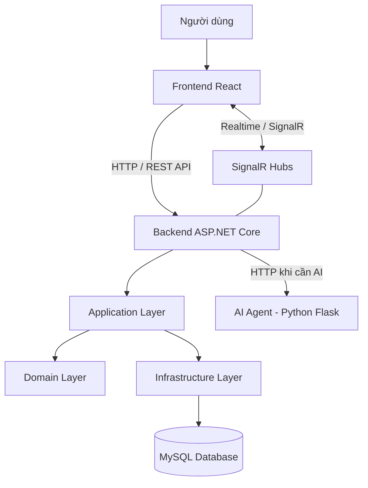

# CollabSphere

**CollabSphere** là hệ thống hỗ trợ học tập theo phương pháp Project-Based Learning (PBL), giúp giảng viên tổ chức hoạt động học tập theo dự án và giúp sinh viên phối hợp thực hiện dự án trên cùng một nền tảng.

Hệ thống hướng đến việc tập trung các hoạt động quản lý học vụ, dự án, nhóm, nhiệm vụ, trao đổi, thông báo và hỗ trợ học tập. Repository được tổ chức thành các phần chính: **Frontend**, **Backend**, **Database** và **Docs**.

## Mục lục

> Chọn một mục bên dưới để chuyển nhanh đến phần cần xem. Các liên kết sử dụng anchor Markdown, hoạt động trên GitHub và các nền tảng hỗ trợ README.

1. [Mục tiêu và phạm vi hệ thống](#1-mục-tiêu-và-phạm-vi-hệ-thống)
2. [Cơ sở lý thuyết và nguyên lý hoạt động](#11-cơ-sở-lý-thuyết-và-nguyên-lý-hoạt-động)
3. [Công nghệ sử dụng](#2-công-nghệ-sử-dụng)
4. [Cấu trúc repository](#3-cấu-trúc-repository)
5. [Yêu cầu môi trường](#4-yêu-cầu-môi-trường)
6. [Cài đặt MySQL](#5-cài-đặt-cơ-sở-dữ-liệu-mysql)
7. [Cách chạy dự án](#6-cách-chạy-dự-án-backend-và-frontend)
8. [Kết nối Frontend và Backend](#7-kết-nối-frontend--backend)
9. [Các chức năng FE01–FE12](#8-các-chức-năng-chính)
10. [API và JWT](#9-api-và-xác-thực)
11. [SignalR](#10-giao-tiếp-thời-gian-thực-signalr)
12. [AI Agent](#11-ai-agent-dịch-vụ-tùy-chọn)
13. [Kiểm thử và Build](#12-kiểm-thử-và-build)
14. [Các lỗi thường gặp](#13-một-số-lỗi-thường-gặp)
15. [Bảo mật và lưu ý phát triển](#14-bảo-mật-và-lưu-ý-phát-triển)

### Tài liệu tham khảo trong repository

- [Tài liệu chức năng FE01–FE12](docs/README.md)
- [Hướng dẫn API Contract](docs/API-CONTRACT-GUIDE.md)
- [API học vụ](docs/api-hoc-vu.md)
- [Cấu trúc dự án](docs/PROJECT-TREE.md)
- [ERD cơ sở dữ liệu](database/01-erd.md)
- [Schema database](database/schema.sql)
- [README Backend](backend/README.md)
- [README Frontend](frontend/README.md)
- [Thông tin repository](#16-repository)

---

## 1. Mục tiêu và phạm vi hệ thống

CollabSphere hỗ trợ quy trình học tập theo dự án:

- Quản lý tài khoản và phân quyền người dùng.
- Quản lý môn học, đề cương và lớp học.
- Hỗ trợ tổ chức hoạt động học tập theo dự án.
- Quản lý nhóm, nhiệm vụ và tiến độ thực hiện.
- Hỗ trợ giao tiếp, cuộc họp và cộng tác.
- Theo dõi thông báo và các hoạt động liên quan.
- Tích hợp dịch vụ AI riêng để hỗ trợ một số chức năng học tập.
**Lưu ý về phạm vi triển khai:** tài liệu yêu cầu, cấu trúc cơ sở dữ liệu và mã nguồn có thể mô tả các mức độ hoàn thiện khác nhau. Việc một chức năng xuất hiện trong tài liệu hoặc có bảng dữ liệu không đồng nghĩa toàn bộ API và giao diện của chức năng đó đã hoàn thiện. Khi đánh giá trạng thái triển khai, cần kiểm tra mã nguồn và chạy thử luồng thực tế.

### 1.1. Cơ sở lý thuyết và nguyên lý hoạt động

Phần này trình bày những nguyên lý công nghệ đứng sau CollabSphere. Đây là phần giải thích kiến trúc và cách các thành phần phối hợp với nhau, giúp người đọc hiểu **vì sao hệ thống được thiết kế như vậy**, thay vì chỉ biết cách cài đặt và chạy chương trình.

#### a. Project-Based Learning (PBL) – Học tập dựa trên dự án

Project-Based Learning là phương pháp học tập trong đó người học tiếp thu kiến thức thông qua việc giải quyết một vấn đề hoặc hoàn thành một sản phẩm/dự án cụ thể. Thay vì chỉ học lý thuyết riêng lẻ, sinh viên cần lập kế hoạch, phân chia công việc, phối hợp với thành viên và đánh giá kết quả.

CollabSphere hướng đến việc số hóa quy trình đó:

1. Giảng viên tổ chức môn học và lớp học.
2. Hoạt động học tập được triển khai theo dự án.
3. Sinh viên phối hợp trong nhóm và thực hiện nhiệm vụ.
4. Tiến độ được theo dõi thông qua cột mốc và điểm kiểm tra.
5. Kết quả được trao đổi, đánh giá và phản hồi.

Như vậy, hệ thống không chỉ lưu trữ thông tin mà còn đóng vai trò là không gian hỗ trợ quá trình cộng tác trong học tập.

#### b. Kiến trúc Client–Server và phân tầng

CollabSphere sử dụng mô hình Client–Server: Frontend là phía người dùng (Client), còn Backend cung cấp dịch vụ và xử lý nghiệp vụ (Server). Cơ sở dữ liệu lưu trữ thông tin lâu dài.

Backend được chia thành các project có trách nhiệm riêng:

| Tầng | Trách nhiệm chính | Ví dụ trong dự án |
|---|---|---|
| Presentation / API | Tiếp nhận HTTP request, kiểm tra đầu vào, trả response | `CollabSphere.API`, Controllers, Hubs |
| Application | Tổ chức use case, DTO và các abstraction phục vụ nghiệp vụ | `CollabSphere.Application` |
| Domain | Mô tả thực thể và quy tắc nghiệp vụ cốt lõi | `CollabSphere.Domain` |
| Infrastructure | Hiện thực truy cập dữ liệu và tích hợp kỹ thuật | `CollabSphere.Infrastructure`, EF Core, MySQL |

Cách phân tầng này giúp hạn chế việc giao diện API phụ thuộc trực tiếp vào chi tiết lưu trữ. Ví dụ, Controller tiếp nhận yêu cầu từ người dùng, các thành phần ứng dụng xử lý luồng nghiệp vụ, còn Infrastructure đảm nhiệm việc làm việc với cơ sở dữ liệu.
#### c. REST API – Cách Frontend trao đổi với Backend

REST API là cách tổ chức giao tiếp qua HTTP theo tài nguyên. Frontend gửi request đến Backend; Backend kiểm tra request, thực hiện xử lý và trả kết quả thường ở dạng JSON.

Các phương thức HTTP thường gặp:

| Phương thức | Ý nghĩa phổ biến | Ví dụ |
|---|---|---|
| `GET` | Đọc dữ liệu | Lấy danh sách môn học |
| `POST` | Tạo mới hoặc gửi yêu cầu xử lý | Đăng nhập, tạo dữ liệu |
| `PUT` | Cập nhật tài nguyên | Cập nhật toàn bộ thông tin |
| `PATCH` | Cập nhật một phần | Thay đổi một số trường |
| `DELETE` | Xóa tài nguyên | Xóa một bản ghi |

Ví dụ luồng gọi API:

```text
Người dùng thao tác trên giao diện
          |
          v
Frontend gửi HTTP request
          |
          v
Backend Controller tiếp nhận
          |
          v
Kiểm tra dữ liệu và quyền truy cập
          |
          v
Xử lý nghiệp vụ / truy cập Database
          |
          v
Backend trả HTTP response (JSON)
          |
          v
Frontend cập nhật giao diện
```

REST phù hợp với các thao tác cần yêu cầu – phản hồi rõ ràng như đăng nhập, xem danh sách môn học, quản lý lớp học và truy xuất thông tin.

#### d. JWT – Xác thực người dùng không cần lưu phiên trên Server

JWT (JSON Web Token) là một định dạng token được sử dụng để truyền thông tin xác thực giữa Client và Server. Sau khi đăng nhập thành công, Backend phát hành token; Frontend gửi token trong các request cần xác thực thông qua header:

```http
Authorization: Bearer <access_token>
```

Một JWT thường gồm ba phần được nối bằng dấu chấm: Header, Payload và Signature.

- **Header:** mô tả loại token và thuật toán ký.
- **Payload:** chứa các claim, chẳng hạn mã người dùng hoặc thông tin vai trò.
- **Signature:** giúp Server kiểm tra token có được ký bằng khóa hợp lệ và nội dung có bị thay đổi hay không.

Quy trình cơ bản:

1. Người dùng gửi thông tin đăng nhập.
2. Backend xác minh tài khoản.
3. Nếu hợp lệ, Backend tạo và trả JWT.
4. Frontend gửi JWT trong các request tiếp theo.
5. Backend xác minh chữ ký, thời hạn và quyền cần thiết trước khi cho phép truy cập.

JWT không phải là nơi để lưu mật khẩu hay dữ liệu bí mật. Payload có thể được đọc bởi bên giữ token, vì vậy không đưa thông tin nhạy cảm vào payload. Khóa ký token phải được giữ bí mật.

#### e. Cơ sở dữ liệu quan hệ và Entity Framework Core

CollabSphere sử dụng MySQL – hệ quản trị cơ sở dữ liệu quan hệ. Dữ liệu được tổ chức thành các bảng; các bảng liên kết với nhau bằng khóa chính (Primary Key) và khóa ngoại (Foreign Key).
Ví dụ về quan hệ trong một hệ thống học tập:

- Một môn học có thể được mở thành nhiều lớp học.
- Một lớp học có thể có nhiều sinh viên.
- Một dự án có thể được chia thành nhiều nhóm hoặc nhiệm vụ.
- Một nhóm có thể có nhiều thành viên.

Các quan hệ này cần được thiết kế rõ ràng để giảm dữ liệu trùng lặp và bảo đảm tính nhất quán. Entity Framework Core (EF Core) là ORM giúp ánh xạ đối tượng C# với dữ liệu quan hệ, hỗ trợ truy vấn và thao tác dữ liệu mà không phải tự viết toàn bộ câu SQL cho từng thao tác.

#### f. SignalR – Giao tiếp thời gian thực

REST thường hoạt động theo mô hình Client gửi request rồi chờ response. Với các tình huống cần cập nhật nhanh như chat hoặc thông báo, việc liên tục hỏi Server có dữ liệu mới hay không sẽ không tối ưu.

SignalR hỗ trợ giao tiếp hai chiều giữa Client và Server thông qua kết nối thời gian thực. Khi có sự kiện phù hợp, Server có thể gửi thông tin đến Client mà không cần Client liên tục gửi request hỏi dữ liệu.

Trong CollabSphere, các Hub được khai báo gồm:

- `/hubs/chat`: phục vụ giao tiếp chat.
- `/hubs/notifications`: phục vụ thông báo.

SignalR bổ sung cho REST API, không thay thế hoàn toàn REST. Những thao tác truy vấn hoặc cập nhật dữ liệu thông thường vẫn có thể sử dụng HTTP API.

#### g. AI Agent – Tách chức năng AI thành dịch vụ riêng

AI Agent trong repository được tổ chức thành dịch vụ Python Flask riêng, tách khỏi Backend ASP.NET Core. Backend có thể giao tiếp với dịch vụ này qua HTTP thông qua HttpClient được cấu hình tên `FlaskAI`.

Việc tách riêng mang lại một số lợi ích:

- Có thể phát triển hoặc thay đổi phần xử lý AI mà ít ảnh hưởng đến API chính.
- Mỗi dịch vụ có thể sử dụng hệ sinh thái thư viện phù hợp với ngôn ngữ của nó.
- Có thể bật hoặc tắt AI Agent độc lập khi phát triển và kiểm thử.

Đổi lại, khi sử dụng chức năng phụ thuộc AI, cần bảo đảm dịch vụ Python đang chạy và Backend gọi đúng địa chỉ. Nếu AI Agent không hoạt động, các chức năng không phụ thuộc AI vẫn có thể được kiểm tra riêng.

#### h. Sơ đồ tổng quan luồng dữ liệu

Sơ đồ dưới đây mô tả mối quan hệ giữa các thành phần chính. Đây là sơ đồ kiến trúc khái quát, không phải sơ đồ triển khai máy chủ production.



**Điểm đáng chú ý:** CollabSphere kết hợp nhiều kiểu giao tiếp cho những nhu cầu khác nhau: REST API cho thao tác dữ liệu theo request/response, SignalR cho cập nhật thời gian thực và HTTP giữa Backend với AI Agent. Việc phân chia đúng trách nhiệm giúp hệ thống dễ phát triển, kiểm thử và bảo trì hơn.

## 2. Công nghệ sử dụng

| Thành phần | Công nghệ |
|---|---|
| Frontend | React 18, React DOM, React Router |
| Công cụ phát triển Frontend | Vite 5 |
| Ngôn ngữ Frontend | JavaScript / JSX, CSS |
| Giao tiếp thời gian thực phía Frontend | `@microsoft/signalr` |
| Backend API | ASP.NET Core Web API |
| Ngôn ngữ Backend | C# |
| Nền tảng .NET | .NET 10 (`net10.0`) |
| ORM | Entity Framework Core |
| Cơ sở dữ liệu | MySQL 8.0+ |
| Xác thực | JWT Bearer |
| Mã hóa mật khẩu | ASP.NET Core Identity PasswordHasher |
| Realtime Backend | SignalR |
| AI Agent | Python Flask service riêng |
| Quản lý mã nguồn | Git |

## 3. Cấu trúc repository

```text
CNPM-main/
├── backend/
│   ├── CollabSphere.API/             # ASP.NET Core Web API
│   ├── CollabSphere.Application/      # DTO, interface và xử lý ứng dụng
│   ├── CollabSphere.Domain/           # Entity và mô hình nghiệp vụ cốt lõi
│   ├── CollabSphere.Infrastructure/   # Database, repository, migration, seed
│   ├── ai-agent/                      # Dịch vụ AI Python riêng
│   ├── tests/                         # Script kiểm thử API
│   ├── CollabSphere.sln
│   └── README.md
│
├── frontend/
│   ├── public/                        # Tài nguyên tĩnh
│   ├── src/
│   │   ├── assets/
│   │   ├── components/
│   │   ├── contexts/
│   │   ├── hooks/
│   │   ├── pages/
│   │   ├── routes/
│   │   ├── services/
│   │   ├── utils/
│   │   ├── App.jsx
│   │   └── main.jsx
│   ├── package.json
│   ├── vite.config.js
│   └── README.md
│
├── database/
│   ├── schema.sql                     # Schema cơ sở dữ liệu
│   ├── migrations/                    # Các migration SQL
│   ├── seeds/                         # Dữ liệu khởi tạo
│   ├── scripts/                       # Script hỗ trợ database
│   └── 01-erd.md                      # Tài liệu ERD
│
├── docs/
│   ├── FE01-user-account-management.md
│   ├── FE02-subject-syllabus-management.md
│   ├── FE03-class-management.md
│   ├── FE04-project-management.md
│   ├── FE05-team-workspace-management.md
│   ├── FE06-milestone-checkpoint-management.md
│   ├── FE07-communication-meetings.md
│   ├── FE08-resource-management.md
│   ├── FE09-realtime-collaboration-tools.md
│   ├── FE10-assessment-feedback.md
│   ├── FE11-ai-assistance.md
│   ├── FE12-notification-management.md
│   ├── API-CONTRACT-GUIDE.md
│   ├── api-hoc-vu.md
│   ├── PROJECT-TREE.md
│   └── README.md
│
└── README.md
```

### Vai trò các thành phần

- **frontend:** giao diện web, định tuyến trang, quản lý trạng thái giao diện và gọi API.
- **backend/CollabSphere.API:** nhận HTTP request, xử lý controller, xác thực JWT, phân quyền và cung cấp SignalR Hub.
- **backend/CollabSphere.Application:** các DTO, interface và thành phần thuộc tầng ứng dụng.
- **backend/CollabSphere.Domain:** các entity, enum, exception và mô hình nghiệp vụ cốt lõi.
- **backend/CollabSphere.Infrastructure:** truy cập dữ liệu, cấu hình Entity Framework, repository, SQL migration và seed.
- **backend/ai-agent:** dịch vụ Python chạy độc lập với ASP.NET Core API.
- **database:** schema, migration, seed và tài liệu cơ sở dữ liệu.
- **docs:** tài liệu yêu cầu chức năng, hướng dẫn API và cấu trúc dự án.

---

## 4. Yêu cầu môi trường

Cài đặt các công cụ sau trước khi chạy dự án:

| Công cụ | Yêu cầu |
|---|---|
| .NET SDK | .NET 10 |
| Node.js | Phiên bản 18 trở lên |
| npm | Đi kèm Node.js |
| MySQL Server | MySQL 8.0 trở lên |
| Git | Phiên bản phù hợp với hệ điều hành |
| PowerShell | Khuyến nghị trên Windows để chạy các lệnh bên dưới |
| Python | Chỉ cần khi chạy AI Agent |

Kiểm tra cài đặt:

```powershell
dotnet --version
node -v
npm -v
mysql --version
python --version
```

## 5. Cài đặt cơ sở dữ liệu MySQL

### 5.1. Khởi động MySQL

Khởi động MySQL Server và bảo đảm máy chủ đang lắng nghe tại `localhost:3306`. Nếu MySQL của bạn dùng cổng hoặc tài khoản khác, hãy sử dụng đúng thông tin đó trong chuỗi kết nối ở phần chạy Backend.

### 5.2. Tạo database

Mở MySQL Workbench, phpMyAdmin hoặc MySQL command line và thực thi:

```sql
CREATE DATABASE collabsphere
  CHARACTER SET utf8mb4
  COLLATE utf8mb4_unicode_ci;
```

Nếu database đã tồn tại thì không cần tạo lại.

### 5.3. Nạp cấu trúc và dữ liệu

Repository có `database/schema.sql`, các thư mục migration và seed. Có thể dùng công cụ MySQL để nạp schema theo quy trình của nhóm. Script `database/scripts/run_mysql.sh` là script Bash dành cho môi trường có MySQL client; script kiểm tra kết nối, tạo database nếu chưa có và áp dụng `schema.sql`.

Không chạy script kiểm thử hoặc seed trên cơ sở dữ liệu production. Nên sử dụng database phát triển riêng.

---

## 6. Cách chạy dự án (Backend và Frontend)
Đây là quy trình chạy ứng dụng trên Windows bằng PowerShell. **Backend và Frontend phải được chạy ở hai cửa sổ Terminal riêng biệt** và cần giữ cả hai cửa sổ hoạt động trong khi sử dụng hệ thống.

### 6.1. Chạy Backend API

Mở Terminal PowerShell thứ nhất tại thư mục chứa repository, sau đó thực hiện lần lượt:

```powershell
cd CNPM-main\backend\CollabSphere.API

dotnet user-secrets set "ConnectionStrings:DefaultConnection" "Server=localhost;Port=3306;Database=collabsphere;User=root;Password=MAT_KHAU_MYSQL;"

dotnet user-secrets set "Jwt:Key" ([Convert]::ToBase64String((1..48 | ForEach-Object { Get-Random -Maximum 256 })))

dotnet user-secrets set "Seed:DefaultPassword" "Collab@12345"

$env:ASPNETCORE_ENVIRONMENT = "Development"

dotnet run --urls "http://localhost:5000"
```

**Cần thay đổi trước khi chạy:**

- Thay `MAT_KHAU_MYSQL` bằng mật khẩu tài khoản MySQL đang sử dụng. Nếu tài khoản `root` không có mật khẩu, để trống phần sau `Password=`, ví dụ `Password=;`.
- Các lệnh `user-secrets` lưu cấu hình bí mật cho project .NET ở máy hiện tại, không ghi mật khẩu vào source code.
- Lệnh tạo `Jwt:Key` sinh khóa ngẫu nhiên. Khi chạy lại lệnh này, khóa JWT sẽ thay đổi; các token được phát hành bằng khóa cũ sẽ không còn xác thực được.
- `Seed:DefaultPassword` là mật khẩu mặc định dùng cho các tài khoản mẫu khi cơ chế seed Development được kích hoạt. Mật khẩu đăng nhập mẫu cần đối chiếu với dữ liệu seed/tài liệu của nhóm.

Khi Backend chạy thành công, API sử dụng địa chỉ:

```text
http://localhost:5000
```

Có thể kiểm tra trạng thái API và kết nối database tại:

```text
http://localhost:5000/api/system/status
```

Trong môi trường Development, tài liệu OpenAPI được ánh xạ tại:

```text
http://localhost:5000/openapi/v1.json
```

### 6.2. Chạy Frontend

Mở **Terminal PowerShell thứ hai** tại thư mục chứa repository và chạy:

```powershell
cd CNPM-main\frontend

npm.cmd install

npm.cmd run dev
```

- `npm.cmd install`: cài đặt các thư viện được khai báo trong `package.json`.
- `npm.cmd run dev`: khởi động máy chủ phát triển Vite.
- Dùng `npm.cmd` để tránh một số trường hợp PowerShell chặn script `npm.ps1`.

Khi chạy thành công, mở trình duyệt tại:

```text
http://localhost:5173
```

### 6.3. Thứ tự khởi động và sử dụng

1. Khởi động MySQL Server.
2. Chạy Backend theo mục **6.1** và chờ API khởi động thành công.
3. Chạy Frontend theo mục **6.2** ở Terminal khác.
4. Mở `http://localhost:5173` để sử dụng hệ thống.
5. Khi kết thúc, nhấn `Ctrl + C` ở từng Terminal để dừng Frontend và Backend.
**Lưu ý:** Frontend được cấu hình proxy các đường dẫn `/api` và `/hubs` về Backend. Mặc định proxy trỏ đến `http://localhost:5000`; nếu đổi cổng Backend, cần cập nhật `VITE_API_URL` hoặc cấu hình tương ứng trong `frontend/vite.config.js`.

---

## 7. Kết nối Frontend – Backend

Frontend sử dụng REST API để trao đổi dữ liệu với Backend. Vite proxy chuyển tiếp:

| Đường dẫn Frontend | Đích Backend | Mục đích |
|---|---|---|
| `/api/*` | `http://localhost:5000/api/*` | Gọi REST API |
| `/hubs/*` | `http://localhost:5000/hubs/*` | SignalR và WebSocket |

Cấu hình proxy nằm trong `frontend/vite.config.js`. Giá trị mặc định của `VITE_API_URL` là `http://localhost:5000`.

Không cần ghi địa chỉ Backend đầy đủ cho từng request nếu Frontend đang gọi API thông qua các đường dẫn tương đối và sử dụng proxy của Vite.

## 8. Các chức năng chính

Các nhóm chức năng được mô tả trong tài liệu dự án:

| Mã | Nhóm chức năng | Tài liệu |
|---|---|---|
| FE01 | Quản lý tài khoản người dùng | [FE01](docs/FE01-user-account-management.md) |
| FE02 | Quản lý môn học và đề cương | [FE02](docs/FE02-subject-syllabus-management.md) |
| FE03 | Quản lý lớp học | [FE03](docs/FE03-class-management.md) |
| FE04 | Quản lý dự án | [FE04](docs/FE04-project-management.md) |
| FE05 | Quản lý nhóm và không gian làm việc | [FE05](docs/FE05-team-workspace-management.md) |
| FE06 | Quản lý cột mốc và điểm kiểm tra | [FE06](docs/FE06-milestone-checkpoint-management.md) |
| FE07 | Giao tiếp và cuộc họp | [FE07](docs/FE07-communication-meetings.md) |
| FE08 | Quản lý tài nguyên học tập | [FE08](docs/FE08-resource-management.md) |
| FE09 | Công cụ cộng tác thời gian thực | [FE09](docs/FE09-realtime-collaboration-tools.md) |
| FE10 | Đánh giá và phản hồi | [FE10](docs/FE10-assessment-feedback.md) |
| FE11 | Hỗ trợ học tập bằng AI | [FE11](docs/FE11-ai-assistance.md) |
| FE12 | Quản lý thông báo | [FE12](docs/FE12-notification-management.md) |

Danh sách trên là các nhóm chức năng trong tài liệu yêu cầu. Mức độ hoàn thiện của từng chức năng cần được xác nhận bằng mã nguồn và kiểm thử thực tế.

## 9. API và xác thực

Backend cung cấp REST API. Một số endpoint hiện có trong source:

| Method | Endpoint | Mô tả |
|---|---|---|
| `POST` | `/api/auth/login` | Đăng nhập và nhận JWT |
| `GET` | `/api/auth/me` | Lấy thông tin tài khoản hiện tại |
| `GET` | `/api/system/status` | Kiểm tra trạng thái API và database |
| `GET` | `/api/system/database-check` | Kiểm tra khả năng truy cập database |
| `GET/POST/PUT/DELETE` | `/api/subjects` | Quản lý môn học |
| `GET/POST/PUT/DELETE` | `/api/syllabi` | Quản lý đề cương |
| `GET/POST/PUT/PATCH/DELETE` | `/api/classes` | Quản lý lớp học |
| `GET/POST/DELETE` | `/api/classes/{id}/lecturers` | Phân công giảng viên |
| `GET/POST/DELETE` | `/api/classes/{id}/students` | Ghi danh sinh viên |
| `GET/PATCH` | `/api/admin/users` | Quản lý tài khoản quản trị |

Các API được bảo vệ yêu cầu gửi JWT trong header:

```http
Authorization: Bearer <access_token>
```

Một số quyền được sử dụng trong Backend gồm `ADMIN`, `HEAD` và `STAFF`; API quản trị người dùng yêu cầu quyền `ADMIN`. Xem chi tiết route, request/response và quy tắc nghiệp vụ tại [docs/api-hoc-vu.md](docs/api-hoc-vu.md) và [docs/API-CONTRACT-GUIDE.md](docs/API-CONTRACT-GUIDE.md).

## 10. Giao tiếp thời gian thực (SignalR)

Backend đăng ký các SignalR Hub:

| Hub | Đường dẫn |
|---|---|
| ChatHub | `/hubs/chat` |
| NotificationHub | `/hubs/notifications` |

Frontend sử dụng thư viện `@microsoft/signalr` để kết nối. Kết nối Hub cần Backend hoạt động và thông tin xác thực hợp lệ. Backend hỗ trợ truyền JWT qua query parameter `access_token` đối với các kết nối Hub được cấu hình.

Vite proxy đã bật WebSocket cho đường dẫn `/hubs`.

## 11. AI Agent (dịch vụ tùy chọn)

Thư mục `backend/ai-agent` chứa dịch vụ Python riêng, không tự khởi chạy cùng Backend .NET.

Backend đăng ký HttpClient tên `FlaskAI`, mặc định gọi dịch vụ tại:

```text
http://127.0.0.1:5001
```

Để cài thư viện Python, mở Terminal tại thư mục AI Agent:

```powershell
cd CNPM-main\backend\ai-agent
python -m pip install -r requirements.txt
```

AI Agent chỉ cần chạy khi kiểm thử hoặc sử dụng các chức năng có phụ thuộc vào dịch vụ này. Cách cấu hình và khởi chạy chi tiết cần đối chiếu với `run.py` và cấu hình bên trong `backend/ai-agent`.

## 12. Kiểm thử và build

### Backend

Solution chính nằm tại `backend/CollabSphere.sln`. Có thể restore và build từ thư mục `backend`:

```powershell
cd CNPM-main\backend
dotnet restore CollabSphere.sln
dotnet build CollabSphere.sln
```

Script smoke test API:

```powershell
powershell -ExecutionPolicy Bypass -File .\backend\tests\api-smoke-test.ps1 -BaseUrl "http://localhost:5000" -Password "Collab@12345"
```

Chạy lệnh trên từ thư mục gốc repository. Script cần Backend và MySQL đang hoạt động, đồng thời cần tài khoản seed phù hợp. Script tạo và dọn dữ liệu thử nghiệm, vì vậy chỉ chạy trên database phát triển/kiểm thử.

### Frontend

Các lệnh sau chạy từ thư mục `frontend`:

```powershell
npm.cmd run build
npm.cmd run preview
```
Kiểm tra realtime (nếu đã chuẩn bị tài khoản và biến môi trường kiểm thử):

```powershell
npm.cmd run test:realtime
```

## 13. Một số lỗi thường gặp

| Hiện tượng | Nguyên nhân có thể | Cách xử lý |
|---|---|---|
| Backend không kết nối được MySQL | MySQL chưa chạy, sai port, username hoặc password | Kiểm tra MySQL Server và `ConnectionStrings:DefaultConnection` |
| `Access denied for user` | Sai thông tin đăng nhập MySQL | Cập nhật lại `ConnectionStrings:DefaultConnection` bằng `dotnet user-secrets set` |
| Database không tồn tại | Chưa tạo database `collabsphere` | Tạo database theo mục 5 |
| Cổng 5000 đang được sử dụng | Có tiến trình khác chiếm cổng | Dừng tiến trình đó hoặc chọn cổng khác và cập nhật proxy Frontend |
| Frontend không gọi được API | Backend chưa chạy hoặc proxy sai địa chỉ | Kiểm tra Backend tại `http://localhost:5000` và `VITE_API_URL` |
| Không cài được package Frontend | Node/npm chưa đúng phiên bản hoặc mạng gặp sự cố | Kiểm tra `node -v`, `npm -v`, sau đó chạy lại `npm.cmd install` |
| JWT không còn hợp lệ sau khi đổi key | Đã tạo `Jwt:Key` mới | Đăng nhập lại để nhận token mới |
| Chức năng AI không phản hồi | AI Agent chưa chạy hoặc không ở cổng 5001 | Kiểm tra dịch vụ Python và cấu hình địa chỉ AI |

## 14. Bảo mật và lưu ý phát triển

- Không commit mật khẩu MySQL, JWT key, access token hoặc thông tin bí mật lên Git.
- Không sử dụng mật khẩu mẫu cho môi trường production.
- Không dùng database production để chạy seed hoặc script kiểm thử có thao tác ghi/xóa dữ liệu.
- Khi thay đổi cấu trúc database, cập nhật schema/migration và các cấu hình ánh xạ liên quan.
- Khi thêm hoặc sửa API, cập nhật contract, phân quyền, kiểm thử và tài liệu.
- Kiểm tra quyền truy cập ở Backend; không chỉ dựa vào việc ẩn/hiện thành phần giao diện.
- Cần xác nhận các luồng nghiệp vụ bằng kiểm thử thực tế trước khi kết luận chức năng đã hoàn thiện.

## 15. Tài liệu tham khảo trong repository

- [Tài liệu chức năng](docs/README.md)
- [Cấu trúc dự án](docs/PROJECT-TREE.md)
- [Hướng dẫn API Contract](docs/API-CONTRACT-GUIDE.md)
- [API học vụ](docs/api-hoc-vu.md)
- [ERD cơ sở dữ liệu](database/01-erd.md)
- [README Backend](backend/README.md)
- [README Frontend](frontend/README.md)

## 16. Repository

- GitHub: https://github.com/nguyenminhthien140906-dot/CNPM
- Backend: `backend/`
- Frontend: `frontend/`
- Database: `database/`
- Documentation: `docs/`

---

**CollabSphere – Supporting Project-Based Learning Through Collaboration.**

