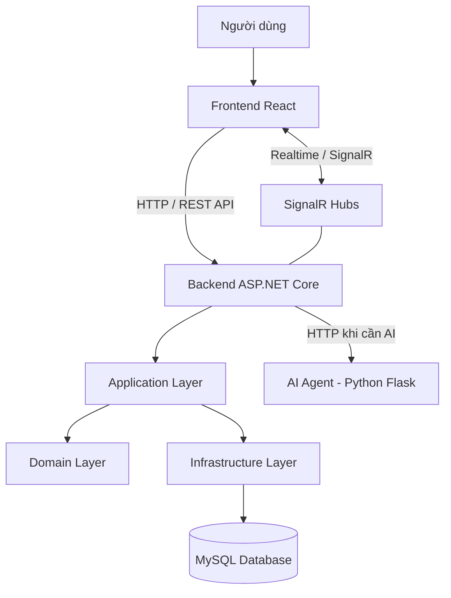

# CollabSphere

**CollabSphere** là hệ thống hỗ trợ học tập theo phương pháp Project-Based Learning (PBL), giúp giảng viên tổ chức hoạt động học tập theo dự án và giúp sinh viên phối hợp thực hiện dự án trên cùng một nền tảng.

Hệ thống hướng đến việc tập trung các hoạt động quản lý học vụ, dự án, nhóm, nhiệm vụ, trao đổi, thông báo và hỗ trợ học tập. Repository được tổ chức thành các phần chính: **Frontend**, **Backend**, **Database** và **Docs**.

## Mục lục

> Chọn một mục bên dưới để chuyển nhanh đến phần cần xem. Các liên kết sử dụng anchor Markdown, hoạt động trên GitHub và các nền tảng hỗ trợ README.

1. [Mục tiêu và phạm vi hệ thống](#1-mục-tiêu-và-phạm-vi-hệ-thống)
   - [1.1. Cơ sở lý thuyết và nguyên lý hoạt động](#11-cơ-sở-lý-thuyết-và-nguyên-lý-hoạt-động)
2. [Công nghệ sử dụng](#2-công-nghệ-sử-dụng)
3. [Cấu trúc repository](#3-cấu-trúc-repository)
4. [Yêu cầu môi trường](#4-yêu-cầu-môi-trường)
5. [Cài đặt cơ sở dữ liệu MySQL](#5-cài-đặt-cơ-sở-dữ-liệu-mysql)
6. [Cách chạy dự án (Backend và Frontend)](#6-cách-chạy-dự-án-backend-và-frontend)
   - [6.3. Đăng nhập và tài khoản](#63-đăng-nhập-và-tài-khoản)
7. [Kết nối Frontend – Backend](#7-kết-nối-frontend--backend)
8. [Các chức năng chính (FE01–FE12)](#8-các-chức-năng-chính)
9. [API và xác thực](#9-api-và-xác-thực)
10. [Giao tiếp thời gian thực (SignalR)](#10-giao-tiếp-thời-gian-thực-signalr)
11. [AI Agent (dịch vụ tùy chọn)](#11-ai-agent-dịch-vụ-tùy-chọn)
12. [Kiểm thử và build](#12-kiểm-thử-và-build)
13. [Một số lỗi thường gặp](#13-một-số-lỗi-thường-gặp)
14. [Bảo mật và lưu ý phát triển](#14-bảo-mật-và-lưu-ý-phát-triển)
15. [Tài liệu tham khảo trong repository](#15-tài-liệu-tham-khảo-trong-repository)
16. [Repository](#16-repository)

---

## 1. Mục tiêu và phạm vi hệ thống

CollabSphere hỗ trợ quy trình học tập theo dự án:

- Quản lý tài khoản và phân quyền người dùng.
- Quản lý môn học, đề cương và lớp học.
- Hỗ trợ tổ chức hoạt động học tập theo dự án.
- Quản lý nhóm, nhiệm vụ và tiến độ thực hiện.
- Hỗ trợ giao tiếp, cuộc họp và cộng tác.
- Theo dõi thông báo và các hoạt động liên quan.
- Tích hợp dịch vụ AI riêng để hỗ trợ một số chức năng học tập.

**Lưu ý về phạm vi triển khai:** tài liệu yêu cầu, cấu trúc cơ sở dữ liệu và mã nguồn có thể mô tả các mức độ hoàn thiện khác nhau. Việc một chức năng xuất hiện trong tài liệu hoặc có bảng dữ liệu không đồng nghĩa toàn bộ API và giao diện của chức năng đó đã hoàn thiện. Khi đánh giá trạng thái triển khai, cần kiểm tra mã nguồn và chạy thử luồng thực tế.

Cụ thể ở trạng thái hiện tại:

- **Backend** có Controller cho: xác thực, quản trị người dùng, môn học, đề cương, lớp học, phân công và ghi danh, cuộc họp, thông báo, AI, kiểm tra hệ thống, cùng hai SignalR Hub.
- **Frontend** có giao diện cho đủ các nhóm chức năng. Chế độ **dùng thử** chạy hoàn toàn bằng dữ liệu mẫu trong trình duyệt; chế độ đăng nhập thật chỉ hoạt động với những phần Backend đã có API.
- Trong `frontend/src` còn một số file `.cs` và `.razor` không được dùng khi chạy Vite.

### 1.1. Cơ sở lý thuyết và nguyên lý hoạt động

Phần này trình bày những nguyên lý công nghệ đứng sau CollabSphere. Đây là phần giải thích kiến trúc và cách các thành phần phối hợp với nhau, giúp người đọc hiểu **vì sao hệ thống được thiết kế như vậy**, thay vì chỉ biết cách cài đặt và chạy chương trình.

#### a. Project-Based Learning (PBL) – Học tập dựa trên dự án

Project-Based Learning là phương pháp học tập trong đó người học tiếp thu kiến thức thông qua việc giải quyết một vấn đề hoặc hoàn thành một sản phẩm/dự án cụ thể. Thay vì chỉ học lý thuyết riêng lẻ, sinh viên cần lập kế hoạch, phân chia công việc, phối hợp với thành viên và đánh giá kết quả.

CollabSphere hướng đến việc số hóa quy trình đó:

1. Giảng viên tổ chức môn học và lớp học.
2. Hoạt động học tập được triển khai theo dự án.
3. Sinh viên phối hợp trong nhóm và thực hiện nhiệm vụ.
4. Tiến độ được theo dõi thông qua cột mốc và điểm kiểm tra.
5. Kết quả được trao đổi, đánh giá và phản hồi.

Như vậy, hệ thống không chỉ lưu trữ thông tin mà còn đóng vai trò là không gian hỗ trợ quá trình cộng tác trong học tập.

#### b. Kiến trúc Client–Server và phân tầng

CollabSphere sử dụng mô hình Client–Server: Frontend là phía người dùng (Client), còn Backend cung cấp dịch vụ và xử lý nghiệp vụ (Server). Cơ sở dữ liệu lưu trữ thông tin lâu dài.

Backend được chia thành các project có trách nhiệm riêng:

| Tầng | Trách nhiệm chính | Ví dụ trong dự án |
|---|---|---|
| Presentation / API | Tiếp nhận HTTP request, kiểm tra đầu vào, trả response | `CollabSphere.API`, Controllers, Hubs |
| Application | Tổ chức use case, DTO và các abstraction phục vụ nghiệp vụ | `CollabSphere.Application` |
| Domain | Mô tả thực thể và quy tắc nghiệp vụ cốt lõi | `CollabSphere.Domain` |
| Infrastructure | Hiện thực truy cập dữ liệu và tích hợp kỹ thuật | `CollabSphere.Infrastructure`, EF Core, MySQL |

Cách phân tầng này giúp hạn chế việc giao diện API phụ thuộc trực tiếp vào chi tiết lưu trữ. Ví dụ, Controller tiếp nhận yêu cầu từ người dùng, các thành phần ứng dụng xử lý luồng nghiệp vụ, còn Infrastructure đảm nhiệm việc làm việc với cơ sở dữ liệu.

#### c. REST API – Cách Frontend trao đổi với Backend

REST API là cách tổ chức giao tiếp qua HTTP theo tài nguyên. Frontend gửi request đến Backend; Backend kiểm tra request, thực hiện xử lý và trả kết quả thường ở dạng JSON.

Các phương thức HTTP thường gặp:

| Phương thức | Ý nghĩa phổ biến | Ví dụ |
|---|---|---|
| `GET` | Đọc dữ liệu | Lấy danh sách môn học |
| `POST` | Tạo mới hoặc gửi yêu cầu xử lý | Đăng nhập, tạo dữ liệu |
| `PUT` | Cập nhật tài nguyên | Cập nhật toàn bộ thông tin |
| `PATCH` | Cập nhật một phần | Thay đổi một số trường |
| `DELETE` | Xóa tài nguyên | Xóa một bản ghi |

Ví dụ luồng gọi API:

```text
Người dùng thao tác trên giao diện
          |
          v
Frontend gửi HTTP request
          |
          v
Backend Controller tiếp nhận
          |
          v
Kiểm tra dữ liệu và quyền truy cập
          |
          v
Xử lý nghiệp vụ / truy cập Database
          |
          v
Backend trả HTTP response (JSON)
          |
          v
Frontend cập nhật giao diện
```

REST phù hợp với các thao tác cần yêu cầu – phản hồi rõ ràng như đăng nhập, xem danh sách môn học, quản lý lớp học và truy xuất thông tin.

#### d. JWT – Xác thực người dùng không cần lưu phiên trên Server

JWT (JSON Web Token) là một định dạng token được sử dụng để truyền thông tin xác thực giữa Client và Server. Sau khi đăng nhập thành công, Backend phát hành token; Frontend gửi token trong các request cần xác thực thông qua header:

```http
Authorization: Bearer <access_token>
```

Một JWT thường gồm ba phần được nối bằng dấu chấm: Header, Payload và Signature.

- **Header:** mô tả loại token và thuật toán ký.
- **Payload:** chứa các claim, chẳng hạn mã người dùng hoặc thông tin vai trò.
- **Signature:** giúp Server kiểm tra token có được ký bằng khóa hợp lệ và nội dung có bị thay đổi hay không.

Quy trình cơ bản:

1. Người dùng gửi thông tin đăng nhập.
2. Backend xác minh tài khoản.
3. Nếu hợp lệ, Backend tạo và trả JWT.
4. Frontend gửi JWT trong các request tiếp theo.
5. Backend xác minh chữ ký, thời hạn và quyền cần thiết trước khi cho phép truy cập.

JWT không phải là nơi để lưu mật khẩu hay dữ liệu bí mật. Payload có thể được đọc bởi bên giữ token, vì vậy không đưa thông tin nhạy cảm vào payload. Khóa ký token phải được giữ bí mật.

#### e. Cơ sở dữ liệu quan hệ và Entity Framework Core

CollabSphere sử dụng MySQL – hệ quản trị cơ sở dữ liệu quan hệ. Dữ liệu được tổ chức thành các bảng; các bảng liên kết với nhau bằng khóa chính (Primary Key) và khóa ngoại (Foreign Key).

Ví dụ về quan hệ trong một hệ thống học tập:

- Một môn học có thể được mở thành nhiều lớp học.
- Một lớp học có thể có nhiều sinh viên.
- Một dự án có thể được chia thành nhiều nhóm hoặc nhiệm vụ.
- Một nhóm có thể có nhiều thành viên.

Các quan hệ này cần được thiết kế rõ ràng để giảm dữ liệu trùng lặp và bảo đảm tính nhất quán. Entity Framework Core (EF Core) là ORM giúp ánh xạ đối tượng C# với dữ liệu quan hệ, hỗ trợ truy vấn và thao tác dữ liệu mà không phải tự viết toàn bộ câu SQL cho từng thao tác.

Riêng việc **tạo và nâng cấp cấu trúc bảng** trong dự án này được thực hiện bằng các file SQL migration, không dùng cơ chế migration của EF Core (xem [mục 5.3](#53-migration-và-seed-tự-động)).

#### f. SignalR – Giao tiếp thời gian thực

REST thường hoạt động theo mô hình Client gửi request rồi chờ response. Với các tình huống cần cập nhật nhanh như chat hoặc thông báo, việc liên tục hỏi Server có dữ liệu mới hay không sẽ không tối ưu.

SignalR hỗ trợ giao tiếp hai chiều giữa Client và Server thông qua kết nối thời gian thực. Khi có sự kiện phù hợp, Server có thể gửi thông tin đến Client mà không cần Client liên tục gửi request hỏi dữ liệu.

Trong CollabSphere, các Hub được khai báo gồm:

- `/hubs/chat`: phục vụ giao tiếp chat.
- `/hubs/notifications`: phục vụ thông báo.

SignalR bổ sung cho REST API, không thay thế hoàn toàn REST. Những thao tác truy vấn hoặc cập nhật dữ liệu thông thường vẫn có thể sử dụng HTTP API.

#### g. AI Agent – Tách chức năng AI thành dịch vụ riêng

AI Agent trong repository được tổ chức thành dịch vụ Python Flask riêng, tách khỏi Backend ASP.NET Core. Backend có thể giao tiếp với dịch vụ này qua HTTP thông qua HttpClient được cấu hình tên `FlaskAI`.

Việc tách riêng mang lại một số lợi ích:

- Có thể phát triển hoặc thay đổi phần xử lý AI mà ít ảnh hưởng đến API chính.
- Mỗi dịch vụ có thể sử dụng hệ sinh thái thư viện phù hợp với ngôn ngữ của nó.
- Có thể bật hoặc tắt AI Agent độc lập khi phát triển và kiểm thử.

Đổi lại, khi sử dụng chức năng phụ thuộc AI, cần bảo đảm dịch vụ Python đang chạy và Backend gọi đúng địa chỉ. Nếu AI Agent không hoạt động, các chức năng không phụ thuộc AI vẫn có thể được kiểm tra riêng.

#### h. Sơ đồ tổng quan luồng dữ liệu

Sơ đồ dưới đây mô tả mối quan hệ giữa các thành phần chính. Đây là sơ đồ kiến trúc khái quát, không phải sơ đồ triển khai máy chủ production.



**Điểm đáng chú ý:** CollabSphere kết hợp nhiều kiểu giao tiếp cho những nhu cầu khác nhau: REST API cho thao tác dữ liệu theo request/response, SignalR cho cập nhật thời gian thực và HTTP giữa Backend với AI Agent. Việc phân chia đúng trách nhiệm giúp hệ thống dễ phát triển, kiểm thử và bảo trì hơn.

---

## 2. Công nghệ sử dụng

| Thành phần | Công nghệ |
|---|---|
| Frontend | React 18, React DOM, React Router |
| Công cụ phát triển Frontend | Vite 5 |
| Ngôn ngữ Frontend | JavaScript / JSX, CSS |
| Giao tiếp thời gian thực phía Frontend | `@microsoft/signalr` |
| Backend API | ASP.NET Core Web API |
| Ngôn ngữ Backend | C# |
| Nền tảng .NET | .NET 10 (`net10.0`) |
| ORM | Entity Framework Core |
| Cơ sở dữ liệu | MySQL 8.0+ |
| Xác thực | JWT Bearer |
| Mã hóa mật khẩu | ASP.NET Core Identity PasswordHasher |
| Realtime Backend | SignalR |
| AI Agent | Python Flask service riêng |
| Quản lý mã nguồn | Git |

---

## 3. Cấu trúc repository

```text
CNPM-main/
├── backend/
│   ├── CollabSphere.API/              # ASP.NET Core Web API
│   ├── CollabSphere.Application/      # DTO, interface và xử lý ứng dụng
│   ├── CollabSphere.Domain/           # Entity và mô hình nghiệp vụ cốt lõi
│   ├── CollabSphere.Infrastructure/   # Database, repository, migration, seed
│   ├── ai-agent/                      # Dịch vụ AI Python riêng
│   ├── tests/                         # Script kiểm thử API
│   ├── CollabSphere.sln
│   └── README.md
│
├── frontend/
│   ├── public/                        # Tài nguyên tĩnh
│   ├── src/
│   │   ├── assets/
│   │   ├── components/
│   │   ├── contexts/
│   │   ├── data/                      # Dữ liệu mẫu cho chế độ dùng thử
│   │   ├── hooks/
│   │   ├── pages/
│   │   ├── services/
│   │   ├── utils/
│   │   ├── App.jsx
│   │   └── main.jsx
│   ├── package.json
│   ├── vite.config.js
│   └── README.md
│
├── database/
│   ├── schema.sql                     # Schema cơ sở dữ liệu (tham khảo)
│   ├── migrations/versions/           # Các migration SQL (*.up.sql, *.down.sql)
│   ├── seeds/                         # Dữ liệu khởi tạo
│   ├── scripts/                       # Script hỗ trợ database
│   └── 01-erd.md                      # Tài liệu ERD
│
├── docs/
│   ├── FE01-user-account-management.md
│   ├── FE02-subject-syllabus-management.md
│   ├── FE03-class-management.md
│   ├── FE04-project-management.md
│   ├── FE05-team-workspace-management.md
│   ├── FE06-milestone-checkpoint-management.md
│   ├── FE07-communication-meetings.md
│   ├── FE08-resource-management.md
│   ├── FE09-realtime-collaboration-tools.md
│   ├── FE10-assessment-feedback.md
│   ├── FE11-ai-assistance.md
│   ├── FE12-notification-management.md
│   ├── API-CONTRACT-GUIDE.md
│   ├── api-hoc-vu.md
│   ├── PROJECT-TREE.md
│   └── README.md
│
└── README.md
```

### Vai trò các thành phần

- **frontend:** giao diện web, định tuyến trang, quản lý trạng thái giao diện và gọi API.
- **backend/CollabSphere.API:** nhận HTTP request, xử lý controller, xác thực JWT, phân quyền và cung cấp SignalR Hub.
- **backend/CollabSphere.Application:** các DTO, interface và thành phần thuộc tầng ứng dụng.
- **backend/CollabSphere.Domain:** các entity, enum, exception và mô hình nghiệp vụ cốt lõi.
- **backend/CollabSphere.Infrastructure:** truy cập dữ liệu, cấu hình Entity Framework, repository, chạy SQL migration và seed.
- **backend/ai-agent:** dịch vụ Python chạy độc lập với ASP.NET Core API.
- **database:** schema, migration, seed và tài liệu cơ sở dữ liệu.
- **docs:** tài liệu yêu cầu chức năng, hướng dẫn API và cấu trúc dự án.

---

## 4. Yêu cầu môi trường

Cài đặt các công cụ sau trước khi chạy dự án:

| Công cụ | Yêu cầu |
|---|---|
| .NET SDK | .NET 10 |
| Node.js | Phiên bản 18 trở lên |
| npm | Đi kèm Node.js |
| MySQL Server | MySQL 8.0 trở lên |
| MySQL Workbench hoặc MySQL Command Line Client | Để tạo database (lệnh SQL không chạy được trong PowerShell) |
| Git | Phiên bản phù hợp với hệ điều hành |
| PowerShell | Khuyến nghị trên Windows để chạy các lệnh bên dưới |
| Python | Chỉ cần khi chạy AI Agent |

Kiểm tra cài đặt:

```powershell
dotnet --version
node -v
npm.cmd -v
mysql --version
python --version
```

---

## 5. Cài đặt cơ sở dữ liệu MySQL

### 5.1. Cài đặt và bật MySQL

Kiểm tra máy đã có dịch vụ MySQL chưa (PowerShell):

```powershell
Get-Service *mysql*
```

- **Có hiện dịch vụ** (ví dụ `MySQL80`) và trạng thái `Stopped`: bật bằng cách mở PowerShell **với quyền Administrator** rồi chạy `Start-Service MySQL80` (thay đúng tên dịch vụ). Hoặc nhấn `Win + R`, gõ `services.msc`, tìm dịch vụ MySQL, chuột phải chọn **Start**.
- **Không hiện gì:** máy chưa cài MySQL. Tải **MySQL Installer** tại <https://dev.mysql.com/downloads/installer/>, cài **MySQL Server 8.0 trở lên** và đặt mật khẩu cho tài khoản `root`. Hãy nhớ mật khẩu này vì sẽ dùng ở bước chạy Backend.

Kiểm tra MySQL đã lắng nghe ở cổng 3306:

```powershell
Test-NetConnection localhost -Port 3306
```

Kết quả `TcpTestSucceeded : True` nghĩa là MySQL đang chạy. Nếu MySQL dùng cổng hoặc tài khoản khác, hãy dùng đúng thông tin đó trong chuỗi kết nối ở mục 6.1.

### 5.2. Tạo database

Mở **MySQL Workbench** hoặc **MySQL Command Line Client**, đăng nhập bằng tài khoản `root`, rồi chạy lệnh SQL sau. **Không gõ lệnh này vào PowerShell**, vì PowerShell sẽ báo `The term 'CREATE' is not recognized`.

```sql
CREATE DATABASE collabsphere
  CHARACTER SET utf8mb4
  COLLATE utf8mb4_unicode_ci;
```

Nếu database đã tồn tại thì không cần tạo lại.

**Chỉ cần tạo database rỗng.** Không cần nạp `schema.sql` hay chạy seed thủ công khi chạy hệ thống bằng Backend, vì Backend sẽ tự tạo bảng và dữ liệu mẫu (xem mục 5.3).

### 5.3. Migration và seed tự động

Khi khởi động, Backend tự thực hiện:

1. **Migration:** tìm các file `database/migrations/versions/*.up.sql`, sắp xếp theo tên và chạy những phiên bản chưa có trong bảng `schema_migrations`. Mỗi migration thành công được ghi vào bảng này, nên các lần chạy sau sẽ hiện `Skipped`. File `*.down.sql` là script rollback **thủ công**, không tự chạy.
2. **Seed** (chỉ ở môi trường `Development` và khi đã đặt `Seed:DefaultPassword`): chạy các file trong `database/seeds/` theo thứ tự `001_seed_roles.sql` → `005_seed_classes.sql`. File seed dùng chuỗi giữ chỗ cho mật khẩu, được thay bằng hash sinh lúc chạy, nên không lưu mật khẩu dạng rõ.

Các bảng được tạo:

| Migration | Các bảng |
|---|---|
| `001_identity_academic` | `roles`, `users`, `students`, `lecturers`, `subjects`, `syllabi`, `study_classes`, `class_students`, `class_lecturers` |
| `002_projects_teams` | `projects`, `teams`, `team_members` |
| `003_progress_tasks_submissions` | `milestones`, `checkpoints`, `tasks`, `task_assignees`, `submissions` |
| `004_resources_communication` | `resources`, `meetings`, `meeting_participants`, `messages` |
| `005_workspaces_documents` | `workspaces`, `whiteboard_snapshots`, `workspace_documents`, `document_versions` |
| `006_evaluations_notifications_ai` | `evaluations`, `notifications`, `ai_conversations`, `ai_messages` |
| `007_seed_roles` | Dữ liệu vai trò |

Sơ đồ quan hệ đầy đủ xem tại [`database/01-erd.md`](database/01-erd.md).

Khi cần thay đổi schema, tạo migration **phiên bản mới** (một file `.up.sql` và một file `.down.sql`), không sửa migration đã được áp dụng. Nếu migration lỗi giữa chừng, đọc tên migration và thông báo lỗi trước khi xử lý; với database đã có dữ liệu, sao lưu trước khi xóa hoặc tạo lại.

Không chạy script kiểm thử hoặc seed trên cơ sở dữ liệu production. Nên sử dụng database phát triển riêng.

---

## 6. Cách chạy dự án (Backend và Frontend)

Đây là quy trình chạy ứng dụng trên Windows bằng PowerShell. **Backend và Frontend phải được chạy ở hai cửa sổ Terminal riêng biệt** và cần giữ cả hai cửa sổ hoạt động trong khi sử dụng hệ thống.

Sơ đồ kết nối khi chạy:

```text
Trình duyệt ──► Frontend (Vite :5173) ──proxy /api, /hubs──► Backend (:5000) ──► MySQL (:3306)
```

**Điều kiện trước khi chạy:** MySQL đã bật (mục 5.1) và đã tạo database `collabsphere` (mục 5.2).

### 6.1. Chạy Backend API

Mở Terminal PowerShell thứ nhất, di chuyển tới thư mục chứa repository. Nếu đường dẫn có dấu cách, đặt trong dấu ngoặc kép, ví dụ `cd "C:\Users\Ten\Downloads\CNPM-main (13)\CNPM-main\backend\CollabSphere.API"`. Sau đó thực hiện lần lượt:

```powershell
cd CNPM-main\backend\CollabSphere.API

dotnet user-secrets set "ConnectionStrings:DefaultConnection" "Server=localhost;Port=3306;Database=collabsphere;User=root;Password=MAT_KHAU_MYSQL;"

dotnet user-secrets set "Jwt:Key" ([Convert]::ToBase64String((1..48 | ForEach-Object { Get-Random -Maximum 256 })))

dotnet user-secrets set "Seed:DefaultPassword" "Collab@12345"

$env:ASPNETCORE_ENVIRONMENT = "Development"

dotnet run --urls "http://localhost:5000"
```

**Cần thay đổi trước khi chạy:**

- Thay `MAT_KHAU_MYSQL` bằng **mật khẩu thật** của tài khoản MySQL (không để nguyên chữ giữ chỗ). Nếu tài khoản `root` không có mật khẩu, để trống phần sau `Password=`, ví dụ `Password=;`.
- Các lệnh `user-secrets` lưu cấu hình bí mật cho project .NET ở máy hiện tại, không ghi mật khẩu vào source code. Chỉ cần chạy **một lần** trên mỗi máy. Muốn xem lại các giá trị đã lưu: `dotnet user-secrets list`.
- Lệnh tạo `Jwt:Key` sinh khóa ngẫu nhiên. Khi chạy lại lệnh này, khóa JWT sẽ thay đổi; các token được phát hành bằng khóa cũ sẽ không còn xác thực được.
- `Seed:DefaultPassword` là mật khẩu chung cho các tài khoản mẫu (xem mục 6.3.1). Nếu không đặt, hệ thống sẽ bỏ qua bước seed và không có tài khoản để đăng nhập.
- `$env:ASPNETCORE_ENVIRONMENT = "Development"` chỉ có hiệu lực trong Terminal hiện tại. Mở Terminal mới thì phải đặt lại.
- **Hãy chạy bằng `dotnet run` như trên, không dùng nút chạy (F5) của Visual Studio**, vì Visual Studio có thể chọn cổng khác 5000 khiến Frontend không gọi được API.

**Backend chạy thành công** khi Terminal hiện các dòng sau và giữ nguyên, không thoát:

```text
[Migration] Applied: 001_identity_academic
...
[Migration] Hoàn tất.
[Seed] OK: 001_seed_roles.sql
...
[Seed] Hoàn tất.
Now listening on: http://localhost:5000
```

Từ lần chạy thứ hai, các dòng migration sẽ hiện `Skipped`. Lần chạy đầu có thể mất từ vài chục giây đến một hai phút vì phải build và tạo bảng.

Nếu Terminal dừng với lỗi đỏ (ví dụ `Unable to connect to any of the specified MySQL hosts`), xem [mục 13](#13-một-số-lỗi-thường-gặp).

Kiểm tra bằng trình duyệt:

| Địa chỉ | Mô tả |
|---|---|
| `http://localhost:5000/api/system/status` | Trạng thái API và kết nối database |
| `http://localhost:5000/api/system/database-check` | Kiểm tra khả năng truy cập database |
| `http://localhost:5000/openapi/v1.json` | Tài liệu OpenAPI (chỉ ở môi trường Development) |

### 6.2. Chạy Frontend

Mở **Terminal PowerShell thứ hai** tại thư mục chứa repository và chạy:

```powershell
cd CNPM-main\frontend

npm.cmd install

npm.cmd run dev
```

- `npm.cmd install`: cài đặt các thư viện được khai báo trong `package.json`.
- `npm.cmd run dev`: khởi động máy chủ phát triển Vite.
- Dùng `npm.cmd` để tránh trường hợp PowerShell chặn script `npm.ps1` (lỗi `running scripts is disabled on this system`). Hoặc cho phép chạy script một lần, rồi mở lại Terminal để dùng `npm` bình thường:

```powershell
Set-ExecutionPolicy -Scope CurrentUser RemoteSigned
```

Vite chạy ở cổng cố định 5173 (`strictPort`): nếu cổng bị chiếm, Vite sẽ báo lỗi thay vì tự đổi cổng.

Khi chạy thành công, mở trình duyệt tại:

```text
http://localhost:5173
```

### 6.3. Đăng nhập và tài khoản

Trang đăng nhập có hai cách vào hệ thống:

| Cách | Mô tả | Cần Backend và MySQL |
|---|---|---|
| **Đăng nhập thật** | Nhập tên đăng nhập (hoặc email) và mật khẩu của một tài khoản mẫu ở bảng 6.3.1 | Có |
| **Dùng thử dữ liệu mẫu** | Cuộn xuống phần "Trải nghiệm nhanh", chọn vai trò rồi bấm **"Dùng thử với dữ liệu mẫu"** (xem 6.3.2) | Không |

#### 6.3.1. Tài khoản đăng nhập thật

Các tài khoản này được tạo tự động khi chạy Backend ở môi trường `Development` và đã đặt `Seed:DefaultPassword` (mục 6.1). **Tất cả tài khoản dùng chung một mật khẩu: giá trị `Seed:DefaultPassword`.** Với hướng dẫn trong tài liệu này, mật khẩu là `Collab@12345`.

| # | Vai trò | Tên đăng nhập | Mật khẩu | Họ tên | Email | Mã hồ sơ |
|---|---|---|---|---|---|---|
| 1 | Quản trị viên (`ADMIN`) | `admin` | `Collab@12345` | System Administrator | admin@collabsphere.local | — |
| 2 | Trưởng bộ môn (`HEAD`) | `head01` | `Collab@12345` | Department Head | head01@collabsphere.local | — |
| 3 | Nhân viên học vụ (`STAFF`) | `staff01` | `Collab@12345` | Academic Staff | staff01@collabsphere.local | — |
| 4 | Giảng viên (`LECTURER`) | `lecturer01` | `Collab@12345` | Nguyen Van Giang | lecturer01@collabsphere.local | `GV001` |
| 5 | Sinh viên (`STUDENT`) | `student01` | `Collab@12345` | Tran Van An | student01@collabsphere.local | `SV001` |
| 6 | Sinh viên (`STUDENT`) | `student02` | `Collab@12345` | Le Thi Binh | student02@collabsphere.local | `SV002` |

Nguồn dữ liệu: `database/seeds/002_seed_users.sql`. Có thể đăng nhập bằng tên đăng nhập hoặc email.

> Đây là tài khoản và mật khẩu dành cho môi trường phát triển. Không dùng cho môi trường production.

**Quyền của từng vai trò trong Backend hiện tại** (đối chiếu từ các Controller):

| Chức năng | `ADMIN` | `HEAD` | `STAFF` | `LECTURER` | `STUDENT` |
|---|:-:|:-:|:-:|:-:|:-:|
| Xem môn học, đề cương, lớp học | ✓ | ✓ | ✓ | ✓ | ✓ |
| Tạo, sửa, xóa môn học, đề cương, lớp học | ✓ | ✓ | ✓ | — | — |
| Phân công giảng viên, ghi danh sinh viên | ✓ | ✓ | ✓ | — | — |
| Quản trị người dùng (xem danh sách, khóa/mở tài khoản) | ✓ | — | — | — | — |
| Cuộc họp, thông báo, AI | ✓ | ✓ | ✓ | ✓ | ✓ |

Các API cuộc họp, thông báo và AI chỉ yêu cầu đăng nhập ở cấp Controller; có thể còn kiểm tra thêm bên trong từng chức năng.

**Lưu ý khi dùng tài khoản thật:**

- Tài khoản chỉ được tạo **một lần**: file seed chỉ thêm tài khoản nếu chưa tồn tại. Vì vậy nếu bạn **đổi `Seed:DefaultPassword` sau khi đã seed**, mật khẩu của các tài khoản đã có **không đổi theo**, và bạn vẫn phải đăng nhập bằng mật khẩu cũ.
- Muốn đặt lại mật khẩu về giá trị mới (chỉ làm trên database phát triển, mất toàn bộ dữ liệu): trong MySQL chạy `DROP DATABASE collabsphere;`, tạo lại database theo mục 5.2, đặt `Seed:DefaultPassword` mới rồi chạy lại Backend.
- Tài khoản bị khóa (`is_active = false`) sẽ không đăng nhập được. `admin` có thể khóa hoặc mở tài khoản qua `PATCH /api/admin/users/{id}/status`.
- Đăng nhập báo sai tên hoặc mật khẩu trong khi chưa thấy dòng `[Seed] OK` ở Terminal Backend: chưa seed, xem mục 13.

Thử đăng nhập nhanh bằng PowerShell (không cần mở web):

```powershell
Invoke-RestMethod -Method Post -Uri "http://localhost:5000/api/auth/login" `
  -ContentType "application/json" `
  -Body '{"usernameOrEmail":"admin","password":"Collab@12345"}'
```

Nếu thành công, kết quả có `Success = True` kèm access token trong phần `Data`.

#### 6.3.2. Tài khoản dùng thử (dữ liệu mẫu, không cần mật khẩu)

Ở trang đăng nhập, chọn một vai trò trong danh sách rồi bấm **"Dùng thử với dữ liệu mẫu"**. Hệ thống vào thẳng, không cần Backend, MySQL hay mật khẩu. Dữ liệu chỉ lưu trên trình duyệt và không gửi đến máy chủ.

| Vai trò | Tên hiển thị trong chế độ dùng thử |
|---|---|
| Quản trị viên | Quản trị viên |
| Trưởng bộ môn | Trưởng bộ môn |
| Nhân viên học vụ | Nhân viên học vụ |
| Giảng viên | Giảng viên Nguyễn Minh Anh |
| Sinh viên | Sinh viên Trần Gia Bảo |

Trong chế độ này có thể đổi vai trò bất kỳ lúc nào ở thanh thông báo màu trên cùng của trang ("Vai trò: ..."). Kết nối realtime (chat, thông báo) không hoạt động ở chế độ dùng thử.

### 6.4. Thứ tự khởi động và dừng hệ thống

1. Bật MySQL Server và tạo database (mục 5).
2. Chạy Backend theo mục **6.1** và chờ dòng `Now listening on: http://localhost:5000`.
3. Chạy Frontend theo mục **6.2** ở Terminal khác.
4. Mở `http://localhost:5173` để sử dụng hệ thống.
5. Khi kết thúc, nhấn `Ctrl + C` ở từng Terminal để dừng Frontend và Backend.

**Lưu ý:** Frontend được cấu hình proxy các đường dẫn `/api` và `/hubs` về Backend. Mặc định proxy trỏ đến `http://localhost:5000`. Nếu đổi cổng Backend, tạo file `frontend/.env` với nội dung sau rồi khởi động lại `npm.cmd run dev`:

```text
VITE_API_URL=http://localhost:CỔNG_CỦA_BẠN
```

---

## 7. Kết nối Frontend – Backend

Frontend sử dụng REST API để trao đổi dữ liệu với Backend. Vite proxy chuyển tiếp:

| Đường dẫn Frontend | Đích Backend | Mục đích |
|---|---|---|
| `/api/*` | `http://localhost:5000/api/*` | Gọi REST API |
| `/hubs/*` | `http://localhost:5000/hubs/*` | SignalR và WebSocket |

Cấu hình proxy nằm trong `frontend/vite.config.js`. Giá trị mặc định của `VITE_API_URL` là `http://localhost:5000`.

Không cần ghi địa chỉ Backend đầy đủ cho từng request nếu Frontend đang gọi API thông qua các đường dẫn tương đối và sử dụng proxy của Vite.

Khi triển khai Frontend và Backend ở hai tên miền khác nhau, đặt biến `VITE_PUBLIC_API_URL` ở Frontend và bật CORS ở API.

| Biến Frontend | Mặc định | Mô tả |
|---|---|---|
| `VITE_API_URL` | `http://localhost:5000` | Địa chỉ Backend mà Vite proxy tới (khi phát triển) |
| `VITE_PUBLIC_API_URL` | Trống | Địa chỉ API khi Frontend và Backend ở tên miền khác nhau |

---

## 8. Các chức năng chính

Các nhóm chức năng được mô tả trong tài liệu dự án:

| Mã | Nhóm chức năng | Tài liệu |
|---|---|---|
| FE01 | Quản lý tài khoản người dùng | [FE01](docs/FE01-user-account-management.md) |
| FE02 | Quản lý môn học và đề cương | [FE02](docs/FE02-subject-syllabus-management.md) |
| FE03 | Quản lý lớp học | [FE03](docs/FE03-class-management.md) |
| FE04 | Quản lý dự án | [FE04](docs/FE04-project-management.md) |
| FE05 | Quản lý nhóm và không gian làm việc | [FE05](docs/FE05-team-workspace-management.md) |
| FE06 | Quản lý cột mốc và điểm kiểm tra | [FE06](docs/FE06-milestone-checkpoint-management.md) |
| FE07 | Giao tiếp và cuộc họp | [FE07](docs/FE07-communication-meetings.md) |
| FE08 | Quản lý tài nguyên học tập | [FE08](docs/FE08-resource-management.md) |
| FE09 | Công cụ cộng tác thời gian thực | [FE09](docs/FE09-realtime-collaboration-tools.md) |
| FE10 | Đánh giá và phản hồi | [FE10](docs/FE10-assessment-feedback.md) |
| FE11 | Hỗ trợ học tập bằng AI | [FE11](docs/FE11-ai-assistance.md) |
| FE12 | Quản lý thông báo | [FE12](docs/FE12-notification-management.md) |

Danh sách trên là các nhóm chức năng trong tài liệu yêu cầu. Mức độ hoàn thiện của từng chức năng cần được xác nhận bằng mã nguồn và kiểm thử thực tế.

---

## 9. API và xác thực

Backend cung cấp REST API. Các endpoint hiện có trong source:

### Hệ thống và xác thực

| Method | Endpoint | Mô tả |
|---|---|---|
| `GET` | `/api/system/status` | Kiểm tra trạng thái API và database |
| `GET` | `/api/system/database-check` | Kiểm tra khả năng truy cập database |
| `POST` | `/api/auth/login` | Đăng nhập và nhận JWT |
| `GET` | `/api/auth/me` | Lấy thông tin tài khoản hiện tại |

Ví dụ đăng nhập:

```http
POST http://localhost:5000/api/auth/login
Content-Type: application/json

{
  "usernameOrEmail": "admin",
  "password": "Collab@12345"
}
```

### Quản trị, học vụ

| Method | Endpoint | Mô tả |
|---|---|---|
| `GET` | `/api/admin/users` | Danh sách người dùng |
| `GET` | `/api/admin/users/{id}` | Chi tiết người dùng |
| `PATCH` | `/api/admin/users/{id}/status` | Khóa hoặc mở tài khoản |
| `GET/POST` | `/api/subjects` | Danh sách, tạo môn học |
| `GET/PUT/DELETE` | `/api/subjects/{id}` | Xem, sửa, xóa môn học |
| `GET` | `/api/subjects/{id}/syllabus` | Đề cương của môn học |
| `GET/POST` | `/api/syllabi` | Danh sách, tạo đề cương |
| `GET/PUT/DELETE` | `/api/syllabi/{id}` | Xem, sửa, xóa đề cương |
| `GET/POST` | `/api/classes` | Danh sách, tạo lớp học |
| `GET/PUT/PATCH/DELETE` | `/api/classes/{id}` | Xem, cập nhật, xóa lớp học |
| `PATCH` | `/api/classes/{id}/status` | Đổi trạng thái lớp |
| `GET` | `/api/lecturers`, `/api/students` | Danh sách giảng viên, sinh viên |
| `GET/POST/DELETE` | `/api/classes/{classId}/lecturers` | Xem, phân công, gỡ giảng viên |
| `GET/POST/DELETE` | `/api/classes/{classId}/students` | Xem, ghi danh, gỡ sinh viên |

### Cuộc họp, thông báo, AI

| Method | Endpoint | Mô tả |
|---|---|---|
| `GET` | `/api/meetings/team/{teamId}` | Cuộc họp của nhóm |
| `POST` | `/api/meetings` | Tạo cuộc họp |
| `POST` | `/api/meetings/{meetingId}/join` | Tham gia cuộc họp |
| `PUT/DELETE` | `/api/meetings/{meetingId}` | Sửa, xóa cuộc họp |
| `GET` | `/api/notifications` | Danh sách thông báo |
| `PATCH` | `/api/notifications/{id}/read` | Đánh dấu đã đọc |
| `POST` | `/api/ai/chat` | Hỏi đáp với trợ lý AI |
| `GET` | `/api/ai/conversations/{conversationId}/messages` | Lịch sử hội thoại |
| `GET` | `/api/ai/teams/{teamId}/progress` | Tiến độ của nhóm |
| `GET` | `/api/ai/teams/{teamId}/contributions` | Đóng góp của thành viên |

### Xác thực và phân quyền

Các API được bảo vệ yêu cầu gửi JWT trong header:

```http
Authorization: Bearer <access_token>
```

Backend có các policy theo vai trò `ADMIN`, `HEAD`, `STAFF`, `LECTURER`, `STUDENT`; API quản trị người dùng yêu cầu quyền `ADMIN`. Xem chi tiết route, request/response và quy tắc nghiệp vụ tại [docs/api-hoc-vu.md](docs/api-hoc-vu.md) và [docs/API-CONTRACT-GUIDE.md](docs/API-CONTRACT-GUIDE.md).

### Cấu hình Backend

| Khóa | Nơi đặt | Bắt buộc | Mô tả |
|---|---|---|---|
| `ConnectionStrings:DefaultConnection` | User Secrets | Có | Chuỗi kết nối MySQL |
| `Jwt:Key` | User Secrets | Có | Khóa ký JWT, Base64, tối thiểu 32 byte sau giải mã |
| `Jwt:Issuer` | `appsettings.json` | Có | Mặc định `CollabSphere` |
| `Jwt:Audience` | `appsettings.json` | Có | Mặc định `CollabSphereUsers` |
| `Seed:DefaultPassword` | User Secrets | Không | Mật khẩu tài khoản mẫu (chỉ dùng ở Development) |

---

## 10. Giao tiếp thời gian thực (SignalR)

Backend đăng ký các SignalR Hub:

| Hub | Đường dẫn |
|---|---|
| ChatHub | `/hubs/chat` |
| NotificationHub | `/hubs/notifications` |

Frontend sử dụng thư viện `@microsoft/signalr` để kết nối. Kết nối Hub cần Backend hoạt động và thông tin xác thực hợp lệ. Backend hỗ trợ truyền JWT qua query parameter `access_token` đối với các kết nối Hub được cấu hình.

Vite proxy đã bật WebSocket cho đường dẫn `/hubs`. Ở chế độ dùng thử dữ liệu mẫu, kết nối realtime không hoạt động.

---

## 11. AI Agent (dịch vụ tùy chọn)

Thư mục `backend/ai-agent` chứa dịch vụ Python riêng, không tự khởi chạy cùng Backend .NET. Chỉ cần chạy khi kiểm thử hoặc sử dụng các chức năng có phụ thuộc vào dịch vụ này.

Backend đăng ký HttpClient tên `FlaskAI`, mặc định gọi dịch vụ tại:

```text
http://127.0.0.1:5001
```

**Bước 1. Cài thư viện** (Terminal riêng):

```powershell
cd CNPM-main\backend\ai-agent
python -m venv venv
venv\Scripts\activate
python -m pip install -r requirements.txt
```

Nếu `pip install` báo lỗi đọc `requirements.txt`, file đang lưu ở dạng UTF-16. Mở bằng Notepad, chọn **Save As** và đổi Encoding thành **UTF-8**.

**Bước 2. Tạo file `backend/ai-agent/.env`** (dịch vụ đọc thông tin MySQL từ file này):

```text
DB_USER=root
DB_PASSWORD=MAT_KHAU_MYSQL
DB_HOST=127.0.0.1
DB_PORT=3306
DB_NAME=collabsphere
```

**Bước 3. Chạy dịch vụ:**

```powershell
python run.py
```

Kiểm tra: mở `http://127.0.0.1:5001/health`; kết quả đúng có `"database": "connected"`.

Không commit file `.env` lên Git.

---

## 12. Kiểm thử và build

### Backend

Solution chính nằm tại `backend/CollabSphere.sln`. Có thể restore và build từ thư mục `backend`:

```powershell
cd CNPM-main\backend
dotnet restore CollabSphere.sln
dotnet build CollabSphere.sln
```

Các script kiểm thử API nằm trong `backend/tests/`: `api-smoke-test.ps1`, `notification-test.ps1`, `meeting-test.ps1`, `ai-test.ps1` (script AI cần AI Agent đang chạy).

Chạy smoke test từ thư mục gốc repository:

```powershell
powershell -ExecutionPolicy Bypass -File .\backend\tests\api-smoke-test.ps1 -BaseUrl "http://localhost:5000" -Password "Collab@12345"
```

Tham số `-Password` phải trùng với `Seed:DefaultPassword` bạn đã đặt. Script cần Backend và MySQL đang hoạt động, đồng thời cần tài khoản seed phù hợp. Script tạo và dọn dữ liệu thử nghiệm, vì vậy chỉ chạy trên database phát triển/kiểm thử.

### Frontend

Các lệnh sau chạy từ thư mục `frontend`:

```powershell
npm.cmd run build
npm.cmd run preview
```

Kiểm tra realtime (nếu đã chuẩn bị tài khoản và biến môi trường kiểm thử):

```powershell
npm.cmd run test:realtime
```

---

## 13. Một số lỗi thường gặp

| Hiện tượng | Nguyên nhân có thể | Cách xử lý |
|---|---|---|
| `npm.ps1 cannot be loaded because running scripts is disabled` | PowerShell chặn chạy script | Dùng `npm.cmd`, hoặc chạy `Set-ExecutionPolicy -Scope CurrentUser RemoteSigned` rồi mở lại Terminal |
| Trang `localhost:5173` trắng | Lỗi JavaScript khi tải trang, hoặc `App.jsx` / `main.jsx` bị rỗng | Mở F12, tab Console để xem lỗi đỏ. Kiểm tra `frontend/src/App.jsx` và `main.jsx` có nội dung; `main.jsx` phải bọc `BrowserRouter`, `AuthProvider`, `DemoProvider`, `NotificationProvider` |
| Đăng nhập báo `API trả về HTTP 500` (không kèm nội dung) | Backend chưa chạy, đã dừng do lỗi, hoặc chạy sai cổng | Kiểm tra Terminal Backend có dòng `Now listening on: http://localhost:5000` không. Mở `http://localhost:5000/api/system/status` để thử |
| Backend: `Unable to connect to any of the specified MySQL hosts` | MySQL chưa chạy hoặc chưa cài | Bật dịch vụ MySQL hoặc cài MySQL (mục 5.1), kiểm tra `Test-NetConnection localhost -Port 3306`, rồi chạy lại Backend |
| Backend: `Access denied for user 'root'` | Sai mật khẩu MySQL (hoặc đang để nguyên `MAT_KHAU_MYSQL`) | Chạy lại `dotnet user-secrets set "ConnectionStrings:DefaultConnection" ...` với mật khẩu đúng |
| Backend: `Unknown database 'collabsphere'` | Chưa tạo database | Tạo database theo mục 5.2 |
| Backend: `Thiếu Jwt:Key` hoặc `JWT signing key phải có ít nhất 32 bytes` | Chưa đặt hoặc đặt sai `Jwt:Key` | Chạy lại lệnh sinh `Jwt:Key` ở mục 6.1 |
| Backend: `Migration ... thất bại` | Lỗi khi chạy file SQL migration | Đọc tên migration và nội dung lỗi trong Terminal. Với database đã có dữ liệu, sao lưu trước khi xử lý |
| `[Seed] Bỏ qua: chưa đặt Seed:DefaultPassword` hoặc đăng nhập báo sai tên/mật khẩu | Chưa đặt `Seed:DefaultPassword`, hoặc chưa chạy ở chế độ Development nên chưa có tài khoản mẫu | Đặt `Seed:DefaultPassword` và `$env:ASPNETCORE_ENVIRONMENT = "Development"` rồi chạy lại Backend |
| `CREATE : The term 'CREATE' is not recognized` | Lệnh SQL đang gõ nhầm vào PowerShell | Chạy trong MySQL Workbench hoặc MySQL Command Line Client |
| Cổng 5000 đang được sử dụng | Có tiến trình khác chiếm cổng | Dừng tiến trình đó, hoặc chạy Backend ở cổng khác và đặt `VITE_API_URL` |
| Cổng 5173 đang được sử dụng | Vite đặt `strictPort` nên báo lỗi | Tắt chương trình đang dùng cổng 5173 |
| Backend chạy từ Visual Studio (F5) nhưng web không gọi được API | Visual Studio có thể chọn cổng khác 5000 | Chạy bằng `dotnet run --urls "http://localhost:5000"` |
| Frontend không gọi được API | Backend chưa chạy hoặc proxy sai địa chỉ | Kiểm tra Backend tại `http://localhost:5000` và `VITE_API_URL` |
| Không cài được package Frontend | Node/npm chưa đúng phiên bản hoặc mạng gặp sự cố | Kiểm tra `node -v`, `npm.cmd -v`, sau đó chạy lại `npm.cmd install` |
| JWT không còn hợp lệ sau khi đổi key | Đã tạo `Jwt:Key` mới | Đăng nhập lại để nhận token mới |
| Chat và thông báo realtime không hoạt động | Đang ở chế độ dùng thử, hoặc Backend chưa chạy | Đăng nhập thật và bảo đảm Backend đang chạy |
| Chức năng AI không phản hồi | AI Agent chưa chạy, chưa cấu hình `.env`, hoặc không ở cổng 5001 | Kiểm tra dịch vụ Python (mục 11) và mở `http://127.0.0.1:5001/health` |

---

## 14. Bảo mật và lưu ý phát triển

- Không commit mật khẩu MySQL, JWT key, access token, file `.env` hoặc thông tin bí mật lên Git.
- Không sử dụng mật khẩu mẫu (`Collab@12345`) cho môi trường production.
- Không dùng database production để chạy seed hoặc script kiểm thử có thao tác ghi/xóa dữ liệu.
- Khi thay đổi cấu trúc database, tạo migration phiên bản mới (`.up.sql` và `.down.sql`) và cập nhật các cấu hình ánh xạ liên quan; không sửa migration đã áp dụng.
- Khi thêm hoặc sửa API, cập nhật contract, phân quyền, kiểm thử và tài liệu.
- Kiểm tra quyền truy cập ở Backend; không chỉ dựa vào việc ẩn/hiện thành phần giao diện.
- Cần xác nhận các luồng nghiệp vụ bằng kiểm thử thực tế trước khi kết luận chức năng đã hoàn thiện.

---

## 15. Tài liệu tham khảo trong repository

- [Tài liệu chức năng FE01–FE12](docs/README.md)
- [Hướng dẫn API Contract](docs/API-CONTRACT-GUIDE.md)
- [API học vụ](docs/api-hoc-vu.md)
- [Cấu trúc dự án](docs/PROJECT-TREE.md)
- [ERD cơ sở dữ liệu](database/01-erd.md)
- [Schema database](database/schema.sql)
- [README Backend](backend/README.md)
- [README Frontend](frontend/README.md)

## 16. Repository

- GitHub: https://github.com/nguyenminhthien140906-dot/CNPM
- Backend: `backend/`
- Frontend: `frontend/`
- Database: `database/`
- Documentation: `docs/`

---

**CollabSphere – Supporting Project-Based Learning Through Collaboration.**
