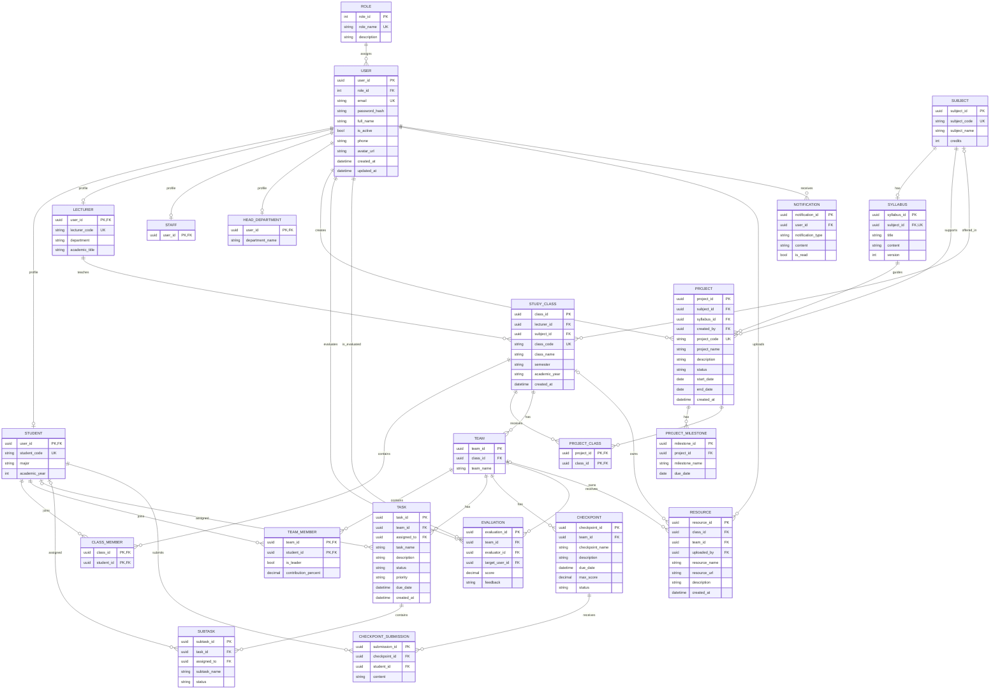

## Ràng buộc nghiệp vụ chính

- `students`, `lecturers`, `staff`, `head_departments`: `user_id` vừa là PK vừa là FK đến `users.user_id`.
- Mỗi môn học có tối đa một đề cương (`syllabus.subject_id` là `UNIQUE`); môn học có thể chưa có đề cương.
- Một sinh viên không thể được thêm hai lần vào cùng lớp hoặc cùng nhóm.
- Mỗi nhóm có tối đa một trưởng nhóm (`team_members.is_leader = TRUE`).
- `contribution_percent` nằm trong khoảng 0–100; điểm đánh giá nằm trong khoảng 0–100.
- Tài liệu (`resources`) phải thuộc **một trong hai** đối tượng: lớp học hoặc nhóm; không được để cả hai cùng rỗng hoặc cùng có giá trị.
- Ngày kết thúc dự án không được trước ngày bắt đầu.
