 # COLLABSPHERE - ENTITY RELATIONSHIP DIAGRAM

## 1. Tổng quan

CollabSphere là hệ thống hỗ trợ học tập theo phương pháp
Project-Based Learning (PBL).

Database quản lý:
- Tài khoản và phân quyền
- Sinh viên và giảng viên
- Môn học và đề cương
- Lớp học
- Dự án và nhóm
- Công việc và tiến độ
- Nộp bài và đánh giá
- Tài nguyên và trao đổi
- Không gian làm việc
- Thông báo và AI

Hệ quản trị: MySQL 8.0+

Thông tin chung:

| Mục | Giá trị |
|---|---|
| Tên database | `collabsphere` |
| Bộ ký tự | `utf8mb4` (collation `utf8mb4_unicode_ci`) |
| Storage engine | InnoDB (hỗ trợ khóa ngoại và giao dịch) |
| Số bảng nghiệp vụ | 29 |
| Bảng kỹ thuật | `schema_migrations` (do Backend tự tạo để ghi nhận các migration đã chạy) |
| Nguồn định nghĩa | `database/migrations/versions/*.up.sql` |

## 2. Quy ước

| Ký hiệu | Ý nghĩa |
|---|---|
| PK | Khóa chính |
| FK | Khóa ngoại |
| UQ | Không được trùng |
| NN | Không được NULL |
| AI | Tự tăng |
| CK | Ràng buộc kiểm tra giá trị (CHECK) |
| IDX | Chỉ mục (Index) |

Quy ước về hành vi khi xóa dữ liệu cha (`ON DELETE`):

| Hành vi | Ý nghĩa |
|---|---|
| CASCADE | Xóa bản ghi cha thì các bản ghi con liên quan bị xóa theo |
| RESTRICT | Không cho xóa bản ghi cha nếu vẫn còn bản ghi con tham chiếu |
| SET NULL | Xóa bản ghi cha thì cột tham chiếu ở bản ghi con được đặt về NULL |

Quy ước đặt tên: tên bảng và cột dùng chữ thường, phân cách bằng dấu gạch dưới (`snake_case`); khóa chính có dạng `<tên_thực_thể>_id`; thời điểm tạo và cập nhật là `created_at`, `updated_at`.

## 3. Sơ đồ ERD

```mermaid
erDiagram

    ROLES ||--o{ USERS : has
    USERS ||--o{ STUDENTS : profile
    USERS ||--o{ LECTURERS : profile

    SUBJECTS ||--o{ SYLLABI : has
    SUBJECTS ||--o{ STUDY_CLASSES : opens

    STUDY_CLASSES ||--o{ CLASS_STUDENTS : contains
    STUDENTS ||--o{ CLASS_STUDENTS : enrolls

    STUDY_CLASSES ||--o{ CLASS_LECTURERS : assigned
    LECTURERS ||--o{ CLASS_LECTURERS : teaches

    STUDY_CLASSES ||--o{ PROJECTS : contains
    SYLLABI o|--o{ PROJECTS : based_on
    USERS ||--o{ PROJECTS : creates
    USERS o|--o{ PROJECTS : approves

    PROJECTS ||--o{ TEAMS : has
    STUDENTS o|--o{ TEAMS : leads

    TEAMS ||--o{ TEAM_MEMBERS : contains
    STUDENTS ||--o{ TEAM_MEMBERS : joins

    PROJECTS ||--o{ MILESTONES : has
    MILESTONES ||--o{ CHECKPOINTS : has

    TEAMS ||--o{ TASKS : performs
    MILESTONES o|--o{ TASKS : includes

    TASKS ||--o{ TASK_ASSIGNEES : assigned
    STUDENTS ||--o{ TASK_ASSIGNEES : receives

    TASKS o|--o{ SUBMISSIONS : receives
    CHECKPOINTS o|--o{ SUBMISSIONS : receives
    TEAMS ||--o{ SUBMISSIONS : submits
    STUDENTS ||--o{ SUBMISSIONS : submits

    PROJECTS o|--o{ RESOURCES : owns
    TEAMS o|--o{ RESOURCES : owns
    USERS ||--o{ RESOURCES : uploads

    TEAMS ||--o{ MEETINGS : schedules
    USERS ||--o{ MEETINGS : creates

    MEETINGS ||--o{ MEETING_PARTICIPANTS : has
    USERS ||--o{ MEETING_PARTICIPANTS : joins

    TEAMS ||--o{ MESSAGES : contains
    USERS ||--o{ MESSAGES : sends

    TEAMS ||--o| WORKSPACES : has
    WORKSPACES ||--o{ WHITEBOARD_SNAPSHOTS : stores
    USERS ||--o{ WHITEBOARD_SNAPSHOTS : creates

    WORKSPACES ||--o{ WORKSPACE_DOCUMENTS : contains
    USERS ||--o{ WORKSPACE_DOCUMENTS : creates

    WORKSPACE_DOCUMENTS ||--o{ DOCUMENT_VERSIONS : has
    USERS ||--o{ DOCUMENT_VERSIONS : edits

    USERS ||--o{ EVALUATIONS : evaluates
    SUBMISSIONS o|--o{ EVALUATIONS : receives
    PROJECTS o|--o{ EVALUATIONS : receives
    TEAMS o|--o{ EVALUATIONS : receives
    STUDENTS o|--o{ EVALUATIONS : receives

    USERS ||--o{ NOTIFICATIONS : receives

    USERS ||--o{ AI_CONVERSATIONS : owns
    AI_CONVERSATIONS ||--o{ AI_MESSAGES : contains

    ROLES {
        bigint role_id PK
        varchar role_code UK
        varchar role_name
        text description
        timestamp created_at
    }

    USERS {
        bigint user_id PK
        bigint role_id FK
        varchar username UK
        varchar email UK
        varchar password_hash
        varchar full_name
        varchar avatar_url
        varchar phone
        boolean is_active
        timestamp created_at
        timestamp updated_at
    }

    STUDENTS {
        bigint student_id PK
        bigint user_id FK, UK
        varchar student_code UK
    }

    LECTURERS {
        bigint lecturer_id PK
        bigint user_id FK, UK
        varchar lecturer_code UK
    }

    SUBJECTS {
        bigint subject_id PK
        varchar subject_code UK
        varchar subject_name
        text description
        timestamp created_at
    }

    SYLLABI {
        bigint syllabus_id PK
        bigint subject_id FK
        varchar version
        varchar title
        text content
        timestamp created_at
    }

    STUDY_CLASSES {
        bigint class_id PK
        bigint subject_id FK
        varchar class_code UK
        varchar class_name
        varchar semester
        varchar academic_year
        integer capacity
        varchar status
        timestamp created_at
    }

    CLASS_STUDENTS {
        bigint class_id PK, FK
        bigint student_id PK, FK
        timestamp enrolled_at
    }

    CLASS_LECTURERS {
        bigint class_id PK, FK
        bigint lecturer_id PK, FK
        varchar assignment_role
        timestamp assigned_at
    }

    PROJECTS {
        bigint project_id PK
        bigint class_id FK
        bigint syllabus_id FK
        bigint created_by FK
        bigint approved_by FK
        varchar title
        text description
        text goals
        text expected_outputs
        text requirements
        date start_date
        date due_date
        int min_group_size
        int max_group_size
        varchar status
        timestamp approved_at
        timestamp created_at
        timestamp updated_at
    }

    TEAMS {
        bigint team_id PK
        bigint project_id FK
        bigint leader_student_id FK
        varchar team_name
        text description
        timestamp created_at
    }

    TEAM_MEMBERS {
        bigint team_id PK, FK
        bigint student_id PK, FK
        timestamp joined_at
    }

    MILESTONES {
        bigint milestone_id PK
        bigint project_id FK
        varchar title
        text description
        date due_date
        int sort_order
        varchar status
        timestamp created_at
    }

    CHECKPOINTS {
        bigint checkpoint_id PK
        bigint milestone_id FK
        varchar title
        text description
        timestamp due_date
        decimal max_score
        varchar status
        timestamp created_at
    }

    TASKS {
        bigint task_id PK
        bigint team_id FK
        bigint milestone_id FK
        varchar title
        text description
        timestamp deadline
        varchar status
        varchar priority
        timestamp created_at
        timestamp updated_at
    }

    TASK_ASSIGNEES {
        bigint task_id PK, FK
        bigint student_id PK, FK
        timestamp assigned_at
    }

    SUBMISSIONS {
        bigint submission_id PK
        bigint task_id FK
        bigint checkpoint_id FK
        bigint team_id FK
        bigint submitted_by FK
        text content
        varchar file_url
        decimal score
        text feedback
        timestamp submitted_at
    }

    RESOURCES {
        bigint resource_id PK
        bigint project_id FK
        bigint team_id FK
        bigint uploaded_by FK
        varchar title
        varchar resource_url
        varchar resource_type
        timestamp created_at
    }

    MEETINGS {
        bigint meeting_id PK
        bigint team_id FK
        bigint created_by FK
        varchar title
        text description
        varchar meeting_url
        timestamp starts_at
        timestamp ends_at
        timestamp created_at
    }

    MEETING_PARTICIPANTS {
        bigint meeting_id PK, FK
        bigint user_id PK, FK
        timestamp joined_at
        varchar attendance_status
    }

    MESSAGES {
        bigint message_id PK
        bigint team_id FK
        bigint sender_id FK
        text content
        varchar message_type
        timestamp created_at
        timestamp updated_at
    }

    WORKSPACES {
        bigint workspace_id PK
        bigint team_id FK, UK
        timestamp created_at
        timestamp updated_at
    }

    WHITEBOARD_SNAPSHOTS {
        bigint snapshot_id PK
        bigint workspace_id FK
        bigint created_by FK
        json snapshot_data
        timestamp created_at
    }

    WORKSPACE_DOCUMENTS {
        bigint document_id PK
        bigint workspace_id FK
        bigint created_by FK
        varchar title
        text content
        timestamp created_at
        timestamp updated_at
    }

    DOCUMENT_VERSIONS {
        bigint version_id PK
        bigint document_id FK
        bigint edited_by FK
        int version_number
        text content
        timestamp created_at
    }

    EVALUATIONS {
        bigint evaluation_id PK
        bigint evaluator_user_id FK
        bigint submission_id FK
        bigint project_id FK
        bigint team_id FK
        bigint student_id FK
        varchar evaluation_type
        decimal score
        text comment
        timestamp created_at
    }

    NOTIFICATIONS {
        bigint notification_id PK
        bigint user_id FK
        varchar title
        text message
        boolean is_read
        timestamp created_at
    }

    AI_CONVERSATIONS {
        bigint conversation_id PK
        bigint user_id FK
        varchar title
        timestamp created_at
        timestamp updated_at
    }

    AI_MESSAGES {
        bigint ai_message_id PK
        bigint conversation_id FK
        varchar sender_type
        text content
        timestamp created_at
    }
```

## 4. Danh sách 29 bảng

### Nhóm 1: Tài khoản và học vụ
1. roles
2. users
3. students
4. lecturers
5. subjects
6. syllabi
7. study_classes
8. class_students
9. class_lecturers

### Nhóm 2: Dự án và nhóm
10. projects
11. teams
12. team_members

### Nhóm 3: Công việc và tiến độ
13. milestones
14. checkpoints
15. tasks
16. task_assignees
17. submissions

### Nhóm 4: Tài nguyên và giao tiếp
18. resources
19. meetings
20. meeting_participants
21. messages

### Nhóm 5: Không gian làm việc
22. workspaces
23. whiteboard_snapshots
24. workspace_documents
25. document_versions

### Nhóm 6: Đánh giá và AI
26. evaluations
27. notifications
28. ai_conversations
29. ai_messages

Mỗi nhóm tương ứng với một file migration:

| Nhóm | File migration |
|---|---|
| Nhóm 1 | `001_identity_academic.up.sql` |
| Nhóm 2 | `002_projects_teams.up.sql` |
| Nhóm 3 | `003_progress_tasks_submissions.up.sql` |
| Nhóm 4 | `004_resources_communication.up.sql` |
| Nhóm 5 | `005_workspaces_documents.up.sql` |
| Nhóm 6 | `006_evaluations_notifications_ai.up.sql` |

## 5. Chi tiết từng bảng

Trong các bảng dưới đây: **Ràng buộc** ghi các điều kiện của cột (PK, FK, UQ, NN, AI, CK); **Mặc định** là giá trị khi không nhập. Mọi cột khóa chính và khóa ngoại có kiểu `BIGINT`.

### Nhóm 1: Tài khoản và học vụ

#### 5.1. roles — Vai trò hệ thống

Lưu 5 vai trò: `ADMIN`, `HEAD`, `STAFF`, `LECTURER`, `STUDENT`.

| Cột | Kiểu | Ràng buộc | Mặc định | Mô tả |
|---|---|---|---|---|
| role_id | BIGINT | PK, AI | | Mã vai trò |
| role_code | VARCHAR(30) | NN, UQ | | Mã vai trò (`ADMIN`, `HEAD`, ...) |
| role_name | VARCHAR(100) | NN | | Tên vai trò |
| description | TEXT | | | Mô tả vai trò |
| created_at | TIMESTAMP | NN | thời điểm hiện tại | Thời điểm tạo |

#### 5.2. users — Tài khoản người dùng

Mỗi người dùng thuộc đúng một vai trò. Mật khẩu chỉ lưu dạng mã hóa (hash).

| Cột | Kiểu | Ràng buộc | Mặc định | Mô tả |
|---|---|---|---|---|
| user_id | BIGINT | PK, AI | | Mã người dùng |
| role_id | BIGINT | FK → roles, NN | | Vai trò của người dùng |
| username | VARCHAR(50) | NN, UQ | | Tên đăng nhập |
| email | VARCHAR(255) | NN, UQ | | Email |
| password_hash | VARCHAR(255) | NN | | Mật khẩu đã mã hóa |
| full_name | VARCHAR(150) | NN | | Họ và tên |
| avatar_url | VARCHAR(500) | | | Đường dẫn ảnh đại diện |
| phone | VARCHAR(20) | | | Số điện thoại |
| is_active | BOOLEAN | NN | TRUE | Tài khoản đang hoạt động hay bị khóa |
| created_at | TIMESTAMP | NN | thời điểm hiện tại | Thời điểm tạo |
| updated_at | TIMESTAMP | NN | thời điểm hiện tại | Tự cập nhật mỗi khi sửa bản ghi |

#### 5.3. students — Hồ sơ sinh viên

Quan hệ 1–1 với `users` (mỗi tài khoản có tối đa một hồ sơ sinh viên).

| Cột | Kiểu | Ràng buộc | Mặc định | Mô tả |
|---|---|---|---|---|
| student_id | BIGINT | PK, AI | | Mã sinh viên (khóa nội bộ) |
| user_id | BIGINT | FK → users, NN, UQ | | Tài khoản tương ứng |
| student_code | VARCHAR(30) | NN, UQ | | Mã số sinh viên (ví dụ `SV001`) |

#### 5.4. lecturers — Hồ sơ giảng viên

Quan hệ 1–1 với `users`.

| Cột | Kiểu | Ràng buộc | Mặc định | Mô tả |
|---|---|---|---|---|
| lecturer_id | BIGINT | PK, AI | | Mã giảng viên (khóa nội bộ) |
| user_id | BIGINT | FK → users, NN, UQ | | Tài khoản tương ứng |
| lecturer_code | VARCHAR(30) | NN, UQ | | Mã giảng viên (ví dụ `GV001`) |

#### 5.5. subjects — Môn học

| Cột | Kiểu | Ràng buộc | Mặc định | Mô tả |
|---|---|---|---|---|
| subject_id | BIGINT | PK, AI | | Mã môn học |
| subject_code | VARCHAR(30) | NN, UQ | | Mã môn (ví dụ `CNPM`) |
| subject_name | VARCHAR(150) | NN | | Tên môn học |
| description | TEXT | | | Mô tả môn học |
| created_at | TIMESTAMP | NN | thời điểm hiện tại | Thời điểm tạo |

#### 5.6. syllabi — Đề cương môn học

Một môn học có nhiều phiên bản đề cương; cặp (`subject_id`, `version`) không được trùng.

| Cột | Kiểu | Ràng buộc | Mặc định | Mô tả |
|---|---|---|---|---|
| syllabus_id | BIGINT | PK, AI | | Mã đề cương |
| subject_id | BIGINT | FK → subjects, NN | | Môn học |
| version | VARCHAR(30) | NN | | Phiên bản đề cương |
| title | VARCHAR(200) | NN | | Tiêu đề |
| content | TEXT | | | Nội dung đề cương |
| created_at | TIMESTAMP | NN | thời điểm hiện tại | Thời điểm tạo |

#### 5.7. study_classes — Lớp học

Một lớp thuộc một môn học.

| Cột | Kiểu | Ràng buộc | Mặc định | Mô tả |
|---|---|---|---|---|
| class_id | BIGINT | PK, AI | | Mã lớp |
| subject_id | BIGINT | FK → subjects, NN | | Môn học của lớp |
| class_code | VARCHAR(30) | NN, UQ | | Mã lớp (ví dụ `CNPM-01`) |
| class_name | VARCHAR(150) | NN | | Tên lớp |
| semester | VARCHAR(30) | | | Học kỳ |
| academic_year | VARCHAR(20) | | | Năm học |
| capacity | INTEGER | CK: NULL hoặc ≥ 0 | | Sĩ số tối đa |
| status | VARCHAR(20) | NN, CK | `OPEN` | Trạng thái: `PLANNED`, `OPEN`, `CLOSED`, `ARCHIVED` |
| created_at | TIMESTAMP | NN | thời điểm hiện tại | Thời điểm tạo |

#### 5.8. class_students — Sinh viên trong lớp

Bảng trung gian nhiều–nhiều giữa lớp và sinh viên. Khóa chính ghép (`class_id`, `student_id`).

| Cột | Kiểu | Ràng buộc | Mặc định | Mô tả |
|---|---|---|---|---|
| class_id | BIGINT | PK, FK → study_classes | | Lớp học |
| student_id | BIGINT | PK, FK → students | | Sinh viên |
| enrolled_at | TIMESTAMP | NN | thời điểm hiện tại | Thời điểm ghi danh |

#### 5.9. class_lecturers — Giảng viên phụ trách lớp

Bảng trung gian nhiều–nhiều giữa lớp và giảng viên. Khóa chính ghép (`class_id`, `lecturer_id`).

| Cột | Kiểu | Ràng buộc | Mặc định | Mô tả |
|---|---|---|---|---|
| class_id | BIGINT | PK, FK → study_classes | | Lớp học |
| lecturer_id | BIGINT | PK, FK → lecturers | | Giảng viên |
| assignment_role | VARCHAR(50) | NN | `LECTURER` | Vai trò phân công trong lớp |
| assigned_at | TIMESTAMP | NN | thời điểm hiện tại | Thời điểm phân công |

### Nhóm 2: Dự án và nhóm

#### 5.10. projects — Dự án

Một dự án thuộc một lớp, có thể dựa trên một đề cương và cần người duyệt.

| Cột | Kiểu | Ràng buộc | Mặc định | Mô tả |
|---|---|---|---|---|
| project_id | BIGINT | PK, AI | | Mã dự án |
| class_id | BIGINT | FK → study_classes, NN | | Lớp thực hiện dự án |
| syllabus_id | BIGINT | FK → syllabi | | Đề cương làm cơ sở (có thể trống) |
| created_by | BIGINT | FK → users, NN | | Người tạo dự án |
| title | VARCHAR(200) | NN | | Tên dự án |
| description | TEXT | | | Mô tả |
| goals | TEXT | | | Mục tiêu |
| expected_outputs | TEXT | | | Sản phẩm đầu ra dự kiến |
| requirements | TEXT | | | Yêu cầu |
| start_date | DATE | CK | | Ngày bắt đầu |
| due_date | DATE | CK | | Hạn hoàn thành |
| min_group_size | INT | NN, CK | 1 | Số thành viên tối thiểu mỗi nhóm |
| max_group_size | INT | NN, CK | 5 | Số thành viên tối đa mỗi nhóm |
| status | VARCHAR(30) | NN | `DRAFT` | Trạng thái dự án |
| approved_by | BIGINT | FK → users | | Người duyệt (có thể trống) |
| approved_at | TIMESTAMP | | | Thời điểm duyệt |
| created_at | TIMESTAMP | NN | thời điểm hiện tại | Thời điểm tạo |
| updated_at | TIMESTAMP | NN | thời điểm hiện tại | Tự cập nhật mỗi khi sửa bản ghi |

#### 5.11. teams — Nhóm

Tên nhóm không được trùng trong cùng một dự án (cặp `project_id`, `team_name` là duy nhất).

| Cột | Kiểu | Ràng buộc | Mặc định | Mô tả |
|---|---|---|---|---|
| team_id | BIGINT | PK, AI | | Mã nhóm |
| project_id | BIGINT | FK → projects, NN | | Dự án của nhóm |
| team_name | VARCHAR(100) | NN | | Tên nhóm |
| leader_student_id | BIGINT | FK → students | | Nhóm trưởng (có thể trống) |
| description | TEXT | | | Mô tả nhóm |
| created_at | TIMESTAMP | NN | thời điểm hiện tại | Thời điểm tạo |

#### 5.12. team_members — Thành viên nhóm

Bảng trung gian nhiều–nhiều giữa nhóm và sinh viên. Khóa chính ghép (`team_id`, `student_id`).

| Cột | Kiểu | Ràng buộc | Mặc định | Mô tả |
|---|---|---|---|---|
| team_id | BIGINT | PK, FK → teams | | Nhóm |
| student_id | BIGINT | PK, FK → students | | Sinh viên |
| joined_at | TIMESTAMP | NN | thời điểm hiện tại | Thời điểm tham gia |

### Nhóm 3: Công việc và tiến độ

#### 5.13. milestones — Cột mốc

| Cột | Kiểu | Ràng buộc | Mặc định | Mô tả |
|---|---|---|---|---|
| milestone_id | BIGINT | PK, AI | | Mã cột mốc |
| project_id | BIGINT | FK → projects, NN | | Dự án |
| title | VARCHAR(200) | NN | | Tên cột mốc |
| description | TEXT | | | Mô tả |
| due_date | DATE | | | Hạn hoàn thành |
| sort_order | INT | NN, CK ≥ 0 | 0 | Thứ tự sắp xếp |
| status | VARCHAR(30) | NN | `PENDING` | Trạng thái |
| created_at | TIMESTAMP | NN | thời điểm hiện tại | Thời điểm tạo |

#### 5.14. checkpoints — Điểm kiểm tra

Mỗi điểm kiểm tra thuộc một cột mốc và có thang điểm tối đa.

| Cột | Kiểu | Ràng buộc | Mặc định | Mô tả |
|---|---|---|---|---|
| checkpoint_id | BIGINT | PK, AI | | Mã điểm kiểm tra |
| milestone_id | BIGINT | FK → milestones, NN | | Cột mốc |
| title | VARCHAR(200) | NN | | Tên điểm kiểm tra |
| description | TEXT | | | Mô tả |
| due_date | TIMESTAMP | | | Hạn nộp |
| max_score | DECIMAL(5,2) | NN, CK ≥ 0 | 100 | Điểm tối đa |
| status | VARCHAR(30) | NN | `PENDING` | Trạng thái |
| created_at | TIMESTAMP | NN | thời điểm hiện tại | Thời điểm tạo |

#### 5.15. tasks — Công việc

Công việc thuộc một nhóm, có thể gắn với một cột mốc.

| Cột | Kiểu | Ràng buộc | Mặc định | Mô tả |
|---|---|---|---|---|
| task_id | BIGINT | PK, AI | | Mã công việc |
| team_id | BIGINT | FK → teams, NN | | Nhóm thực hiện |
| milestone_id | BIGINT | FK → milestones | | Cột mốc liên quan (có thể trống) |
| title | VARCHAR(200) | NN | | Tên công việc |
| description | TEXT | | | Mô tả |
| deadline | TIMESTAMP | | | Hạn chót |
| status | VARCHAR(30) | NN | `TODO` | Trạng thái |
| priority | VARCHAR(30) | NN | `MEDIUM` | Mức ưu tiên |
| created_at | TIMESTAMP | NN | thời điểm hiện tại | Thời điểm tạo |
| updated_at | TIMESTAMP | NN | thời điểm hiện tại | Tự cập nhật mỗi khi sửa bản ghi |

#### 5.16. task_assignees — Người được giao việc

Bảng trung gian nhiều–nhiều giữa công việc và sinh viên. Khóa chính ghép (`task_id`, `student_id`).

| Cột | Kiểu | Ràng buộc | Mặc định | Mô tả |
|---|---|---|---|---|
| task_id | BIGINT | PK, FK → tasks | | Công việc |
| student_id | BIGINT | PK, FK → students | | Sinh viên được giao |
| assigned_at | TIMESTAMP | NN | thời điểm hiện tại | Thời điểm giao việc |

#### 5.17. submissions — Bài nộp

Mỗi bài nộp gắn với **đúng một** đối tượng: hoặc một công việc (`task_id`) hoặc một điểm kiểm tra (`checkpoint_id`), không được cả hai và không được để trống cả hai.

| Cột | Kiểu | Ràng buộc | Mặc định | Mô tả |
|---|---|---|---|---|
| submission_id | BIGINT | PK, AI | | Mã bài nộp |
| task_id | BIGINT | FK → tasks, CK | | Công việc được nộp |
| checkpoint_id | BIGINT | FK → checkpoints, CK | | Điểm kiểm tra được nộp |
| team_id | BIGINT | FK → teams, NN | | Nhóm nộp |
| submitted_by | BIGINT | FK → students, NN | | Sinh viên thực hiện nộp |
| content | TEXT | | | Nội dung bài nộp |
| file_url | VARCHAR(1000) | | | Đường dẫn tệp đính kèm |
| score | DECIMAL(5,2) | CK: NULL hoặc ≥ 0 | | Điểm chấm |
| feedback | TEXT | | | Nhận xét |
| submitted_at | TIMESTAMP | NN | thời điểm hiện tại | Thời điểm nộp |

### Nhóm 4: Tài nguyên và giao tiếp

#### 5.18. resources — Tài nguyên học tập

Mỗi tài nguyên thuộc **đúng một** chủ sở hữu: hoặc một dự án (`project_id`) hoặc một nhóm (`team_id`).

| Cột | Kiểu | Ràng buộc | Mặc định | Mô tả |
|---|---|---|---|---|
| resource_id | BIGINT | PK, AI | | Mã tài nguyên |
| project_id | BIGINT | FK → projects, CK | | Dự án sở hữu |
| team_id | BIGINT | FK → teams, CK | | Nhóm sở hữu |
| uploaded_by | BIGINT | FK → users, NN | | Người tải lên |
| title | VARCHAR(200) | NN | | Tên tài nguyên |
| resource_url | VARCHAR(1000) | NN | | Đường dẫn tài nguyên |
| resource_type | VARCHAR(50) | | | Loại tài nguyên |
| created_at | TIMESTAMP | NN | thời điểm hiện tại | Thời điểm tạo |

#### 5.19. meetings — Cuộc họp

| Cột | Kiểu | Ràng buộc | Mặc định | Mô tả |
|---|---|---|---|---|
| meeting_id | BIGINT | PK, AI | | Mã cuộc họp |
| team_id | BIGINT | FK → teams, NN | | Nhóm tổ chức họp |
| created_by | BIGINT | FK → users, NN | | Người tạo cuộc họp |
| title | VARCHAR(200) | NN | | Tiêu đề |
| description | TEXT | | | Nội dung, mô tả |
| meeting_url | VARCHAR(500) | | | Liên kết phòng họp |
| starts_at | TIMESTAMP | NN | | Thời điểm bắt đầu |
| ends_at | TIMESTAMP | CK: NULL hoặc > starts_at | | Thời điểm kết thúc |
| created_at | TIMESTAMP | NN | thời điểm hiện tại | Thời điểm tạo |

#### 5.20. meeting_participants — Người tham gia cuộc họp

Khóa chính ghép (`meeting_id`, `user_id`).

| Cột | Kiểu | Ràng buộc | Mặc định | Mô tả |
|---|---|---|---|---|
| meeting_id | BIGINT | PK, FK → meetings | | Cuộc họp |
| user_id | BIGINT | PK, FK → users | | Người tham gia |
| joined_at | TIMESTAMP | | | Thời điểm vào họp |
| attendance_status | VARCHAR(30) | NN | `INVITED` | Trạng thái tham dự |

#### 5.21. messages — Tin nhắn nhóm

| Cột | Kiểu | Ràng buộc | Mặc định | Mô tả |
|---|---|---|---|---|
| message_id | BIGINT | PK, AI | | Mã tin nhắn |
| team_id | BIGINT | FK → teams, NN | | Nhóm chat |
| sender_id | BIGINT | FK → users, NN | | Người gửi |
| content | TEXT | NN | | Nội dung tin nhắn |
| message_type | VARCHAR(30) | NN | `TEXT` | Loại tin nhắn |
| created_at | TIMESTAMP | NN | thời điểm hiện tại | Thời điểm gửi |
| updated_at | TIMESTAMP | NN | thời điểm hiện tại | Tự cập nhật mỗi khi sửa bản ghi |

### Nhóm 5: Không gian làm việc

#### 5.22. workspaces — Không gian làm việc

Mỗi nhóm có tối đa một không gian làm việc (quan hệ 1–1 với `teams`).

| Cột | Kiểu | Ràng buộc | Mặc định | Mô tả |
|---|---|---|---|---|
| workspace_id | BIGINT | PK, AI | | Mã không gian làm việc |
| team_id | BIGINT | FK → teams, NN, UQ | | Nhóm sở hữu |
| created_at | TIMESTAMP | NN | thời điểm hiện tại | Thời điểm tạo |
| updated_at | TIMESTAMP | NN | thời điểm hiện tại | Tự cập nhật mỗi khi sửa bản ghi |

#### 5.23. whiteboard_snapshots — Bản chụp bảng trắng

Lưu trạng thái bảng trắng dưới dạng JSON.

| Cột | Kiểu | Ràng buộc | Mặc định | Mô tả |
|---|---|---|---|---|
| snapshot_id | BIGINT | PK, AI | | Mã bản chụp |
| workspace_id | BIGINT | FK → workspaces, NN | | Không gian làm việc |
| created_by | BIGINT | FK → users, NN | | Người lưu |
| snapshot_data | JSON | NN | | Dữ liệu bảng trắng |
| created_at | TIMESTAMP | NN | thời điểm hiện tại | Thời điểm lưu |

#### 5.24. workspace_documents — Tài liệu trong không gian làm việc

| Cột | Kiểu | Ràng buộc | Mặc định | Mô tả |
|---|---|---|---|---|
| document_id | BIGINT | PK, AI | | Mã tài liệu |
| workspace_id | BIGINT | FK → workspaces, NN | | Không gian làm việc |
| created_by | BIGINT | FK → users, NN | | Người tạo |
| title | VARCHAR(200) | NN | | Tiêu đề tài liệu |
| content | TEXT | | | Nội dung hiện tại |
| created_at | TIMESTAMP | NN | thời điểm hiện tại | Thời điểm tạo |
| updated_at | TIMESTAMP | NN | thời điểm hiện tại | Tự cập nhật mỗi khi sửa bản ghi |

#### 5.25. document_versions — Lịch sử phiên bản tài liệu

Số phiên bản phải lớn hơn 0 và không trùng trong cùng một tài liệu (cặp `document_id`, `version_number` là duy nhất).

| Cột | Kiểu | Ràng buộc | Mặc định | Mô tả |
|---|---|---|---|---|
| version_id | BIGINT | PK, AI | | Mã phiên bản |
| document_id | BIGINT | FK → workspace_documents, NN | | Tài liệu |
| edited_by | BIGINT | FK → users, NN | | Người chỉnh sửa |
| version_number | INT | NN, CK > 0 | | Số phiên bản |
| content | TEXT | | | Nội dung của phiên bản |
| created_at | TIMESTAMP | NN | thời điểm hiện tại | Thời điểm lưu phiên bản |

### Nhóm 6: Đánh giá và AI

#### 5.26. evaluations — Đánh giá

Mỗi đánh giá nhắm tới **đúng một** đối tượng trong bốn loại: bài nộp (`submission_id`), dự án (`project_id`), nhóm (`team_id`) hoặc sinh viên (`student_id`).

| Cột | Kiểu | Ràng buộc | Mặc định | Mô tả |
|---|---|---|---|---|
| evaluation_id | BIGINT | PK, AI | | Mã đánh giá |
| evaluator_user_id | BIGINT | FK → users, NN | | Người đánh giá |
| submission_id | BIGINT | FK → submissions, CK | | Đối tượng: bài nộp |
| project_id | BIGINT | FK → projects, CK | | Đối tượng: dự án |
| team_id | BIGINT | FK → teams, CK | | Đối tượng: nhóm |
| student_id | BIGINT | FK → students, CK | | Đối tượng: sinh viên |
| evaluation_type | VARCHAR(30) | NN | | Loại đánh giá |
| score | DECIMAL(5,2) | NN, CK ≥ 0 | | Điểm số |
| comment | TEXT | | | Nhận xét |
| created_at | TIMESTAMP | NN | thời điểm hiện tại | Thời điểm đánh giá |

#### 5.27. notifications — Thông báo

| Cột | Kiểu | Ràng buộc | Mặc định | Mô tả |
|---|---|---|---|---|
| notification_id | BIGINT | PK, AI | | Mã thông báo |
| user_id | BIGINT | FK → users, NN | | Người nhận |
| title | VARCHAR(200) | NN | | Tiêu đề |
| message | TEXT | NN | | Nội dung |
| is_read | BOOLEAN | NN | FALSE | Đã đọc hay chưa |
| created_at | TIMESTAMP | NN | thời điểm hiện tại | Thời điểm tạo |

#### 5.28. ai_conversations — Cuộc hội thoại với AI

| Cột | Kiểu | Ràng buộc | Mặc định | Mô tả |
|---|---|---|---|---|
| conversation_id | BIGINT | PK, AI | | Mã hội thoại |
| user_id | BIGINT | FK → users, NN | | Chủ hội thoại |
| title | VARCHAR(200) | | | Tiêu đề hội thoại |
| created_at | TIMESTAMP | NN | thời điểm hiện tại | Thời điểm tạo |
| updated_at | TIMESTAMP | NN | thời điểm hiện tại | Tự cập nhật mỗi khi sửa bản ghi |

#### 5.29. ai_messages — Tin nhắn trong hội thoại AI

| Cột | Kiểu | Ràng buộc | Mặc định | Mô tả |
|---|---|---|---|---|
| ai_message_id | BIGINT | PK, AI | | Mã tin nhắn |
| conversation_id | BIGINT | FK → ai_conversations, NN | | Cuộc hội thoại |
| sender_type | VARCHAR(20) | NN | | Bên gửi (người dùng hoặc AI) |
| content | TEXT | NN | | Nội dung |
| created_at | TIMESTAMP | NN | thời điểm hiện tại | Thời điểm gửi |

## 6. Khóa ngoại và hành vi khi xóa

| Bảng con | Cột | Bảng cha | Khi xóa bản ghi cha |
|---|---|---|---|
| users | role_id | roles | RESTRICT |
| students | user_id | users | CASCADE |
| lecturers | user_id | users | CASCADE |
| syllabi | subject_id | subjects | CASCADE |
| study_classes | subject_id | subjects | RESTRICT |
| class_students | class_id | study_classes | CASCADE |
| class_students | student_id | students | CASCADE |
| class_lecturers | class_id | study_classes | CASCADE |
| class_lecturers | lecturer_id | lecturers | CASCADE |
| projects | class_id | study_classes | CASCADE |
| projects | syllabus_id | syllabi | SET NULL |
| projects | created_by | users | RESTRICT |
| projects | approved_by | users | SET NULL |
| teams | project_id | projects | CASCADE |
| teams | leader_student_id | students | SET NULL |
| team_members | team_id | teams | CASCADE |
| team_members | student_id | students | CASCADE |
| milestones | project_id | projects | CASCADE |
| checkpoints | milestone_id | milestones | CASCADE |
| tasks | team_id | teams | CASCADE |
| tasks | milestone_id | milestones | SET NULL |
| task_assignees | task_id | tasks | CASCADE |
| task_assignees | student_id | students | CASCADE |
| submissions | task_id | tasks | CASCADE |
| submissions | checkpoint_id | checkpoints | CASCADE |
| submissions | team_id | teams | CASCADE |
| submissions | submitted_by | students | RESTRICT |
| resources | project_id | projects | CASCADE |
| resources | team_id | teams | CASCADE |
| resources | uploaded_by | users | RESTRICT |
| meetings | team_id | teams | CASCADE |
| meetings | created_by | users | RESTRICT |
| meeting_participants | meeting_id | meetings | CASCADE |
| meeting_participants | user_id | users | CASCADE |
| messages | team_id | teams | CASCADE |
| messages | sender_id | users | RESTRICT |
| workspaces | team_id | teams | CASCADE |
| whiteboard_snapshots | workspace_id | workspaces | CASCADE |
| whiteboard_snapshots | created_by | users | RESTRICT |
| workspace_documents | workspace_id | workspaces | CASCADE |
| workspace_documents | created_by | users | RESTRICT |
| document_versions | document_id | workspace_documents | CASCADE |
| document_versions | edited_by | users | RESTRICT |
| evaluations | evaluator_user_id | users | RESTRICT |
| evaluations | submission_id | submissions | CASCADE |
| evaluations | project_id | projects | CASCADE |
| evaluations | team_id | teams | CASCADE |
| evaluations | student_id | students | CASCADE |
| notifications | user_id | users | CASCADE |
| ai_conversations | user_id | users | CASCADE |
| ai_messages | conversation_id | ai_conversations | CASCADE |

Ý nghĩa thực tế:

- **Xóa một lớp học** sẽ xóa theo dự án, nhóm, công việc, bài nộp, đánh giá và các dữ liệu con liên quan (chuỗi CASCADE).
- **Không thể xóa một vai trò** còn có người dùng, hoặc **một môn học** còn có lớp học (RESTRICT).
- **Không thể xóa tài khoản** còn là người tạo dự án, người tải tài nguyên, người gửi tin nhắn, người đánh giá... (RESTRICT). Cần khóa tài khoản (`is_active = FALSE`) thay vì xóa.
- **Xóa nhóm trưởng, người duyệt, đề cương hoặc cột mốc** không làm mất dự án hay công việc, chỉ đặt cột tham chiếu về NULL (SET NULL).

## 7. Ràng buộc duy nhất và ràng buộc kiểm tra

### 7.1. Ràng buộc duy nhất (UNIQUE)

| Bảng | Cột hoặc nhóm cột | Ý nghĩa |
|---|---|---|
| roles | role_code | Mã vai trò không trùng |
| users | username | Tên đăng nhập không trùng |
| users | email | Email không trùng |
| students | user_id | Một tài khoản chỉ có một hồ sơ sinh viên |
| students | student_code | Mã số sinh viên không trùng |
| lecturers | user_id | Một tài khoản chỉ có một hồ sơ giảng viên |
| lecturers | lecturer_code | Mã giảng viên không trùng |
| subjects | subject_code | Mã môn không trùng |
| syllabi | (subject_id, version) | Một môn không có hai đề cương cùng phiên bản |
| study_classes | class_code | Mã lớp không trùng |
| teams | (project_id, team_name) | Tên nhóm không trùng trong cùng dự án |
| workspaces | team_id | Mỗi nhóm có tối đa một không gian làm việc |
| document_versions | (document_id, version_number) | Số phiên bản không trùng trong cùng tài liệu |

### 7.2. Ràng buộc kiểm tra (CHECK)

| Bảng | Điều kiện | Ý nghĩa |
|---|---|---|
| study_classes | `capacity` là NULL hoặc ≥ 0 | Sĩ số không âm |
| study_classes | `status` thuộc `PLANNED`, `OPEN`, `CLOSED`, `ARCHIVED` | Trạng thái lớp hợp lệ |
| projects | `start_date` ≤ `due_date` (khi cả hai có giá trị) | Ngày bắt đầu không sau hạn hoàn thành |
| projects | `min_group_size` ≥ 1 và `max_group_size` ≥ `min_group_size` | Quy mô nhóm hợp lệ |
| milestones | `sort_order` ≥ 0 | Thứ tự không âm |
| checkpoints | `max_score` ≥ 0 | Điểm tối đa không âm |
| submissions | Đúng một trong `task_id` hoặc `checkpoint_id` có giá trị | Mỗi bài nộp có đúng một đối tượng |
| submissions | `score` là NULL hoặc ≥ 0 | Điểm không âm |
| resources | Đúng một trong `project_id` hoặc `team_id` có giá trị | Mỗi tài nguyên có đúng một chủ sở hữu |
| meetings | `ends_at` là NULL hoặc > `starts_at` | Giờ kết thúc sau giờ bắt đầu |
| document_versions | `version_number` > 0 | Số phiên bản dương |
| evaluations | `score` ≥ 0 | Điểm không âm |
| evaluations | Đúng một trong `submission_id`, `project_id`, `team_id`, `student_id` có giá trị | Mỗi đánh giá có đúng một đối tượng |

## 8. Chỉ mục (Index)

Ngoài chỉ mục tự tạo cho khóa chính, khóa ngoại và các cột UNIQUE, database có thêm các chỉ mục để tăng tốc truy vấn:

| Chỉ mục | Bảng | Cột |
|---|---|---|
| idx_projects_class_id | projects | class_id |
| idx_projects_created_by | projects | created_by |
| idx_teams_project_id | teams | project_id |
| idx_milestones_project_id | milestones | project_id |
| idx_checkpoints_milestone_id | checkpoints | milestone_id |
| idx_tasks_team_id | tasks | team_id |
| idx_tasks_milestone_id | tasks | milestone_id |
| idx_submissions_team_id | submissions | team_id |
| idx_submissions_submitted_by | submissions | submitted_by |
| idx_resources_project_id | resources | project_id |
| idx_resources_team_id | resources | team_id |
| idx_meetings_team_id | meetings | team_id |
| idx_meetings_starts_at | meetings | starts_at |
| idx_messages_team_created | messages | team_id, created_at |
| idx_whiteboard_workspace_created | whiteboard_snapshots | workspace_id, created_at |
| idx_workspace_documents_workspace | workspace_documents | workspace_id |
| idx_document_versions_document | document_versions | document_id |
| idx_evaluations_evaluator | evaluations | evaluator_user_id |
| idx_evaluations_submission | evaluations | submission_id |
| idx_evaluations_project | evaluations | project_id |
| idx_evaluations_team | evaluations | team_id |
| idx_evaluations_student | evaluations | student_id |
| idx_notifications_user_read_created | notifications | user_id, is_read, created_at (giảm dần) |
| idx_ai_conversations_user_created | ai_conversations | user_id, created_at (giảm dần) |
| idx_ai_messages_conversation_created | ai_messages | conversation_id, created_at |

## 9. Dữ liệu khởi tạo (Seed)

Dữ liệu mẫu nằm trong `database/seeds/` và chỉ nạp ở môi trường Development khi Backend được cấu hình mật khẩu mẫu.

| File | Nội dung |
|---|---|
| `001_seed_roles.sql` | 5 vai trò: `ADMIN`, `HEAD`, `STAFF`, `LECTURER`, `STUDENT` |
| `002_seed_users.sql` | 6 tài khoản (`admin`, `head01`, `staff01`, `lecturer01`, `student01`, `student02`) cùng hồ sơ giảng viên `GV001` và sinh viên `SV001`, `SV002` |
| `003_seed_subjects.sql` | Các môn học mẫu |
| `004_seed_syllabi.sql` | Các đề cương mẫu |
| `005_seed_classes.sql` | Các lớp học mẫu (ví dụ `CNPM-01`, `CTDL-01`) |

Mật khẩu của tài khoản mẫu được mã hóa lúc nạp dữ liệu; file seed không chứa mật khẩu thật. Các lệnh seed chỉ thêm bản ghi khi chưa tồn tại nên có thể chạy lại mà không tạo trùng.

## 10. Ghi chú

- Cột trạng thái (`status`, `priority`, `attendance_status`, `message_type`, `evaluation_type`, `sender_type`) lưu dạng chuỗi. Chỉ bảng `study_classes` có ràng buộc giới hạn giá trị ở mức database; các cột còn lại do ứng dụng kiểm soát giá trị hợp lệ.
- Việc có bảng trong database không đồng nghĩa API và giao diện của chức năng tương ứng đã hoàn thiện; xem README gốc của dự án để biết phạm vi triển khai.
- Khi thay đổi cấu trúc, tạo migration phiên bản mới (`.up.sql` và `.down.sql`) và cập nhật tài liệu này; không sửa migration đã được áp dụng.
