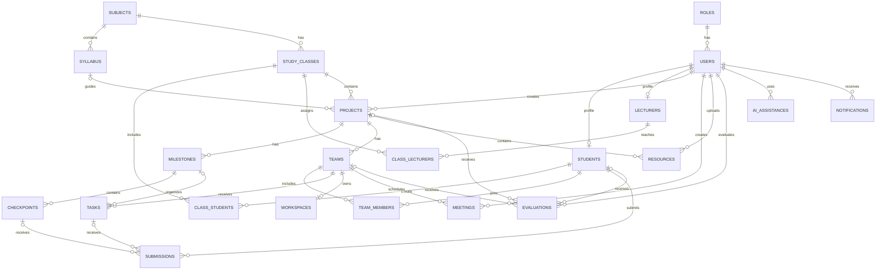

# 01. Thiết kế cơ sở dữ liệu (ERD)

## 1. Giới thiệu

CollabSphere là hệ thống hỗ trợ việc học theo phương pháp Project-Based Learning (PBL). Hệ thống hỗ trợ quản lý tài khoản, môn học, lớp học, dự án, nhóm sinh viên, nhiệm vụ, tiến độ, nộp bài và đánh giá.

Cơ sở dữ liệu sử dụng MySQL 8.0, lưu trữ thông tin và quản lý các mối quan hệ giữa những thực thể trong hệ thống.

## 2. Các thực thể

| STT | Thực thể | Mô tả |
|---|---|---|
| 1 | roles | Vai trò của người dùng |
| 2 | users | Tài khoản người dùng |
| 3 | students | Thông tin sinh viên |
| 4 | lecturers | Thông tin giảng viên |
| 5 | subjects | Môn học |
| 6 | syllabus | Đề cương môn học |
| 7 | study_classes | Lớp học |
| 8 | class_students | Sinh viên thuộc lớp |
| 9 | class_lecturers | Giảng viên phụ trách lớp |
| 10 | projects | Dự án PBL |
| 11 | milestones | Các mốc tiến độ dự án |
| 12 | checkpoints | Các điểm kiểm tra tiến độ |
| 13 | teams | Nhóm thực hiện dự án |
| 14 | team_members | Thành viên nhóm |
| 15 | tasks | Nhiệm vụ của nhóm |
| 16 | workspaces | Không gian làm việc nhóm |
| 17 | meetings | Cuộc họp nhóm |
| 18 | resources | Tài liệu dự án |
| 19 | submissions | Bài nộp |
| 20 | evaluations | Đánh giá |
| 21 | ai_assistances | Lịch sử hỗ trợ AI |
| 22 | notifications | Thông báo |

## 3. Sơ đồ ERD

## 4. Mô tả thuộc tính các thực thể

### 4.1. roles - Vai trò người dùng

| Thuộc tính | Kiểu dữ liệu | Ràng buộc |
|---|---|---|
| id | BIGINT UNSIGNED | PK |
| role_name | VARCHAR(30) | UNIQUE, NOT NULL |

Vai trò xác định quyền truy cập của người dùng, ví dụ: Admin, Head, Staff, Lecturer và Student.

### 4.2. users - Tài khoản người dùng

| Thuộc tính | Kiểu dữ liệu | Ràng buộc |
|---|---|---|
| id | BIGINT UNSIGNED | PK |
| role_id | BIGINT UNSIGNED | FK → roles.id |
| full_name | VARCHAR(150) | NOT NULL |
| email | VARCHAR(255) | UNIQUE, NOT NULL |
| password_hash | VARCHAR(255) | NOT NULL |
| is_active | BOOLEAN | NOT NULL |
| created_at | TIMESTAMP | NOT NULL |
| updated_at | TIMESTAMP | NOT NULL |

### 4.3. students - Sinh viên

| Thuộc tính | Kiểu dữ liệu | Ràng buộc |
|---|---|---|
| id | BIGINT UNSIGNED | PK |
| user_id | BIGINT UNSIGNED | FK → users.id, UNIQUE |
| student_code | VARCHAR(30) | UNIQUE, NOT NULL |

### 4.4. lecturers - Giảng viên

| Thuộc tính | Kiểu dữ liệu | Ràng buộc |
|---|---|---|
| id | BIGINT UNSIGNED | PK |
| user_id | BIGINT UNSIGNED | FK → users.id, UNIQUE |
| lecturer_code | VARCHAR(30) | UNIQUE, NOT NULL |

### 4.5. subjects - Môn học

| Thuộc tính | Kiểu dữ liệu | Ràng buộc |
|---|---|---|
| id | BIGINT UNSIGNED | PK |
| subject_code | VARCHAR(30) | UNIQUE, NOT NULL |
| subject_name | VARCHAR(150) | NOT NULL |
| description | TEXT | NULL |

### 4.6. syllabus - Đề cương môn học

| Thuộc tính | Kiểu dữ liệu | Ràng buộc |
|---|---|---|
| id | BIGINT UNSIGNED | PK |
| subject_id | BIGINT UNSIGNED | FK → subjects.id |
| version | VARCHAR(30) | NOT NULL |
| title | VARCHAR(200) | NOT NULL |
| content | TEXT | NULL |

Mỗi môn học có thể có nhiều phiên bản đề cương. Cặp subject_id và version phải duy nhất.

### 4.7. study_classes - Lớp học

| Thuộc tính | Kiểu dữ liệu | Ràng buộc |
|---|---|---|
| id | BIGINT UNSIGNED | PK |
| subject_id | BIGINT UNSIGNED | FK → subjects.id |
| class_code | VARCHAR(30) | UNIQUE, NOT NULL |
| class_name | VARCHAR(150) | NOT NULL |
| semester | VARCHAR(30) | NULL |
| academic_year | VARCHAR(20) | NULL |
| capacity | INT UNSIGNED | NULL |
| status | ENUM | NOT NULL |

### 4.8. class_students - Sinh viên thuộc lớp

| Thuộc tính | Kiểu dữ liệu | Ràng buộc |
|---|---|---|
| class_id | BIGINT UNSIGNED | PK, FK → study_classes.id |
| student_id | BIGINT UNSIGNED | PK, FK → students.id |
| enrolled_at | TIMESTAMP | NOT NULL |

Khóa chính gồm class_id và student_id để một sinh viên không bị thêm trùng vào cùng một lớp.

### 4.9. class_lecturers - Giảng viên phụ trách lớp

| Thuộc tính | Kiểu dữ liệu | Ràng buộc |
|---|---|---|
| class_id | BIGINT UNSIGNED | PK, FK → study_classes.id |
| lecturer_id | BIGINT UNSIGNED | PK, FK → lecturers.id |
| assignment_role | VARCHAR(50) | NOT NULL |

### 4.10. projects - Dự án PBL

| Thuộc tính | Kiểu dữ liệu | Ràng buộc |
|---|---|---|
| id | BIGINT UNSIGNED | PK |
| class_id | BIGINT UNSIGNED | FK → study_classes.id |
| syllabus_id | BIGINT UNSIGNED | FK → syllabus.id |
| created_by | BIGINT UNSIGNED | FK → users.id |
| title | VARCHAR(200) | NOT NULL |
| description | TEXT | NULL |
| goals | TEXT | NULL |
| expected_outputs | TEXT | NULL |
| requirements | TEXT | NULL |
| start_date | DATE | NULL |
| due_date | DATE | NULL |
| status | ENUM | NOT NULL |
| approved_by | BIGINT UNSIGNED | FK → users.id |
| approved_at | DATETIME | NULL |

Dự án có thể được tạo ở trạng thái nháp, gửi phê duyệt và chuyển sang trạng thái thực hiện sau khi được duyệt.

### 4.11. milestones - Mốc tiến độ

| Thuộc tính | Kiểu dữ liệu | Ràng buộc |
|---|---|---|
| id | BIGINT UNSIGNED | PK |
| project_id | BIGINT UNSIGNED | FK → projects.id |
| title | VARCHAR(200) | NOT NULL |
| description | TEXT | NULL |
| due_date | DATE | NULL |
| sort_order | INT UNSIGNED | NOT NULL |
| status | ENUM | NOT NULL |

### 4.12. checkpoints - Điểm kiểm tra tiến độ

| Thuộc tính | Kiểu dữ liệu | Ràng buộc |
|---|---|---|
| id | BIGINT UNSIGNED | PK |
| milestone_id | BIGINT UNSIGNED | FK → milestones.id |
| title | VARCHAR(200) | NOT NULL |
| description | TEXT | NULL |
| due_date | DATETIME | NULL |
| status | ENUM | NOT NULL |

### 4.13. teams - Nhóm dự án

| Thuộc tính | Kiểu dữ liệu | Ràng buộc |
|---|---|---|
| id | BIGINT UNSIGNED | PK |
| project_id | BIGINT UNSIGNED | FK → projects.id |
| team_name | VARCHAR(100) | NOT NULL |
| leader_student_id | BIGINT UNSIGNED | FK → students.id |

### 4.14. team_members - Thành viên nhóm

| Thuộc tính | Kiểu dữ liệu | Ràng buộc |
|---|---|---|
| team_id | BIGINT UNSIGNED | PK, FK → teams.id |
| student_id | BIGINT UNSIGNED | PK, FK → students.id |
| joined_at | TIMESTAMP | NOT NULL |

### 4.15. tasks - Nhiệm vụ

| Thuộc tính | Kiểu dữ liệu | Ràng buộc |
|---|---|---|
| id | BIGINT UNSIGNED | PK |
| team_id | BIGINT UNSIGNED | FK → teams.id |
| milestone_id | BIGINT UNSIGNED | FK → milestones.id |
| title | VARCHAR(200) | NOT NULL |
| description | TEXT | NULL |
| assignee_student_id | BIGINT UNSIGNED | FK → students.id |
| deadline | DATETIME | NULL |
| status | ENUM | NOT NULL |

### 4.16. workspaces - Không gian làm việc nhóm

| Thuộc tính | Kiểu dữ liệu | Ràng buộc |
|---|---|---|
| id | BIGINT UNSIGNED | PK |
| team_id | BIGINT UNSIGNED | FK → teams.id, UNIQUE |
| whiteboard_data | JSON | NULL |
| document_data | JSON | NULL |
| updated_at | TIMESTAMP | NOT NULL |

### 4.17. meetings - Cuộc họp nhóm

| Thuộc tính | Kiểu dữ liệu | Ràng buộc |
|---|---|---|
| id | BIGINT UNSIGNED | PK |
| team_id | BIGINT UNSIGNED | FK → teams.id |
| created_by | BIGINT UNSIGNED | FK → users.id |
| title | VARCHAR(200) | NOT NULL |
| meeting_url | VARCHAR(500) | NULL |
| starts_at | DATETIME | NOT NULL |
| ends_at | DATETIME | NULL |

### 4.18. resources - Tài liệu dự án

| Thuộc tính | Kiểu dữ liệu | Ràng buộc |
|---|---|---|
| id | BIGINT UNSIGNED | PK |
| project_id | BIGINT UNSIGNED | FK → projects.id |
| uploaded_by | BIGINT UNSIGNED | FK → users.id |
| title | VARCHAR(200) | NOT NULL |
| resource_url | VARCHAR(1000) | NOT NULL |
| resource_type | VARCHAR(50) | NULL |

### 4.19. submissions - Bài nộp

| Thuộc tính | Kiểu dữ liệu | Ràng buộc |
|---|---|---|
| id | BIGINT UNSIGNED | PK |
| task_id | BIGINT UNSIGNED | FK → tasks.id |
| checkpoint_id | BIGINT UNSIGNED | FK → checkpoints.id |
| submitted_by | BIGINT UNSIGNED | FK → students.id |
| content | TEXT | NULL |
| file_url | VARCHAR(1000) | NULL |
| submitted_at | TIMESTAMP | NOT NULL |

Bài nộp phải thuộc một nhiệm vụ hoặc một checkpoint.

### 4.20. evaluations - Đánh giá

| Thuộc tính | Kiểu dữ liệu | Ràng buộc |
|---|---|---|
| id | BIGINT UNSIGNED | PK |
| evaluator_user_id | BIGINT UNSIGNED | FK → users.id |
| project_id | BIGINT UNSIGNED | FK → projects.id |
| team_id | BIGINT UNSIGNED | FK → teams.id |
| student_id | BIGINT UNSIGNED | FK → students.id |
| evaluation_type | ENUM | NOT NULL |
| score | DECIMAL(5,2) | NOT NULL |
| comment | TEXT | NULL |

Đánh giá có thể áp dụng cho dự án, nhóm hoặc sinh viên, tùy loại đánh giá.

### 4.21. ai_assistances - Hỗ trợ AI

| Thuộc tính | Kiểu dữ liệu | Ràng buộc |
|---|---|---|
| id | BIGINT UNSIGNED | PK |
| user_id | BIGINT UNSIGNED | FK → users.id |
| prompt | TEXT | NOT NULL |
| response | TEXT | NULL |
| created_at | TIMESTAMP | NOT NULL |

### 4.22. notifications - Thông báo

| Thuộc tính | Kiểu dữ liệu | Ràng buộc |
|---|---|---|
| id | BIGINT UNSIGNED | PK |
| user_id | BIGINT UNSIGNED | FK → users.id |
| title | VARCHAR(200) | NOT NULL |
| message | TEXT | NOT NULL |
| is_read | BOOLEAN | NOT NULL |
| created_at | TIMESTAMP | NOT NULL |

## 5. Quy tắc thiết kế dữ liệu

1. Mỗi bảng có khóa chính để định danh duy nhất một bản ghi.
2. Các khóa ngoại đảm bảo tính toàn vẹn tham chiếu giữa các bảng.
3. Các bảng trung gian class_students, class_lecturers và team_members dùng khóa chính kép để tránh trùng lặp quan hệ.
4. Các trường email, mã sinh viên, mã giảng viên và mã lớp phải duy nhất.
5. Dữ liệu sử dụng kiểu phù hợp với MySQL 8.0.
6. Các trường trạng thái dùng ENUM để giới hạn giá trị hợp lệ.
7. Các trường thời gian dùng DATE, DATETIME hoặc TIMESTAMP tùy mục đích.

## 6. Kết luận

Thiết kế ERD thể hiện các thực thể chính và mối quan hệ của hệ thống CollabSphere. Từ ERD, các bảng được triển khai trong file schema.sql bằng MySQL.

ERD và schema.sql cần được đồng bộ về tên bảng, thuộc tính, kiểu dữ liệu, khóa chính, khóa ngoại và các ràng buộc để bảo đảm database hoạt động chính xác.

