# COLLABSPHERE - ENTITY RELATIONSHIP DIAGRAM

## 1. Tổng quan

CollabSphere là hệ thống hỗ trợ học tập theo phương pháp
Project-Based Learning (PBL).

Database quản lý:
- Tài khoản và phân quyền
- Sinh viên và giảng viên
- Môn học và đề cương
- Lớp học
- Dự án và nhóm
- Công việc và tiến độ
- Nộp bài và đánh giá
- Tài nguyên và trao đổi
- Không gian làm việc
- Thông báo và AI

Hệ quản trị: MySQL 8.0+

## 2. Quy ước

| Ký hiệu | Ý nghĩa |
|---|---|
| PK | Khóa chính |
| FK | Khóa ngoại |
| UQ | Không được trùng |
| NN | Không được NULL |
| AI | Tự tăng |

## 3. Sơ đồ ERD

```mermaid
erDiagram

    ROLES ||--o{ USERS : has
    USERS ||--o{ STUDENTS : profile
    USERS ||--o{ LECTURERS : profile

    SUBJECTS ||--o{ SYLLABI : has
    SUBJECTS ||--o{ STUDY_CLASSES : opens

    STUDY_CLASSES ||--o{ CLASS_STUDENTS : contains
    STUDENTS ||--o{ CLASS_STUDENTS : enrolls

    STUDY_CLASSES ||--o{ CLASS_LECTURERS : assigned
    LECTURERS ||--o{ CLASS_LECTURERS : teaches

    STUDY_CLASSES ||--o{ PROJECTS : contains
    SYLLABI o|--o{ PROJECTS : based_on
    USERS ||--o{ PROJECTS : creates
    USERS o|--o{ PROJECTS : approves

    PROJECTS ||--o{ TEAMS : has
    STUDENTS o|--o{ TEAMS : leads

    TEAMS ||--o{ TEAM_MEMBERS : contains
    STUDENTS ||--o{ TEAM_MEMBERS : joins

    PROJECTS ||--o{ MILESTONES : has
    MILESTONES ||--o{ CHECKPOINTS : has

    TEAMS ||--o{ TASKS : performs
    MILESTONES o|--o{ TASKS : includes

    TASKS ||--o{ TASK_ASSIGNEES : assigned
    STUDENTS ||--o{ TASK_ASSIGNEES : receives

    TASKS o|--o{ SUBMISSIONS : receives
    CHECKPOINTS o|--o{ SUBMISSIONS : receives
    TEAMS ||--o{ SUBMISSIONS : submits
    STUDENTS ||--o{ SUBMISSIONS : submits

    PROJECTS o|--o{ RESOURCES : owns
    TEAMS o|--o{ RESOURCES : owns
    USERS ||--o{ RESOURCES : uploads

    TEAMS ||--o{ MEETINGS : schedules
    USERS ||--o{ MEETINGS : creates

    MEETINGS ||--o{ MEETING_PARTICIPANTS : has
    USERS ||--o{ MEETING_PARTICIPANTS : joins

    TEAMS ||--o{ MESSAGES : contains
    USERS ||--o{ MESSAGES : sends

    TEAMS ||--o| WORKSPACES : has
    WORKSPACES ||--o{ WHITEBOARD_SNAPSHOTS : stores
    USERS ||--o{ WHITEBOARD_SNAPSHOTS : creates

    WORKSPACES ||--o{ WORKSPACE_DOCUMENTS : contains
    USERS ||--o{ WORKSPACE_DOCUMENTS : creates

    WORKSPACE_DOCUMENTS ||--o{ DOCUMENT_VERSIONS : has
    USERS ||--o{ DOCUMENT_VERSIONS : edits

    USERS ||--o{ EVALUATIONS : evaluates
    SUBMISSIONS o|--o{ EVALUATIONS : receives
    PROJECTS o|--o{ EVALUATIONS : receives
    TEAMS o|--o{ EVALUATIONS : receives
    STUDENTS o|--o{ EVALUATIONS : receives

    USERS ||--o{ NOTIFICATIONS : receives

    USERS ||--o{ AI_CONVERSATIONS : owns
    AI_CONVERSATIONS ||--o{ AI_MESSAGES : contains

    ROLES {
        bigint role_id PK
        varchar role_code
        varchar role_name
    }

    USERS {
        bigint user_id PK
        bigint role_id FK
        varchar username
        varchar email
        varchar password_hash
        varchar full_name
    }

    STUDENTS {
        bigint student_id PK
        bigint user_id FK
        varchar student_code
    }

    LECTURERS {
        bigint lecturer_id PK
        bigint user_id FK
        varchar lecturer_code
    }

    SUBJECTS {
        bigint subject_id PK
        varchar subject_code
        varchar subject_name
    }

    SYLLABI {
        bigint syllabus_id PK
        bigint subject_id FK
        varchar version
        varchar title
    }

    STUDY_CLASSES {
        bigint class_id PK
        bigint subject_id FK
        varchar class_code
        varchar class_name
    }

    CLASS_STUDENTS {
        bigint class_id PK, FK
        bigint student_id PK, FK
    }

    CLASS_LECTURERS {
        bigint class_id PK, FK
        bigint lecturer_id PK, FK
    }

    PROJECTS {
        bigint project_id PK
        bigint class_id FK
        bigint syllabus_id FK
        bigint created_by FK
        bigint approved_by FK
        varchar title
    }

    TEAMS {
        bigint team_id PK
        bigint project_id FK
        bigint leader_student_id FK
        varchar team_name
    }

    TEAM_MEMBERS {
        bigint team_id PK, FK
        bigint student_id PK, FK
    }

    MILESTONES {
        bigint milestone_id PK
        bigint project_id FK
        varchar title
    }

    CHECKPOINTS {
        bigint checkpoint_id PK
        bigint milestone_id FK
        varchar title
    }

    TASKS {
        bigint task_id PK
        bigint team_id FK
        bigint milestone_id FK
        varchar title
    }

    TASK_ASSIGNEES {
        bigint task_id PK, FK
        bigint student_id PK, FK
    }

    SUBMISSIONS {
        bigint submission_id PK
        bigint task_id FK
        bigint checkpoint_id FK
        bigint team_id FK
        bigint submitted_by FK
    }

    RESOURCES {
        bigint resource_id PK
        bigint project_id FK
        bigint team_id FK
        bigint uploaded_by FK
    }

    MEETINGS {
        bigint meeting_id PK
        bigint team_id FK
        bigint created_by FK
    }

    MEETING_PARTICIPANTS {
        bigint meeting_id PK, FK
        bigint user_id PK, FK
    }

    MESSAGES {
        bigint message_id PK
        bigint team_id FK
        bigint sender_id FK
    }

    WORKSPACES {
        bigint workspace_id PK
        bigint team_id FK
    }

    WHITEBOARD_SNAPSHOTS {
        bigint snapshot_id PK
        bigint workspace_id FK
        bigint created_by FK
    }

    WORKSPACE_DOCUMENTS {
        bigint document_id PK
        bigint workspace_id FK
        bigint created_by FK
    }

    DOCUMENT_VERSIONS {
        bigint version_id PK
        bigint document_id FK
        bigint edited_by FK
    }

    EVALUATIONS {
        bigint evaluation_id PK
        bigint evaluator_user_id FK
        bigint submission_id FK
        bigint project_id FK
        bigint team_id FK
        bigint student_id FK
    }

    NOTIFICATIONS {
        bigint notification_id PK
        bigint user_id FK
    }

    AI_CONVERSATIONS {
        bigint conversation_id PK
        bigint user_id FK
    }

    AI_MESSAGES {
        bigint ai_message_id PK
        bigint conversation_id FK
    }
```

## 4. Danh sách 29 bảng

### Nhóm 1: Tài khoản và học vụ
1. roles
2. users
3. students
4. lecturers
5. subjects
6. syllabi
7. study_classes
8. class_students
9. class_lecturers

### Nhóm 2: Dự án và nhóm
10. projects
11. teams
12. team_members

### Nhóm 3: Công việc và tiến độ
13. milestones
14. checkpoints
15. tasks
16. task_assignees
17. submissions

### Nhóm 4: Tài nguyên và giao tiếp
18. resources
19. meetings
20. meeting_participants
21. messages

### Nhóm 5: Không gian làm việc
22. workspaces
23. whiteboard_snapshots
24. workspace_documents
25. document_versions

### Nhóm 6: Đánh giá và AI
26. evaluations
27. notifications
28. ai_conversations
29. ai_messages
