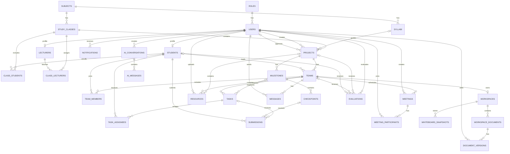

# 01. THIẾT KẾ CƠ SỞ DỮ LIỆU (ERD)

## 1. Giới thiệu

CollabSphere là hệ thống hỗ trợ học tập theo phương pháp Project-Based Learning (PBL). Hệ thống cung cấp các chức năng quản lý tài khoản, môn học, lớp học, dự án, nhóm sinh viên, nhiệm vụ, tiến độ, nộp bài, trao đổi thông tin, không gian làm việc, đánh giá và hỗ trợ AI.

Cơ sở dữ liệu sử dụng **MySQL 8.0** để lưu trữ và quản lý dữ liệu của hệ thống.

Thiết kế cơ sở dữ liệu được chia thành các nhóm chức năng:

- Quản lý tài khoản và phân quyền.
- Quản lý môn học và lớp học.
- Quản lý dự án và nhóm.
- Quản lý nhiệm vụ, tiến độ và bài nộp.
- Quản lý không gian làm việc và trao đổi.
- Quản lý cuộc họp và tài liệu.
- Quản lý đánh giá, thông báo và AI.

---

## 2. Danh sách các thực thể

Cơ sở dữ liệu CollabSphere gồm 29 bảng:

| STT | Tên bảng | Chức năng |
|---:|---|---|
| 1 | roles | Lưu các vai trò trong hệ thống |
| 2 | users | Lưu thông tin tài khoản người dùng |
| 3 | students | Lưu thông tin riêng của sinh viên |
| 4 | lecturers | Lưu thông tin riêng của giảng viên |
| 5 | subjects | Quản lý môn học |
| 6 | syllabi | Quản lý đề cương môn học |
| 7 | study_classes | Quản lý lớp học |
| 8 | class_students | Liên kết sinh viên với lớp học |
| 9 | class_lecturers | Liên kết giảng viên với lớp học |
| 10 | projects | Quản lý dự án PBL |
| 11 | teams | Quản lý nhóm thực hiện dự án |
| 12 | team_members | Quản lý thành viên trong nhóm |
| 13 | milestones | Quản lý các mốc tiến độ |
| 14 | checkpoints | Quản lý các điểm kiểm tra |
| 15 | tasks | Quản lý nhiệm vụ |
| 16 | task_assignees | Liên kết nhiệm vụ với người được giao |
| 17 | submissions | Quản lý bài nộp |
| 18 | resources | Quản lý tài liệu và tài nguyên |
| 19 | meetings | Quản lý cuộc họp |
| 20 | meeting_participants | Quản lý người tham gia cuộc họp |
| 21 | messages | Quản lý tin nhắn trao đổi |
| 22 | workspaces | Quản lý không gian làm việc nhóm |
| 23 | whiteboard_snapshots | Lưu các bản chụp bảng trắng |
| 24 | workspace_documents | Quản lý tài liệu trong không gian làm việc |
| 25 | document_versions | Quản lý phiên bản tài liệu |
| 26 | evaluations | Quản lý đánh giá |
| 27 | notifications | Quản lý thông báo |
| 28 | ai_conversations | Quản lý các cuộc hội thoại với AI |
| 29 | ai_messages | Lưu nội dung tin nhắn trong hội thoại AI |

---

## 3. Sơ đồ ERD

**Chú thích:**

- `||`: Một bản ghi bắt buộc.
- `o|`: Không hoặc một bản ghi.
- `o{`: Không hoặc nhiều bản ghi.
- `|{`: Một hoặc nhiều bản ghi.
- Các bảng trung gian dùng để quản lý quan hệ nhiều - nhiều giữa các thực thể.

---

## 4. Chi tiết các bảng và thuộc tính

### 4.1. roles - Vai trò người dùng

| Thuộc tính | Kiểu dữ liệu | Ràng buộc |
|---|---|---|
| role_id | BIGINT UNSIGNED | PK |
| role_code | VARCHAR(30) | UNIQUE, NOT NULL |
| role_name | VARCHAR(100) | NOT NULL |
| description | TEXT | NULL |
| created_at | TIMESTAMP | NOT NULL |

Chức năng: Lưu các vai trò như Admin, Head, Staff, Lecturer và Student.

### 4.2. users - Tài khoản người dùng

| Thuộc tính | Kiểu dữ liệu | Ràng buộc |
|---|---|---|
| user_id | BIGINT UNSIGNED | PK |
| role_id | BIGINT UNSIGNED | FK → roles.role_id |
| username | VARCHAR(50) | UNIQUE, NOT NULL |
| email | VARCHAR(255) | UNIQUE, NOT NULL |
| password_hash | VARCHAR(255) | NOT NULL |
| full_name | VARCHAR(150) | NOT NULL |
| avatar_url | VARCHAR(500) | NULL |
| phone | VARCHAR(20) | NULL |
| is_active | BOOLEAN | NOT NULL |
| created_at | TIMESTAMP | NOT NULL |
| updated_at | TIMESTAMP | NOT NULL |

Chức năng: Lưu thông tin tài khoản và liên kết tài khoản với vai trò tương ứng.

### 4.3. students - Sinh viên

| Thuộc tính | Kiểu dữ liệu | Ràng buộc |
|---|---|---|
| student_id | BIGINT UNSIGNED | PK |
| user_id | BIGINT UNSIGNED | FK → users.user_id, UNIQUE |
| student_code | VARCHAR(30) | UNIQUE, NOT NULL |

Chức năng: Lưu thông tin riêng của sinh viên, liên kết với tài khoản người dùng.

### 4.4. lecturers - Giảng viên

| Thuộc tính | Kiểu dữ liệu | Ràng buộc |
|---|---|---|
| lecturer_id | BIGINT UNSIGNED | PK |
| user_id | BIGINT UNSIGNED | FK → users.user_id, UNIQUE |
| lecturer_code | VARCHAR(30) | UNIQUE, NOT NULL |

Chức năng: Lưu thông tin riêng của giảng viên.

### 4.5. subjects - Môn học

| Thuộc tính | Kiểu dữ liệu | Ràng buộc |
|---|---|---|
| subject_id | BIGINT UNSIGNED | PK |
| subject_code | VARCHAR(30) | UNIQUE, NOT NULL |
| subject_name | VARCHAR(150) | NOT NULL |
| description | TEXT | NULL |
| created_at | TIMESTAMP | NOT NULL |

Chức năng: Quản lý danh sách môn học được tổ chức trong hệ thống.

### 4.6. syllabi - Đề cương môn học

| Thuộc tính | Kiểu dữ liệu | Ràng buộc |
|---|---|---|
| syllabus_id | BIGINT UNSIGNED | PK |
| subject_id | BIGINT UNSIGNED | FK → subjects.subject_id |
| version | VARCHAR(30) | NOT NULL |
| title | VARCHAR(200) | NOT NULL |
| content | TEXT | NULL |
| created_at | TIMESTAMP | NOT NULL |

Chức năng: Lưu nội dung và các phiên bản đề cương của môn học.

Ràng buộc: Cặp `subject_id` và `version` phải duy nhất.

### 4.7. study_classes - Lớp học

| Thuộc tính | Kiểu dữ liệu | Ràng buộc |
|---|---|---|
| class_id | BIGINT UNSIGNED | PK |
| subject_id | BIGINT UNSIGNED | FK → subjects.subject_id |
| class_code | VARCHAR(30) | UNIQUE, NOT NULL |
| class_name | VARCHAR(150) | NOT NULL |
| semester | VARCHAR(30) | NULL |
| academic_year | VARCHAR(20) | NULL |
| capacity | INT UNSIGNED | NULL |
| status | ENUM | NOT NULL |
| created_at | TIMESTAMP | NOT NULL |

Chức năng: Quản lý các lớp học thuộc từng môn học.

### 4.8. class_students - Sinh viên thuộc lớp

| Thuộc tính | Kiểu dữ liệu | Ràng buộc |
|---|---|---|
| class_id | BIGINT UNSIGNED | PK, FK → study_classes.class_id |
| student_id | BIGINT UNSIGNED | PK, FK → students.student_id |
| enrolled_at | TIMESTAMP | NOT NULL |

Chức năng: Liên kết sinh viên với lớp học.

Khóa chính kép gồm `class_id` và `student_id`, tránh việc một sinh viên được thêm trùng vào cùng một lớp.

### 4.9. class_lecturers - Giảng viên phụ trách lớp

| Thuộc tính | Kiểu dữ liệu | Ràng buộc |
|---|---|---|
| class_id | BIGINT UNSIGNED | PK, FK → study_classes.class_id |
| lecturer_id | BIGINT UNSIGNED | PK, FK → lecturers.lecturer_id |
| assignment_role | VARCHAR(50) | NOT NULL |
| assigned_at | TIMESTAMP | NOT NULL |

Chức năng: Quản lý giảng viên được phân công phụ trách các lớp học.

### 4.10. projects - Dự án PBL

| Thuộc tính | Kiểu dữ liệu | Ràng buộc |
|---|---|---|
| project_id | BIGINT UNSIGNED | PK |
| class_id | BIGINT UNSIGNED | FK → study_classes.class_id |
| syllabus_id | BIGINT UNSIGNED | FK → syllabi.syllabus_id, NULL |
| created_by | BIGINT UNSIGNED | FK → users.user_id |
| title | VARCHAR(200) | NOT NULL |
| description | TEXT | NULL |
| goals | TEXT | NULL |
| expected_outputs | TEXT | NULL |
| requirements | TEXT | NULL |
| start_date | DATE | NULL |
| due_date | DATE | NULL |
| min_group_size | INT UNSIGNED | NOT NULL |
| max_group_size | INT UNSIGNED | NOT NULL |
| status | ENUM | NOT NULL |
| approved_by | BIGINT UNSIGNED | FK → users.user_id, NULL |
| approved_at | DATETIME | NULL |
| created_at | TIMESTAMP | NOT NULL |
| updated_at | TIMESTAMP | NOT NULL |

Chức năng: Quản lý thông tin dự án PBL được tạo trong lớp học.

### 4.11. teams - Nhóm dự án

| Thuộc tính | Kiểu dữ liệu | Ràng buộc |
|---|---|---|
| team_id | BIGINT UNSIGNED | PK |
| project_id | BIGINT UNSIGNED | FK → projects.project_id |
| team_name | VARCHAR(100) | NOT NULL |
| leader_student_id | BIGINT UNSIGNED | FK → students.student_id, NULL |
| description | TEXT | NULL |
| created_at | TIMESTAMP | NOT NULL |

Chức năng: Quản lý các nhóm sinh viên tham gia thực hiện dự án.

### 4.12. team_members - Thành viên nhóm

| Thuộc tính | Kiểu dữ liệu | Ràng buộc |
|---|---|---|
| team_id | BIGINT UNSIGNED | PK, FK → teams.team_id |
| student_id | BIGINT UNSIGNED | PK, FK → students.student_id |
| joined_at | TIMESTAMP | NOT NULL |

Chức năng: Quản lý danh sách sinh viên trong từng nhóm.

Khóa chính kép gồm `team_id` và `student_id`.

### 4.13. milestones - Mốc tiến độ

| Thuộc tính | Kiểu dữ liệu | Ràng buộc |
|---|---|---|
| milestone_id | BIGINT UNSIGNED | PK |
| project_id | BIGINT UNSIGNED | FK → projects.project_id |
| title | VARCHAR(200) | NOT NULL |
| description | TEXT | NULL |
| due_date | DATE | NULL |
| sort_order | INT UNSIGNED | NOT NULL |
| status | ENUM | NOT NULL |
| created_at | TIMESTAMP | NOT NULL |

Chức năng: Chia dự án thành các mốc tiến độ để giảng viên và sinh viên theo dõi quá trình thực hiện.

### 4.14. checkpoints - Điểm kiểm tra tiến độ

| Thuộc tính | Kiểu dữ liệu | Ràng buộc |
|---|---|---|
| checkpoint_id | BIGINT UNSIGNED | PK |
| milestone_id | BIGINT UNSIGNED | FK → milestones.milestone_id |
| title | VARCHAR(200) | NOT NULL |
| description | TEXT | NULL |
| due_date | DATETIME | NULL |
| max_score | DECIMAL(5,2) | NOT NULL |
| status | ENUM | NOT NULL |
| created_at | TIMESTAMP | NOT NULL |

Chức năng: Quản lý các điểm kiểm tra hoặc yêu cầu nộp sản phẩm theo từng mốc tiến độ.

### 4.15. tasks - Nhiệm vụ

| Thuộc tính | Kiểu dữ liệu | Ràng buộc |
|---|---|---|
| task_id | BIGINT UNSIGNED | PK |
| team_id | BIGINT UNSIGNED | FK → teams.team_id |
| milestone_id | BIGINT UNSIGNED | FK → milestones.milestone_id, NULL |
| title | VARCHAR(200) | NOT NULL |
| description | TEXT | NULL |
| deadline | DATETIME | NULL |
| status | ENUM | NOT NULL |
| priority | ENUM | NOT NULL |
| created_at | TIMESTAMP | NOT NULL |
| updated_at | TIMESTAMP | NOT NULL |

Chức năng: Quản lý các công việc cần thực hiện trong từng nhóm.

### 4.16. task_assignees - Người được giao nhiệm vụ

| Thuộc tính | Kiểu dữ liệu | Ràng buộc |
|---|---|---|
| task_id | BIGINT UNSIGNED | PK, FK → tasks.task_id |
| student_id | BIGINT UNSIGNED | PK, FK → students.student_id |
| assigned_at | TIMESTAMP | NOT NULL |

Chức năng: Liên kết nhiệm vụ với một hoặc nhiều sinh viên được giao thực hiện.

Khóa chính kép gồm `task_id` và `student_id`.

### 4.17. submissions - Bài nộp

| Thuộc tính | Kiểu dữ liệu | Ràng buộc |
|---|---|---|
| submission_id | BIGINT UNSIGNED | PK |
| task_id | BIGINT UNSIGNED | FK → tasks.task_id, NULL |
| checkpoint_id | BIGINT UNSIGNED | FK → checkpoints.checkpoint_id, NULL |
| team_id | BIGINT UNSIGNED | FK → teams.team_id |
| submitted_by | BIGINT UNSIGNED | FK → students.student_id |
| content | TEXT | NULL |
| file_url | VARCHAR(1000) | NULL |
| score | DECIMAL(5,2) | NULL |
| feedback | TEXT | NULL |
| submitted_at | TIMESTAMP | NOT NULL |

Chức năng: Lưu bài nộp của sinh viên hoặc nhóm cho nhiệm vụ và checkpoint.

Quy tắc: Mỗi bài nộp phải thuộc một nhiệm vụ hoặc một checkpoint. Không nên để cả hai trường `task_id` và `checkpoint_id` cùng NULL.

### 4.18. resources - Tài liệu và tài nguyên

| Thuộc tính | Kiểu dữ liệu | Ràng buộc |
|---|---|---|
| resource_id | BIGINT UNSIGNED | PK |
| project_id | BIGINT UNSIGNED | FK → projects.project_id, NULL |
| team_id | BIGINT UNSIGNED | FK → teams.team_id, NULL |
| uploaded_by | BIGINT UNSIGNED | FK → users.user_id |
| title | VARCHAR(200) | NOT NULL |
| resource_url | VARCHAR(1000) | NOT NULL |
| resource_type | VARCHAR(50) | NULL |
| created_at | TIMESTAMP | NOT NULL |

Chức năng: Lưu đường dẫn tài liệu, tệp tin và tài nguyên phục vụ dự án hoặc nhóm.

Quy tắc nghiệp vụ: Cần xác định tài liệu thuộc dự án hay nhóm, tránh trường hợp không có đối tượng sở hữu hoặc đồng thời thuộc cả hai nếu hệ thống không cho phép.

### 4.19. meetings - Cuộc họp

| Thuộc tính | Kiểu dữ liệu | Ràng buộc |
|---|---|---|
| meeting_id | BIGINT UNSIGNED | PK |
| team_id | BIGINT UNSIGNED | FK → teams.team_id |
| created_by | BIGINT UNSIGNED | FK → users.user_id |
| title | VARCHAR(200) | NOT NULL |
| description | TEXT | NULL |
| meeting_url | VARCHAR(500) | NULL |
| starts_at | DATETIME | NOT NULL |
| ends_at | DATETIME | NULL |
| created_at | TIMESTAMP | NOT NULL |

Chức năng: Quản lý lịch họp và thông tin cuộc họp của nhóm.

### 4.20. meeting_participants - Người tham gia cuộc họp

| Thuộc tính | Kiểu dữ liệu | Ràng buộc |
|---|---|---|
| meeting_id | BIGINT UNSIGNED | PK, FK → meetings.meeting_id |
| user_id | BIGINT UNSIGNED | PK, FK → users.user_id |
| joined_at | DATETIME | NULL |
| attendance_status | ENUM | NOT NULL |

Chức năng: Lưu danh sách người tham gia và trạng thái tham dự cuộc họp.

### 4.21. messages - Tin nhắn

| Thuộc tính | Kiểu dữ liệu | Ràng buộc |
|---|---|---|
| message_id | BIGINT UNSIGNED | PK |
| team_id | BIGINT UNSIGNED | FK → teams.team_id |
| sender_id | BIGINT UNSIGNED | FK → users.user_id |
| content | TEXT | NOT NULL |
| message_type | ENUM | NOT NULL |
| created_at | TIMESTAMP | NOT NULL |
| updated_at | TIMESTAMP | NOT NULL |

Chức năng: Lưu nội dung trao đổi giữa các thành viên trong nhóm.

### 4.22. workspaces - Không gian làm việc

| Thuộc tính | Kiểu dữ liệu | Ràng buộc |
|---|---|---|
| workspace_id | BIGINT UNSIGNED | PK |
| team_id | BIGINT UNSIGNED | FK → teams.team_id, UNIQUE |
| created_at | TIMESTAMP | NOT NULL |
| updated_at | TIMESTAMP | NOT NULL |

Chức năng: Quản lý không gian làm việc chung của từng nhóm. Mỗi nhóm có tối đa một workspace.

### 4.23. whiteboard_snapshots - Bản lưu bảng trắng

| Thuộc tính | Kiểu dữ liệu | Ràng buộc |
|---|---|---|
| snapshot_id | BIGINT UNSIGNED | PK |
| workspace_id | BIGINT UNSIGNED | FK → workspaces.workspace_id |
| created_by | BIGINT UNSIGNED | FK → users.user_id |
| snapshot_data | JSON | NOT NULL |
| created_at | TIMESTAMP | NOT NULL |

Chức năng: Lưu dữ liệu hoặc ảnh chụp trạng thái bảng trắng của nhóm.

### 4.24. workspace_documents - Tài liệu không gian làm việc

| Thuộc tính | Kiểu dữ liệu | Ràng buộc |
|---|---|---|
| document_id | BIGINT UNSIGNED | PK |
| workspace_id | BIGINT UNSIGNED | FK → workspaces.workspace_id |
| created_by | BIGINT UNSIGNED | FK → users.user_id |
| title | VARCHAR(200) | NOT NULL |
| content | LONGTEXT | NULL |
| created_at | TIMESTAMP | NOT NULL |
| updated_at | TIMESTAMP | NOT NULL |

Chức năng: Quản lý tài liệu dùng chung trong workspace của nhóm.

### 4.25. document_versions - Phiên bản tài liệu

| Thuộc tính | Kiểu dữ liệu | Ràng buộc |
|---|---|---|
| version_id | BIGINT UNSIGNED | PK |
| document_id | BIGINT UNSIGNED | FK → workspace_documents.document_id |
| edited_by | BIGINT UNSIGNED | FK → users.user_id |
| version_number | INT UNSIGNED | NOT NULL |
| content | LONGTEXT | NULL |
| created_at | TIMESTAMP | NOT NULL |

Chức năng: Lưu lịch sử chỉnh sửa và các phiên bản trước đó của tài liệu.

### 4.26. evaluations - Đánh giá

| Thuộc tính | Kiểu dữ liệu | Ràng buộc |
|---|---|---|
| evaluation_id | BIGINT UNSIGNED | PK |
| evaluator_user_id | BIGINT UNSIGNED | FK → users.user_id |
| project_id | BIGINT UNSIGNED | FK → projects.project_id, NULL |
| team_id | BIGINT UNSIGNED | FK → teams.team_id, NULL |
| student_id | BIGINT UNSIGNED | FK → students.student_id, NULL |
| evaluation_type | ENUM | NOT NULL |
| score | DECIMAL(5,2) | NOT NULL |
| comment | TEXT | NULL |
| created_at | TIMESTAMP | NOT NULL |

Chức năng: Lưu kết quả đánh giá dự án, nhóm hoặc cá nhân.

Quy tắc nghiệp vụ: Cần xác định đối tượng được đánh giá theo `evaluation_type` và bảo đảm chỉ chọn đúng đối tượng tương ứng.

### 4.27. notifications - Thông báo

| Thuộc tính | Kiểu dữ liệu | Ràng buộc |
|---|---|---|
| notification_id | BIGINT UNSIGNED | PK |
| user_id | BIGINT UNSIGNED | FK → users.user_id |
| title | VARCHAR(200) | NOT NULL |
| message | TEXT | NOT NULL |
| is_read | BOOLEAN | NOT NULL |
| created_at | TIMESTAMP | NOT NULL |

Chức năng: Lưu thông báo gửi đến từng người dùng, ví dụ thông báo nhiệm vụ mới, deadline và kết quả đánh giá.

### 4.28. ai_conversations - Cuộc hội thoại AI

| Thuộc tính | Kiểu dữ liệu | Ràng buộc |
|---|---|---|
| conversation_id | BIGINT UNSIGNED | PK |
| user_id | BIGINT UNSIGNED | FK → users.user_id |
| title | VARCHAR(200) | NULL |
| created_at | TIMESTAMP | NOT NULL |
| updated_at | TIMESTAMP | NOT NULL |

Chức năng: Quản lý các cuộc hội thoại giữa người dùng và trợ lý AI.

### 4.29. ai_messages - Tin nhắn AI

| Thuộc tính | Kiểu dữ liệu | Ràng buộc |
|---|---|---|
| ai_message_id | BIGINT UNSIGNED | PK |
| conversation_id | BIGINT UNSIGNED | FK → ai_conversations.conversation_id |
| sender_type | ENUM | NOT NULL |
| content | TEXT | NOT NULL |
| created_at | TIMESTAMP | NOT NULL |

Chức năng: Lưu nội dung từng tin nhắn trong một cuộc hội thoại AI, bao gồm nội dung người dùng gửi và phản hồi của AI.

---

## 5. Các mối quan hệ chính

| STT | Bảng thứ nhất | Quan hệ | Bảng thứ hai |
|---:|---|---|---|
| 1 | roles | 1 - N | users |
| 2 | users | 1 - 1 | students |
| 3 | users | 1 - 1 | lecturers |
| 4 | subjects | 1 - N | syllabi |
| 5 | subjects | 1 - N | study_classes |
| 6 | study_classes | N - N | students (qua class_students) |
| 7 | study_classes | N - N | lecturers (qua class_lecturers) |
| 8 | study_classes | 1 - N | projects |
| 9 | projects | 1 - N | teams |
| 10 | projects | 1 - N | milestones |
| 11 | teams | N - N | students (qua team_members) |
| 12 | milestones | 1 - N | checkpoints |
| 13 | teams | 1 - N | tasks |
| 14 | tasks | N - N | students (qua task_assignees) |
| 15 | tasks | 1 - N | submissions |
| 16 | checkpoints | 1 - N | submissions |
| 17 | teams | 1 - 1 | workspaces |
| 18 | teams | 1 - N | meetings |
| 19 | meetings | N - N | users (qua meeting_participants) |
| 20 | teams | 1 - N | messages |
| 21 | workspaces | 1 - N | whiteboard_snapshots |
| 22 | workspaces | 1 - N | workspace_documents |
| 23 | workspace_documents | 1 - N | document_versions |
| 24 | users | 1 - N | evaluations |
| 25 | users | 1 - N | notifications |
| 26 | users | 1 - N | ai_conversations |
| 27 | ai_conversations | 1 - N | ai_messages |

---

## 6. Quy tắc thiết kế cơ sở dữ liệu

1. Mỗi bảng có khóa chính (PK) để định danh duy nhất từng bản ghi.
2. Các khóa ngoại (FK) được sử dụng để liên kết dữ liệu giữa các bảng và đảm bảo tính toàn vẹn tham chiếu.
3. Các bảng trung gian như `class_students`, `class_lecturers`, `team_members`, `task_assignees` và `meeting_participants` sử dụng khóa chính kép để hạn chế dữ liệu liên kết trùng lặp.
4. Các trường như email, username, mã sinh viên, mã giảng viên và mã lớp cần có ràng buộc UNIQUE.
5. Các trường bắt buộc sử dụng NOT NULL.
6. Các trường trạng thái và loại dữ liệu có tập giá trị cố định có thể sử dụng ENUM.
7. Các trường thời gian sử dụng DATE, DATETIME hoặc TIMESTAMP tùy mục đích.
8. Các bảng sử dụng InnoDB để hỗ trợ khóa ngoại và giao dịch.
9. Các trường dữ liệu dạng cấu trúc linh hoạt có thể sử dụng JSON trong MySQL 8.0.
10. Tên bảng, tên cột, kiểu dữ liệu và ràng buộc trong ERD phải thống nhất với file `schema.sql`.

---

## 7. Một số quy tắc nghiệp vụ cần bảo đảm

Ngoài các khóa chính và khóa ngoại, hệ thống cần kiểm tra một số quy tắc nghiệp vụ:

- Sinh viên được thêm vào nhóm phải thuộc lớp học tương ứng với dự án.
- Trưởng nhóm phải là thành viên của nhóm đó.
- Nhiệm vụ được giao cho sinh viên phải thuộc nhóm mà sinh viên tham gia.
- Checkpoint phải thuộc một milestone của dự án tương ứng.
- Bài nộp phải gắn với nhiệm vụ hoặc checkpoint hợp lệ.
- Điểm đánh giá không được nhỏ hơn giá trị tối thiểu hoặc lớn hơn giới hạn cho phép.
- Thời gian kết thúc cuộc họp phải sau thời gian bắt đầu.
- Ngày kết thúc dự án phải phù hợp với ngày bắt đầu dự án.
- Tài liệu cần xác định rõ thuộc dự án hay workspace/nhóm theo quy tắc của hệ thống.

Các quy tắc này có thể cần được kiểm tra bằng CHECK constraint, khóa ngoại bổ sung hoặc logic xử lý ở Backend tùy theo cấu trúc thực tế.

---

## 8. Kết luận

ERD mô tả cấu trúc dữ liệu của hệ thống CollabSphere với 29 bảng, bao gồm các chức năng quản lý tài khoản, môn học, lớp học, dự án PBL, nhóm, nhiệm vụ, tiến độ, bài nộp, workspace, trao đổi, đánh giá, thông báo và hỗ trợ AI.

Thiết kế này là cơ sở để triển khai cơ sở dữ liệu trong file `schema.sql`.

**Lưu ý:** ERD và `schema.sql` phải được kiểm tra đồng bộ về tên bảng, tên cột, kiểu dữ liệu, khóa chính, khóa ngoại và các ràng buộc. Khi thay đổi cấu trúc ở một file, cần cập nhật file còn lại để tránh sai lệch giữa tài liệu thiết kế và cơ sở dữ liệu thực tế.
