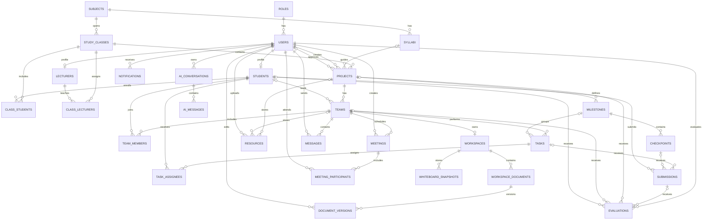

# CollabSphere – Entity Relationship Diagram (ERD)

## 1. Tổng quan

CollabSphere là hệ thống hỗ trợ học tập theo phương pháp Project-Based Learning (PBL).

Cơ sở dữ liệu được thiết kế để quản lý người dùng, môn học, lớp học, đề cương, dự án, nhóm, nhiệm vụ, bài nộp, đánh giá và các hoạt động cộng tác trong quá trình học tập.

Database sử dụng MySQL 8.0, với các bảng được liên kết thông qua khóa chính (PK), khóa ngoại (FK) và các ràng buộc dữ liệu.

## 2. Quy ước

| Ký hiệu | Ý nghĩa |
|---|---|
| PK | Khóa chính |
| FK | Khóa ngoại |
| UQ | Giá trị duy nhất |
| NN | Không được để trống |
| AI | Tự động tăng |

- Mỗi thực thể được biểu diễn bằng một bảng.
- Quan hệ nhiều-nhiều được triển khai bằng bảng trung gian.
- Các trường có hậu tố `_id` thường là khóa ngoại hoặc khóa chính.
- Các trường thời gian sử dụng `TIMESTAMP` hoặc `DATETIME`.
- Các trường dữ liệu dạng JSON sử dụng kiểu `JSON` của MySQL.

## 3. Sơ đồ ERD

## 4. Danh sách thực thể và thuộc tính

### 4.1. Quản lý người dùng

#### ROLES

Lưu thông tin các vai trò trong hệ thống.

| Thuộc tính | Kiểu dữ liệu | Ràng buộc |
|---|---|---|
| role_id | BIGINT UNSIGNED | PK, AI |
| role_code | VARCHAR(30) | UQ, NN |
| role_name | VARCHAR(100) | NN |
| description | TEXT | |
| created_at | TIMESTAMP | NN |

#### USERS

Lưu thông tin tài khoản của người dùng.

| Thuộc tính | Kiểu dữ liệu | Ràng buộc |
|---|---|---|
| user_id | BIGINT UNSIGNED | PK, AI |
| role_id | BIGINT UNSIGNED | FK, NN |
| username | VARCHAR(50) | UQ, NN |
| email | VARCHAR(255) | UQ, NN |
| password_hash | VARCHAR(255) | NN |
| full_name | VARCHAR(150) | NN |
| avatar_url | VARCHAR(500) | |
| phone | VARCHAR(20) | |
| is_active | BOOLEAN | NN |
| created_at | TIMESTAMP | NN |
| updated_at | TIMESTAMP | NN |

#### STUDENTS

Lưu thông tin riêng của sinh viên.

| Thuộc tính | Kiểu dữ liệu | Ràng buộc |
|---|---|---|
| student_id | BIGINT UNSIGNED | PK, AI |
| user_id | BIGINT UNSIGNED | FK, UQ, NN |
| student_code | VARCHAR(30) | UQ, NN |

#### LECTURERS

Lưu thông tin riêng của giảng viên.

| Thuộc tính | Kiểu dữ liệu | Ràng buộc |
|---|---|---|
| lecturer_id | BIGINT UNSIGNED | PK, AI |
| user_id | BIGINT UNSIGNED | FK, UQ, NN |
| lecturer_code | VARCHAR(30) | UQ, NN |

### 4.2. Quản lý môn học và lớp học

#### SUBJECTS

Lưu thông tin môn học.

| Thuộc tính | Kiểu dữ liệu | Ràng buộc |
|---|---|---|
| subject_id | BIGINT UNSIGNED | PK, AI |
| subject_code | VARCHAR(30) | UQ, NN |
| subject_name | VARCHAR(150) | NN |
| description | TEXT | |
| created_at | TIMESTAMP | NN |

#### SYLLABI

Lưu đề cương môn học.

| Thuộc tính | Kiểu dữ liệu | Ràng buộc |
|---|---|---|
| syllabus_id | BIGINT UNSIGNED | PK, AI |
| subject_id | BIGINT UNSIGNED | FK, NN |
| version | VARCHAR(30) | NN |
| title | VARCHAR(200) | NN |
| content | LONGTEXT | |
| created_at | TIMESTAMP | NN |

Ràng buộc: `UNIQUE(subject_id, version)`.

#### STUDY_CLASSES

Lưu thông tin lớp học.

| Thuộc tính | Kiểu dữ liệu | Ràng buộc |
|---|---|---|
| class_id | BIGINT UNSIGNED | PK, AI |
| subject_id | BIGINT UNSIGNED | FK, NN |
| class_code | VARCHAR(30) | UQ, NN |
| class_name | VARCHAR(150) | NN |
| semester | VARCHAR(30) | |
| academic_year | VARCHAR(20) | |
| capacity | INT UNSIGNED | |
| status | ENUM | NN |
| created_at | TIMESTAMP | NN |

`status`: PLANNED, OPEN, CLOSED, ARCHIVED.

#### CLASS_STUDENTS

Bảng trung gian thể hiện sinh viên tham gia lớp học.

| Thuộc tính | Kiểu dữ liệu | Ràng buộc |
|---|---|---|
| class_id | BIGINT UNSIGNED | PK, FK |
| student_id | BIGINT UNSIGNED | PK, FK |
| enrolled_at | TIMESTAMP | NN |

Khóa chính kép: `(class_id, student_id)`.

#### CLASS_LECTURERS

Bảng trung gian thể hiện giảng viên được phân công vào lớp.

| Thuộc tính | Kiểu dữ liệu | Ràng buộc |
|---|---|---|
| class_id | BIGINT UNSIGNED | PK, FK |
| lecturer_id | BIGINT UNSIGNED | PK, FK |
| assignment_role | VARCHAR(50) | NN |
| assigned_at | TIMESTAMP | NN |

Khóa chính kép: `(class_id, lecturer_id)`.

### 4.3. Quản lý dự án và nhóm

#### PROJECTS

Lưu thông tin dự án học tập.

| Thuộc tính | Kiểu dữ liệu | Ràng buộc |
|---|---|---|
| project_id | BIGINT UNSIGNED | PK, AI |
| class_id | BIGINT UNSIGNED | FK, NN |
| syllabus_id | BIGINT UNSIGNED | FK |
| created_by | BIGINT UNSIGNED | FK, NN |
| approved_by | BIGINT UNSIGNED | FK |
| project_name | VARCHAR(200) | NN |
| description | TEXT | |
| objectives | TEXT | |
| expected_outputs | TEXT | |
| requirements | TEXT | |
| start_date | DATE | |
| deadline | DATE | |
| status | ENUM | NN |
| created_at | TIMESTAMP | NN |
| updated_at | TIMESTAMP | NN |

`status`: DRAFT, PENDING, APPROVED, IN_PROGRESS, COMPLETED, CANCELLED.

#### TEAMS

Lưu thông tin nhóm thực hiện dự án.

| Thuộc tính | Kiểu dữ liệu | Ràng buộc |
|---|---|---|
| team_id | BIGINT UNSIGNED | PK, AI |
| project_id | BIGINT UNSIGNED | FK, NN |
| leader_id | BIGINT UNSIGNED | FK |
| team_name | VARCHAR(150) | NN |
| description | TEXT | |
| created_at | TIMESTAMP | NN |

Ràng buộc: `UNIQUE(project_id, team_name)`.

#### TEAM_MEMBERS

Bảng trung gian thể hiện thành viên của nhóm.

| Thuộc tính | Kiểu dữ liệu | Ràng buộc |
|---|---|---|
| team_id | BIGINT UNSIGNED | PK, FK |
| student_id | BIGINT UNSIGNED | PK, FK |
| joined_at | TIMESTAMP | NN |
| member_role | ENUM | NN |

Khóa chính kép: `(team_id, student_id)`.

### 4.4. Quản lý tiến độ và nhiệm vụ

#### MILESTONES

Lưu các mốc tiến độ của dự án.

| Thuộc tính | Kiểu dữ liệu | Ràng buộc |
|---|---|---|
| milestone_id | BIGINT UNSIGNED | PK, AI |
| project_id | BIGINT UNSIGNED | FK, NN |
| milestone_name | VARCHAR(200) | NN |
| description | TEXT | |
| due_date | DATE | |
| status | ENUM | NN |
| created_at | TIMESTAMP | NN |

#### CHECKPOINTS

Lưu các điểm kiểm tra thuộc một milestone.

| Thuộc tính | Kiểu dữ liệu | Ràng buộc |
|---|---|---|
| checkpoint_id | BIGINT UNSIGNED | PK, AI |
| milestone_id | BIGINT UNSIGNED | FK, NN |
| checkpoint_name | VARCHAR(200) | NN |
| description | TEXT | |
| due_date | DATE | |
| status | ENUM | NN |

#### TASKS

Lưu nhiệm vụ của nhóm.

| Thuộc tính | Kiểu dữ liệu | Ràng buộc |
|---|---|---|
| task_id | BIGINT UNSIGNED | PK, AI |
| team_id | BIGINT UNSIGNED | FK, NN |
| milestone_id | BIGINT UNSIGNED | FK |
| task_name | VARCHAR(200) | NN |
| description | TEXT | |
| priority | ENUM | NN |
| status | ENUM | NN |
| start_date | DATE | |
| due_date | DATE | |
| created_at | TIMESTAMP | NN |

#### TASK_ASSIGNEES

Bảng trung gian thể hiện sinh viên được giao nhiệm vụ.

| Thuộc tính | Kiểu dữ liệu | Ràng buộc |
|---|---|---|
| task_id | BIGINT UNSIGNED | PK, FK |
| student_id | BIGINT UNSIGNED | PK, FK |
| assigned_at | TIMESTAMP | NN |

Khóa chính kép: `(task_id, student_id)`.

### 4.5. Bài nộp và tài nguyên

#### SUBMISSIONS

Lưu bài nộp của sinh viên.

| Thuộc tính | Kiểu dữ liệu | Ràng buộc |
|---|---|---|
| submission_id | BIGINT UNSIGNED | PK, AI |
| task_id | BIGINT UNSIGNED | FK |
| checkpoint_id | BIGINT UNSIGNED | FK |
| student_id | BIGINT UNSIGNED | FK, NN |
| submission_url | VARCHAR(1000) | |
| content | LONGTEXT | |
| submitted_at | TIMESTAMP | NN |
| status | ENUM | NN |

Ràng buộc: bài nộp phải có `task_id` hoặc `checkpoint_id`.

#### RESOURCES

Lưu tài nguyên phục vụ dự án và nhóm.

| Thuộc tính | Kiểu dữ liệu | Ràng buộc |
|---|---|---|
| resource_id | BIGINT UNSIGNED | PK, AI |
| project_id | BIGINT UNSIGNED | FK |
| team_id | BIGINT UNSIGNED | FK |
| uploaded_by | BIGINT UNSIGNED | FK, NN |
| resource_name | VARCHAR(200) | NN |
| resource_url | VARCHAR(1000) | NN |
| resource_type | VARCHAR(50) | |
| created_at | TIMESTAMP | NN |

Ràng buộc: tài nguyên phải thuộc dự án hoặc nhóm.

### 4.6. Họp nhóm và trao đổi

#### MEETINGS

Lưu thông tin cuộc họp nhóm.

| Thuộc tính | Kiểu dữ liệu | Ràng buộc |
|---|---|---|
| meeting_id | BIGINT UNSIGNED | PK, AI |
| team_id | BIGINT UNSIGNED | FK, NN |
| created_by | BIGINT UNSIGNED | FK, NN |
| meeting_title | VARCHAR(200) | NN |
| description | TEXT | |
| meeting_url | VARCHAR(1000) | |
| start_time | DATETIME | NN |
| end_time | DATETIME | |
| created_at | TIMESTAMP | NN |

#### MEETING_PARTICIPANTS

Bảng trung gian thể hiện người tham gia cuộc họp.

| Thuộc tính | Kiểu dữ liệu | Ràng buộc |
|---|---|---|
| meeting_id | BIGINT UNSIGNED | PK, FK |
| user_id | BIGINT UNSIGNED | PK, FK |
| joined_at | TIMESTAMP | |
| attendance_status | ENUM | NN |

#### MESSAGES

Lưu tin nhắn trong nhóm.

| Thuộc tính | Kiểu dữ liệu | Ràng buộc |
|---|---|---|
| message_id | BIGINT UNSIGNED | PK, AI |
| team_id | BIGINT UNSIGNED | FK, NN |
| sender_id | BIGINT UNSIGNED | FK, NN |
| content | TEXT | NN |
| sent_at | TIMESTAMP | NN |
| edited_at | TIMESTAMP | |

### 4.7. Không gian làm việc

#### WORKSPACES

Lưu không gian làm việc của nhóm.

| Thuộc tính | Kiểu dữ liệu | Ràng buộc |
|---|---|---|
| workspace_id | BIGINT UNSIGNED | PK, AI |
| team_id | BIGINT UNSIGNED | FK, UQ, NN |
| workspace_name | VARCHAR(200) | NN |
| created_at | TIMESTAMP | NN |

#### WHITEBOARD_SNAPSHOTS

Lưu các bản chụp bảng trắng.

| Thuộc tính | Kiểu dữ liệu | Ràng buộc |
|---|---|---|
| snapshot_id | BIGINT UNSIGNED | PK, AI |
| workspace_id | BIGINT UNSIGNED | FK, NN |
| snapshot_name | VARCHAR(200) | |
| snapshot_data | JSON | NN |
| created_at | TIMESTAMP | NN |

#### WORKSPACE_DOCUMENTS

Lưu tài liệu trong không gian làm việc.

| Thuộc tính | Kiểu dữ liệu | Ràng buộc |
|---|---|---|
| document_id | BIGINT UNSIGNED | PK, AI |
| workspace_id | BIGINT UNSIGNED | FK, NN |
| document_name | VARCHAR(200) | NN |
| document_type | VARCHAR(50) | |
| created_at | TIMESTAMP | NN |
| updated_at | TIMESTAMP | NN |

#### DOCUMENT_VERSIONS

Lưu các phiên bản tài liệu.

| Thuộc tính | Kiểu dữ liệu | Ràng buộc |
|---|---|---|
| version_id | BIGINT UNSIGNED | PK, AI |
| document_id | BIGINT UNSIGNED | FK, NN |
| edited_by | BIGINT UNSIGNED | FK, NN |
| version_number | INT UNSIGNED | NN |
| file_url | VARCHAR(1000) | |
| content | LONGTEXT | |
| created_at | TIMESTAMP | NN |

Ràng buộc: `UNIQUE(document_id, version_number)`.

### 4.8. Đánh giá và thông báo

#### EVALUATIONS

Lưu kết quả đánh giá.

| Thuộc tính | Kiểu dữ liệu | Ràng buộc |
|---|---|---|
| evaluation_id | BIGINT UNSIGNED | PK, AI |
| evaluator_id | BIGINT UNSIGNED | FK, NN |
| submission_id | BIGINT UNSIGNED | FK |
| project_id | BIGINT UNSIGNED | FK |
| team_id | BIGINT UNSIGNED | FK |
| student_id | BIGINT UNSIGNED | FK |
| score | DECIMAL(5,2) | |
| comments | TEXT | |
| evaluated_at | TIMESTAMP | NN |

Ràng buộc: chỉ được chọn đúng một đối tượng cần đánh giá.

#### NOTIFICATIONS

Lưu thông báo của người dùng.

| Thuộc tính | Kiểu dữ liệu | Ràng buộc |
|---|---|---|
| notification_id | BIGINT UNSIGNED | PK, AI |
| user_id | BIGINT UNSIGNED | FK, NN |
| title | VARCHAR(200) | NN |
| content | TEXT | |
| notification_type | VARCHAR(50) | |
| is_read | BOOLEAN | NN |
| created_at | TIMESTAMP | NN |

### 4.9. Trợ lý AI

#### AI_CONVERSATIONS

Lưu các cuộc hội thoại với AI.

| Thuộc tính | Kiểu dữ liệu | Ràng buộc |
|---|---|---|
| conversation_id | BIGINT UNSIGNED | PK, AI |
| user_id | BIGINT UNSIGNED | FK, NN |
| conversation_title | VARCHAR(200) | |
| created_at | TIMESTAMP | NN |

#### AI_MESSAGES

Lưu tin nhắn trong cuộc hội thoại AI.

| Thuộc tính | Kiểu dữ liệu | Ràng buộc |
|---|---|---|
| ai_message_id | BIGINT UNSIGNED | PK, AI |
| conversation_id | BIGINT UNSIGNED | FK, NN |
| sender_type | ENUM | NN |
| content | LONGTEXT | NN |
| created_at | TIMESTAMP | NN |

## 5. Các quan hệ chính

| Quan hệ | Loại |
|---|---|
| ROLES – USERS | 1:N |
| USERS – STUDENTS | 1:0..1 |
| USERS – LECTURERS | 1:0..1 |
| SUBJECTS – SYLLABI | 1:N |
| SUBJECTS – STUDY_CLASSES | 1:N |
| STUDY_CLASSES – STUDENTS | N:M |
| STUDY_CLASSES – LECTURERS | N:M |
| STUDY_CLASSES – PROJECTS | 1:N |
| PROJECTS – TEAMS | 1:N |
| TEAMS – STUDENTS | N:M |
| PROJECTS – MILESTONES | 1:N |
| MILESTONES – CHECKPOINTS | 1:N |
| TEAMS – TASKS | 1:N |
| TASKS – STUDENTS | N:M |
| TASKS – SUBMISSIONS | 1:N |
| CHECKPOINTS – SUBMISSIONS | 1:N |
| TEAMS – MEETINGS | 1:N |
| TEAMS – MESSAGES | 1:N |
| TEAMS – WORKSPACES | 1:0..1 |
| WORKSPACES – DOCUMENTS | 1:N |
| DOCUMENTS – DOCUMENT_VERSIONS | 1:N |
| USERS – NOTIFICATIONS | 1:N |
| USERS – AI_CONVERSATIONS | 1:N |
| AI_CONVERSATIONS – AI_MESSAGES | 1:N |

## 6. Nguyên tắc toàn vẹn dữ liệu

- Các khóa chính phải duy nhất và không được để trống.
- Các khóa ngoại phải tham chiếu đến bản ghi tồn tại.
- Không cho phép tạo sinh viên hoặc giảng viên trùng mã.
- Một sinh viên không được ghi danh trùng lớp.
- Một sinh viên không được tham gia cùng nhóm nhiều lần.
- Một nhiệm vụ không được giao cho cùng sinh viên nhiều lần.
- Điểm đánh giá nằm trong khoảng từ 0 đến 100.
- Ngày kết thúc không được trước ngày bắt đầu.
- Các quan hệ nhiều-nhiều được quản lý thông qua bảng trung gian.

## 7. Đối chiếu với schema.sql

File `schema.sql` triển khai các thực thể và quan hệ được mô tả trong tài liệu này.

Các bảng trung gian sử dụng khóa chính kép. Các bảng nghiệp vụ sử dụng khóa ngoại để bảo đảm tính toàn vẹn tham chiếu.

Một số điều kiện nghiệp vụ cần được kiểm tra trong backend, chẳng hạn:

- Sinh viên được giao nhiệm vụ phải thuộc nhóm thực hiện nhiệm vụ.
- Sinh viên nộp bài phải thuộc lớp học của dự án.
- Nhóm phải thuộc đúng dự án và lớp học.
- Người đánh giá phải có quyền đánh giá đối tượng tương ứng.
