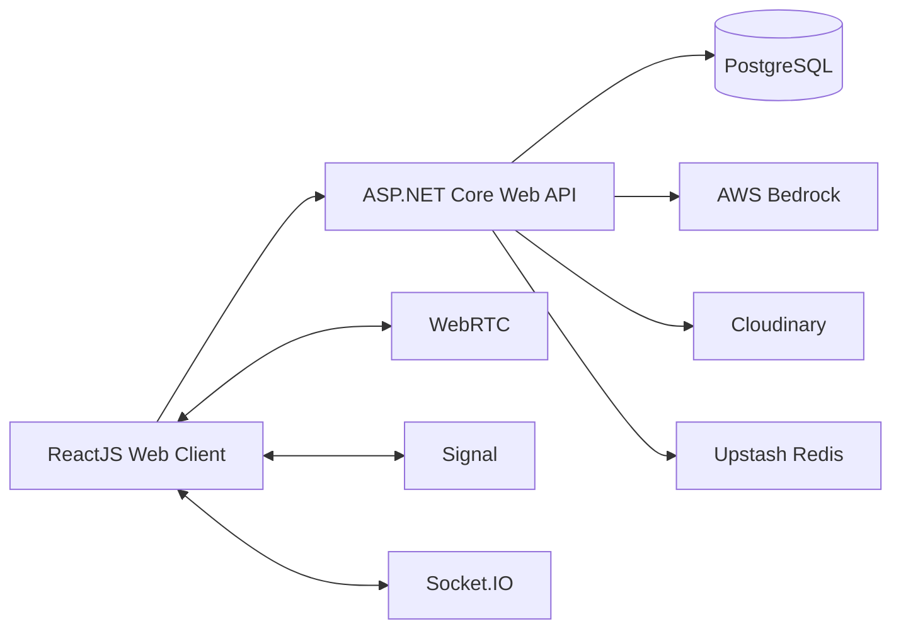

# System Architecture



## Layering Backend

```text
API / Controllers
        ↓
Application / Services
        ↓
Domain / Entities
        ↓
Infrastructure / EF Core
        ↓
PostgreSQL
```

## Frontend

```text
src/
  app/
  components/
  layouts/
  pages/
  features/
  services/
  hooks/
  types/
```

## Backend

```text
backend/
  CollabSphere.Api/
  CollabSphere.Application/
  CollabSphere.Domain/
  CollabSphere.Infrastructure/
```

Tên project có thể điều chỉnh khi nhóm tạo solution, nhưng phải thống nhất trước khi merge.
