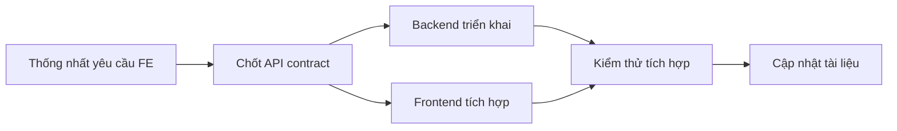

# Hướng dẫn thống nhất hợp đồng API

Tài liệu này bổ sung quy ước để nhóm chuyển các tài liệu FE thành code.

## Quy ước đề xuất

- API dùng tiền tố `/api`.
- Dữ liệu gửi/nhận dùng JSON, trừ endpoint tải tệp.
- Endpoint cần xác thực phải kiểm tra người dùng hiện tại và role trước khi thực hiện nghiệp vụ.
- Trả lỗi theo một cấu trúc thống nhất.

### Ví dụ phản hồi thành công

```json
{
  "success": true,
  "data": {},
  "message": "Thao tác thành công"
}
```

### Ví dụ phản hồi lỗi

```json
{
  "success": false,
  "error": {
    "code": "FORBIDDEN",
    "message": "Bạn không có quyền thực hiện thao tác này."
  }
}
```

## Quy trình tích hợp

1. Nhóm thống nhất endpoint, request, response và role được phép.
2. Backend triển khai và kiểm thử API.
3. Frontend tích hợp theo hợp đồng đã thống nhất.
4. Cập nhật tài liệu nếu nhóm thay đổi hợp đồng API.


