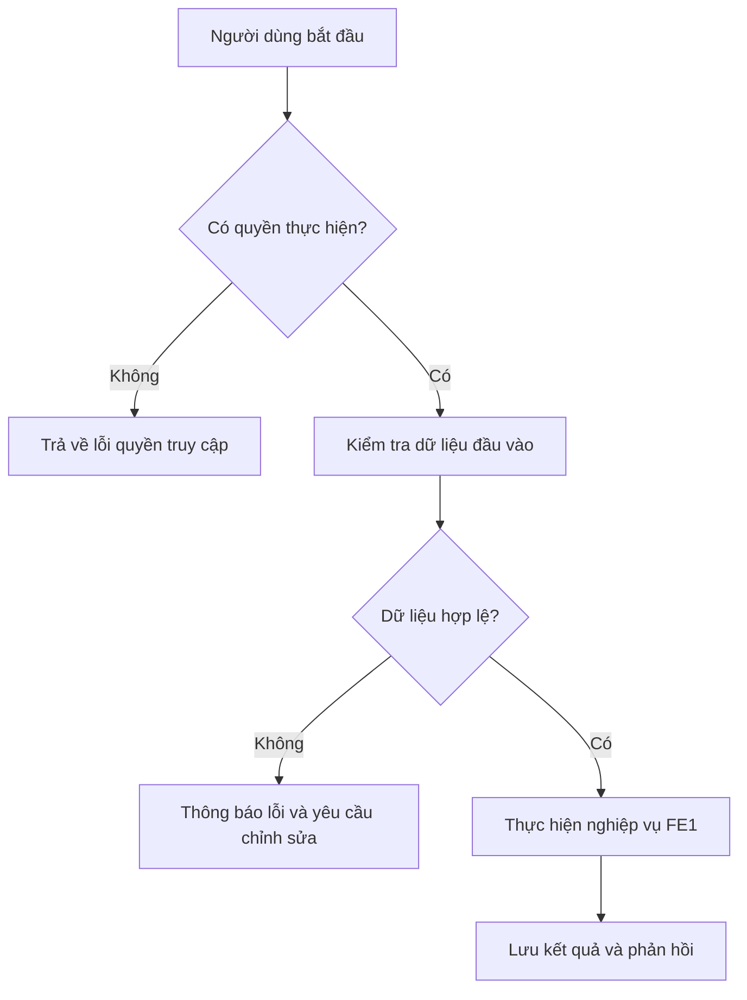

# FE1. Quản lý tài khoản và phân quyền

## 1. Mục tiêu

Quản lý tài khoản người dùng theo các vai trò Admin, Head Department, Staff, Lecturer và Student; Admin có thể xem tài khoản và vô hiệu hóa tài khoản, Staff quản lý tài khoản Lecturer/Student được phân công.

## 2. Vai trò liên quan

Admin, Staff

## 3. Luồng nghiệp vụ

1. Người dùng có quyền mở danh sách tài khoản.
2. Hệ thống kiểm tra quyền truy cập.
3. Hệ thống trả về danh sách hoặc chi tiết tài khoản.
4. Khi Admin vô hiệu hóa tài khoản, hệ thống cập nhật trạng thái và ghi nhận kết quả.

## 4. Quy tắc nghiệp vụ

- Chỉ Admin được vô hiệu hóa tài khoản theo yêu cầu hiện tại.
- Staff chỉ quản lý các tài khoản thuộc phạm vi nghiệp vụ được giao.
- Không cho phép người không có quyền thực hiện thao tác quản trị.

## 5. API dự kiến

> Đây là hợp đồng API đề xuất để nhóm thống nhất trước khi code, chưa xác nhận là đã được triển khai.

| Phương thức | Endpoint | Mục đích |
|---|---|---|
| `GET` | `/api/users` | Xem danh sách tài khoản |
| `GET` | `/api/users/{id}` | Xem chi tiết tài khoản |
| `PATCH` | `/api/users/{id}/status` | Cập nhật trạng thái tài khoản |

### Ví dụ dữ liệu JSON

```json
{
  "isActive": false
}
```

## 6. Sơ đồ luồng chức năng



## 7. Tiêu chí nghiệm thu

- Người dùng có quyền thực hiện được các thao tác được mô tả trong tài liệu.
- Người dùng không có quyền bị từ chối truy cập hoặc thao tác.
- Dữ liệu không hợp lệ được báo lỗi rõ ràng và không làm sai lệch dữ liệu đã lưu.
- Kết quả thao tác được trả về để giao diện hiển thị cho người dùng.
