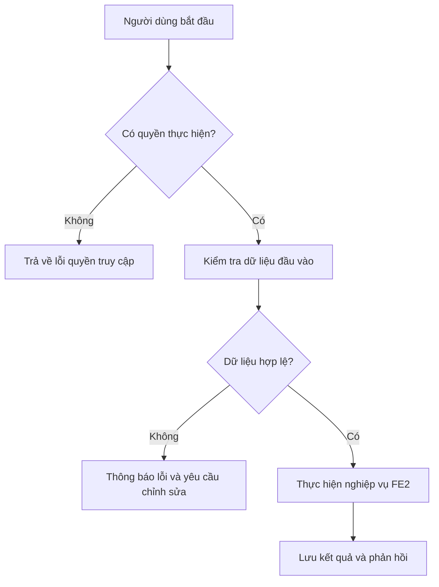

# FE2. Quản lý môn học và đề cương

## 1. Mục tiêu

Cho phép Staff nhập tệp để tạo dữ liệu môn học và syllabus, xem danh sách/chi tiết và quản lý dữ liệu môn học, đề cương trong hệ thống.

## 2. Vai trò liên quan

Staff

## 3. Luồng nghiệp vụ

1. Staff chọn tệp dữ liệu cần nhập.
2. Hệ thống kiểm tra định dạng và dữ liệu bắt buộc.
3. Hệ thống báo các dòng không hợp lệ hoặc lưu dữ liệu hợp lệ.
4. Staff xem lại danh sách môn học và syllabus đã nhập.

## 4. Quy tắc nghiệp vụ

- Chỉ Staff được thực hiện chức năng nhập và quản lý theo phạm vi đề tài.
- Dữ liệu nhập cần có các trường bắt buộc theo mẫu thống nhất của nhóm.
- Không tự động ghi dữ liệu nếu tệp không vượt qua bước kiểm tra.

## 5. API dự kiến

> Đây là hợp đồng API đề xuất để nhóm thống nhất trước khi code, chưa xác nhận là đã được triển khai.

| Phương thức | Endpoint | Mục đích |
|---|---|---|
| `POST` | `/api/subjects/import` | Nhập dữ liệu môn học |
| `GET` | `/api/subjects` | Danh sách môn học |
| `GET` | `/api/subjects/{id}/syllabus` | Xem đề cương của môn học |
| `POST` | `/api/syllabi/import` | Nhập dữ liệu syllabus |

### Ví dụ dữ liệu JSON

```json
{
  "subjectCode": "COSRE101",
  "subjectName": "Project-Based Learning",
  "syllabusFile": "syllabus.csv"
}
```

## 6. Sơ đồ luồng chức năng



## 7. Tiêu chí nghiệm thu

- Người dùng có quyền thực hiện được các thao tác được mô tả trong tài liệu.
- Người dùng không có quyền bị từ chối truy cập hoặc thao tác.
- Dữ liệu không hợp lệ được báo lỗi rõ ràng và không làm sai lệch dữ liệu đã lưu.
- Kết quả thao tác được trả về để giao diện hiển thị cho người dùng.
