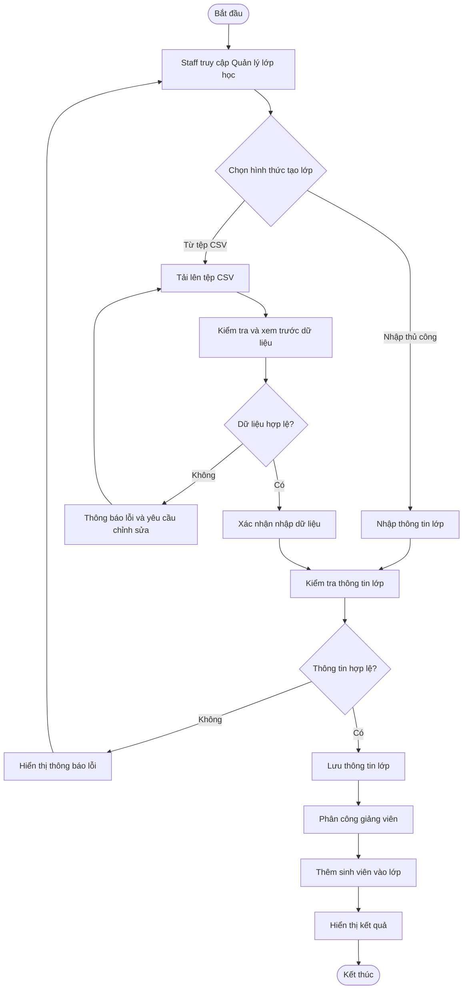
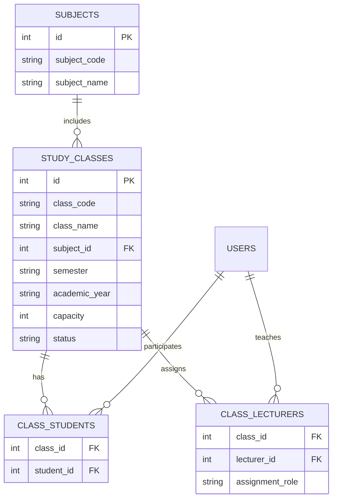

# FE03 – QUẢN LÝ LỚP HỌC

> **Mã chức năng:** FE03  
> **Tên chức năng:** Quản lý lớp học  
> **Hệ thống:** CollabSphere – Hệ thống hỗ trợ học tập theo phương pháp Project-Based Learning (PBL)  
> **Tác nhân chính:** Staff

---

## 1. Tổng quan chức năng

### 1.1. Mục tiêu

Chức năng Quản lý lớp học cho phép Staff tạo lớp từ tệp dữ liệu, quản lý thông tin lớp, quản lý danh sách sinh viên và phân công giảng viên phụ trách. Chức năng giúp tập trung dữ liệu lớp học, giảm thao tác thủ công và hỗ trợ tổ chức hoạt động học tập theo phương pháp Project-Based Learning (PBL).

### 1.2. Phạm vi chức năng

| Mã | Chức năng | Mô tả |
|---|---|---|
| FE03.01 | Nhập dữ liệu lớp | Tạo lớp từ tệp CSV và kiểm tra dữ liệu trước khi lưu |
| FE03.02 | Quản lý thông tin lớp | Tạo mới, xem, tìm kiếm và cập nhật thông tin lớp |
| FE03.03 | Quản lý sinh viên | Thêm, xem và gỡ sinh viên khỏi lớp |
| FE03.04 | Phân công giảng viên | Phân công, xem và thay đổi giảng viên phụ trách |

### 1.3. Đối tượng sử dụng

| Vai trò | Quyền hạn |
|---|---|
| **Staff** | Tạo lớp, nhập dữ liệu, cập nhật thông tin, quản lý sinh viên và phân công giảng viên |
| **Lecturer** | Xem các lớp được phân công và thực hiện hoạt động giảng dạy trong phạm vi quyền hạn |
| **Student** | Xem thông tin lớp được tham gia và thực hiện hoạt động học tập |
| **Admin** | Quản lý quyền truy cập và hỗ trợ xử lý các vấn đề về tài khoản, phân quyền |

---

## 2. Mô tả chi tiết chức năng

### 2.1. Nhập dữ liệu lớp từ tệp CSV

**Mục đích:** Hỗ trợ Staff tạo lớp và nhập dữ liệu nhanh chóng từ tệp có cấu trúc thống nhất.

**Các bước thực hiện:**

1. Staff chọn chức năng nhập dữ liệu lớp.
2. Tải lên tệp CSV theo mẫu quy định.
3. Hệ thống kiểm tra định dạng và nội dung dữ liệu.
4. Hiển thị dữ liệu hợp lệ và các dòng có lỗi.
5. Staff kiểm tra và xác nhận nhập dữ liệu.
6. Hệ thống lưu dữ liệu theo quy tắc nghiệp vụ.

**Yêu cầu xử lý:**

- Kiểm tra các trường bắt buộc.
- Phát hiện mã lớp bị trùng.
- Kiểm tra mã môn học và tài khoản liên quan.
- Thông báo dòng, cột và nguyên nhân gây lỗi.
- Chỉ thực hiện lưu sau khi Staff xác nhận.
- Hạn chế tình trạng dữ liệu được tạo một phần khi quá trình nhập gặp lỗi.

### 2.2. Quản lý thông tin lớp

Staff có thể thực hiện các thao tác sau:

- Tạo lớp học mới.
- Xem danh sách và chi tiết lớp học.
- Tìm kiếm lớp theo mã lớp, tên lớp, môn học hoặc học kỳ.
- Cập nhật thông tin lớp.
- Thay đổi trạng thái hoạt động của lớp.
- Lưu trữ lớp không còn hoạt động theo quy định của hệ thống.

**Thông tin lớp học gồm:**

| Trường dữ liệu | Mô tả |
|---|---|
| `class_code` | Mã lớp, không được trùng |
| `class_name` | Tên lớp |
| `subject_code` | Mã môn học |
| `semester` | Học kỳ |
| `academic_year` | Năm học |
| `capacity` | Sĩ số tối đa |
| `schedule` | Lịch học |
| `room` | Phòng học |
| `status` | Trạng thái lớp |

### 2.3. Quản lý sinh viên trong lớp

Staff có thể quản lý danh sách sinh viên tham gia lớp học.

Các thao tác chính:

- Thêm sinh viên vào lớp.
- Xem danh sách sinh viên của lớp.
- Gỡ sinh viên khỏi lớp theo quyền được cấp.
- Nhập danh sách sinh viên từ tệp dữ liệu.
- Kiểm tra tài khoản sinh viên có tồn tại hay không.
- Kiểm tra sinh viên đã được thêm vào lớp trước đó hay chưa.

**Kết quả mong đợi:** Danh sách thành viên được cập nhật chính xác, không phát sinh sinh viên trùng trong cùng một lớp.

### 2.4. Phân công giảng viên

Staff thực hiện phân công giảng viên phụ trách lớp học.

Các thao tác chính:

- Thêm giảng viên vào lớp.
- Xem danh sách giảng viên được phân công.
- Thay đổi hoặc gỡ phân công.
- Phân biệt giảng viên chính và giảng viên hỗ trợ nếu nghiệp vụ yêu cầu.

Hệ thống cần kiểm tra tài khoản giảng viên hợp lệ và bảo đảm thao tác được thực hiện bởi người có quyền phù hợp.

---

## 3. Quy trình nghiệp vụ



---

## 4. Quy tắc nghiệp vụ

| Mã | Quy tắc |
|---|---|
| BR03.01 | Chỉ người dùng có quyền phù hợp mới được tạo và cập nhật lớp |
| BR03.02 | Mã lớp phải duy nhất trong hệ thống |
| BR03.03 | Môn học được gán cho lớp phải tồn tại |
| BR03.04 | Giảng viên và sinh viên phải có tài khoản hợp lệ |
| BR03.05 | Một sinh viên không được thêm trùng vào cùng một lớp |
| BR03.06 | Không vượt quá sĩ số tối đa nếu lớp có quy định giới hạn |
| BR03.07 | Dữ liệu từ tệp phải được kiểm tra trước khi lưu |
| BR03.08 | Hệ thống phải thông báo rõ nguyên nhân khi dữ liệu không hợp lệ |
| BR03.09 | Lớp có dữ liệu liên quan nên được lưu trữ hoặc ngừng hoạt động thay vì xóa trực tiếp |

---

## 5. API đề xuất

> **Lưu ý:** Các endpoint dưới đây là thiết kế đề xuất cho chức năng FE03, cần đối chiếu với backend thực tế trước khi triển khai.

| Phương thức | Endpoint | Mục đích |
|---|---|---|
| `GET` | `/api/classes` | Lấy danh sách lớp |
| `POST` | `/api/classes` | Tạo lớp mới |
| `GET` | `/api/classes/{classId}` | Xem chi tiết lớp |
| `PATCH` | `/api/classes/{classId}` | Cập nhật thông tin lớp |
| `PATCH` | `/api/classes/{classId}/status` | Cập nhật trạng thái lớp |
| `POST` | `/api/classes/import/preview` | Kiểm tra và xem trước dữ liệu CSV |
| `POST` | `/api/classes/import/confirm` | Xác nhận nhập dữ liệu |
| `GET` | `/api/classes/{classId}/students` | Lấy danh sách sinh viên |
| `POST` | `/api/classes/{classId}/students` | Thêm sinh viên vào lớp |
| `DELETE` | `/api/classes/{classId}/students/{studentId}` | Gỡ sinh viên khỏi lớp |
| `POST` | `/api/classes/{classId}/students/import` | Nhập sinh viên từ tệp |
| `GET` | `/api/classes/{classId}/lecturers` | Lấy danh sách giảng viên |
| `POST` | `/api/classes/{classId}/lecturers` | Phân công giảng viên |
| `DELETE` | `/api/classes/{classId}/lecturers/{lecturerId}` | Gỡ phân công giảng viên |

### 5.1. Ví dụ dữ liệu tạo lớp

```json
{
  "class_code": "IT001",
  "class_name": "Lap trinh C++ - Nhom 1",
  "subject_code": "IT101",
  "semester": "HK1",
  "academic_year": "2026-2027",
  "capacity": 40,
  "schedule": "Thu 2, tiet 1-3",
  "room": "A101"
}
```

### 5.2. Ví dụ phân công giảng viên

```json
{
  "lecturer_id": 12,
  "assignment_role": "primary"
}
```

### 5.3. Ví dụ thêm sinh viên vào lớp

```json
{
  "student_ids": [101, 102, 103]
}
```

---

## 6. Mô hình dữ liệu đề xuất

Các bảng dưới đây là gợi ý thiết kế, cần được đối chiếu với ERD và `database/schema.sql` chính thức của dự án.

| Bảng | Vai trò |
|---|---|
| `study_classes` | Lưu thông tin lớp học |
| `subjects` | Lưu thông tin môn học |
| `users` | Lưu thông tin tài khoản người dùng |
| `class_students` | Liên kết sinh viên với lớp |
| `class_lecturers` | Liên kết giảng viên với lớp |
| `class_import_batches` | Có thể dùng để theo dõi các lần nhập dữ liệu |

### 6.1. Sơ đồ quan hệ đề xuất



---

## 7. Tiêu chí nghiệm thu

- [ ] Staff tạo được lớp bằng cách nhập thông tin thủ công.
- [ ] Staff tải lên tệp CSV và xem trước dữ liệu trước khi lưu.
- [ ] Hệ thống phát hiện mã lớp trùng và dữ liệu không hợp lệ.
- [ ] Staff xem, tìm kiếm và cập nhật được thông tin lớp.
- [ ] Staff thêm và gỡ được sinh viên khỏi lớp theo quyền hạn.
- [ ] Staff phân công và gỡ phân công giảng viên theo quyền hạn.
- [ ] Hệ thống không cho phép thêm trùng sinh viên vào cùng một lớp.
- [ ] Người dùng không có quyền không thể thực hiện thao tác quản lý lớp.
- [ ] Hệ thống thông báo rõ ràng khi thao tác thành công hoặc thất bại.

---

## 8. Kịch bản kiểm thử

| Mã | Trường hợp kiểm thử | Kết quả mong đợi |
|---|---|---|
| TC03.01 | Tạo lớp với dữ liệu hợp lệ | Tạo lớp thành công |
| TC03.02 | Tạo lớp có mã bị trùng | Từ chối và thông báo lỗi |
| TC03.03 | Nhập tệp CSV đúng định dạng | Hiển thị dữ liệu xem trước |
| TC03.04 | Nhập tệp có dữ liệu sai | Hiển thị lỗi cụ thể |
| TC03.05 | Thêm sinh viên hợp lệ | Sinh viên được thêm vào lớp |
| TC03.06 | Thêm sinh viên đã thuộc lớp | Không tạo thành viên trùng |
| TC03.07 | Phân công giảng viên hợp lệ | Phân công thành công |
| TC03.08 | Người dùng không có quyền sửa lớp | Từ chối thao tác |
| TC03.09 | Cập nhật thông tin lớp | Thông tin mới được lưu |

---

## 9. Kế hoạch triển khai

1. Xây dựng giao diện danh sách và chi tiết lớp học.
2. Xây dựng chức năng tạo, xem, sửa và quản lý trạng thái lớp.
3. Xây dựng chức năng nhập dữ liệu từ CSV.
4. Xây dựng chức năng quản lý sinh viên trong lớp.
5. Xây dựng chức năng phân công giảng viên.
6. Kết nối API với cơ sở dữ liệu.
7. Kiểm tra phân quyền và dữ liệu đầu vào.
8. Kiểm thử các trường hợp thành công và thất bại.

---

## 10. Tài liệu liên quan

- [FE01 – Quản lý tài khoản người dùng](FE01-user-account-management.md)
- [FE02 – Quản lý môn học và đề cương](FE02-subject-syllabus-management.md)
- [FE04 – Quản lý dự án](FE04-project-management.md)
- [FE05 – Quản lý nhóm và thành viên](FE05-team-management.md)
- [FE12 – Quản lý phân quyền](FE12-authorization.md)

> **Ghi chú:** Tên file liên kết cần được kiểm tra theo tên file thực tế trong thư mục `docs`. Mô hình dữ liệu và API cần được đồng bộ với thiết kế và mã nguồn hiện có của CollabSphere.

