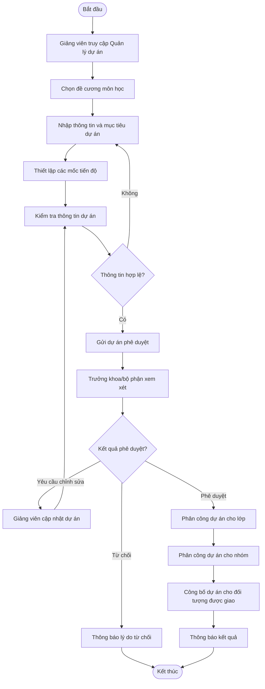

# FE04 – Quản lý dự án

## 1. Quản lý dự án

### 1.1. Tạo dự án
- Tạo dự án mới từ đề cương môn học.
- Chọn đề cương môn học phù hợp.
- Nhập tên và mô tả dự án.
- Thiết lập mục tiêu dự án.
- Nhập yêu cầu và nội dung thực hiện.
- Thiết lập thời gian bắt đầu và kết thúc.
- Lưu dự án dưới dạng bản nháp.
- Chỉnh sửa thông tin dự án trước khi gửi phê duyệt.

### 1.2. Danh sách dự án
- Hiển thị danh sách dự án do giảng viên tạo.
- Hiển thị tên dự án và đề cương môn học liên quan.
- Hiển thị thời gian thực hiện.
- Hiển thị trạng thái phê duyệt.
- Hiển thị trạng thái thực hiện.
- Tìm kiếm dự án theo tên.
- Lọc dự án theo môn học và trạng thái.
- Xem thông tin chi tiết dự án.

### 1.3. Quản lý thông tin dự án
- Xem thông tin chi tiết dự án.
- Cập nhật tên và mô tả dự án.
- Chỉnh sửa mục tiêu và yêu cầu thực hiện.
- Cập nhật thời gian thực hiện.
- Lưu thông tin sau khi chỉnh sửa.
- Kiểm tra dữ liệu trước khi lưu.
- Chỉ cho phép chỉnh sửa theo trạng thái dự án và quyền hạn.

### 1.4. Quản lý mốc tiến độ (Milestone)
- Tạo mốc tiến độ cho dự án.
- Nhập tên và mô tả từng mốc.
- Thiết lập thời hạn hoàn thành.
- Sắp xếp thứ tự các mốc tiến độ.
- Cập nhật thông tin mốc tiến độ.
- Xóa mốc tiến độ khi phù hợp.
- Hiển thị danh sách milestone theo thời gian.
- Kiểm tra thời hạn milestone nằm trong khoảng thời gian thực hiện dự án.

### 1.5. Gửi dự án phê duyệt
- Kiểm tra thông tin dự án trước khi gửi.
- Kiểm tra mục tiêu, yêu cầu và các mốc tiến độ.
- Gửi dự án đến Trưởng khoa/bộ phận.
- Cập nhật trạng thái phê duyệt thành chờ duyệt.
- Theo dõi kết quả phê duyệt.
- Xem ý kiến phản hồi từ người phê duyệt.
- Chỉnh sửa dự án theo yêu cầu.
- Gửi lại dự án sau khi chỉnh sửa.

### 1.6. Phê duyệt dự án
- Hiển thị danh sách dự án chờ phê duyệt.
- Xem thông tin và đề cương môn học liên quan.
- Kiểm tra mục tiêu, yêu cầu và mốc tiến độ.
- Phê duyệt dự án.
- Từ chối dự án và ghi lý do.
- Yêu cầu giảng viên chỉnh sửa dự án.
- Lưu kết quả phê duyệt.
- Lưu thông tin người phê duyệt và thời điểm xử lý.
- Cập nhật trạng thái phê duyệt tương ứng.

### 1.7. Phân công dự án
- Chọn lớp học phần được giao dự án.
- Phân công dự án cho một hoặc nhiều lớp theo yêu cầu.
- Chọn nhóm sinh viên thuộc lớp được giao.
- Phân công dự án cho nhóm.
- Xem danh sách lớp và nhóm đã được phân công.
- Kiểm tra dự án đã được phê duyệt trước khi phân công.
- Cập nhật thông tin phân công theo quyền hạn.
- Thông báo kết quả phân công.

### 1.8. Theo dõi trạng thái dự án
- Hiển thị trạng thái phê duyệt của dự án.
- Hiển thị trạng thái thực hiện dự án.
- Cập nhật trạng thái theo từng giai đoạn nghiệp vụ.
- Theo dõi thời gian thực hiện dự án.
- Hiển thị các mốc tiến độ của dự án.
- Lưu lịch sử thay đổi trạng thái khi cần thiết.

## 2. Quy trình nghiệp vụ

## 3. Vai trò tham gia

| Vai trò | Trách nhiệm |
|---|---|
| Giảng viên | Tạo dự án, thiết lập mục tiêu và milestone, gửi phê duyệt, chỉnh sửa dự án và thực hiện phân công theo quyền hạn. |
| Trưởng khoa/bộ phận | Xem xét, phê duyệt, từ chối hoặc yêu cầu chỉnh sửa dự án. |
| Staff | Hỗ trợ quản lý lớp học và thông tin phân công nếu được cấp quyền. |
| Sinh viên | Xem dự án được giao, yêu cầu thực hiện và các mốc tiến độ liên quan. |

## 4. Trạng thái dự án

### 4.1. Trạng thái phê duyệt
- `Draft`: Bản nháp, chưa gửi phê duyệt.
- `PendingApproval`: Đang chờ phê duyệt.
- `NeedsRevision`: Cần chỉnh sửa theo phản hồi.
- `Rejected`: Đã bị từ chối.
- `Approved`: Đã được phê duyệt.

### 4.2. Trạng thái thực hiện
- `NotStarted`: Chưa bắt đầu thực hiện.
- `InProgress`: Đang thực hiện.
- `Completed`: Đã hoàn thành.
- `Archived`: Đã lưu trữ.

## 5. Quy tắc nghiệp vụ

- Dự án phải liên kết với đề cương môn học phù hợp.
- Thông tin dự án phải đầy đủ trước khi gửi phê duyệt.
- Mỗi milestone phải có tên và thời hạn hoàn thành.
- Thời hạn milestone phải nằm trong khoảng thời gian thực hiện dự án.
- Dự án chỉ được phân công cho lớp hoặc nhóm sau khi được phê duyệt.
- Nhóm được phân công phải thuộc lớp học phần được giao dự án.
- Dự án cần chỉnh sửa phải được cập nhật trước khi gửi lại phê duyệt.
- Dự án bị từ chối không được phân công; giảng viên chỉ được tạo hoặc gửi lại bản chỉnh sửa nếu quy trình cho phép.
- Chỉ người dùng có quyền phù hợp mới được tạo, chỉnh sửa, phê duyệt hoặc phân công dự án.
- Hệ thống cần lưu kết quả phê duyệt và cập nhật trạng thái dự án.
- Việc chỉnh sửa dự án sau phê duyệt phải tuân theo quyền hạn và quy định của hệ thống.
