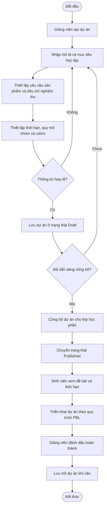

# FE04 – Quản lý đề bài dự án

## 1. Quản lý dự án

## 1. Chức năng chi tiết

 **1.1 — Tạo đề bài dự án**

Giảng viên tạo đề bài dự án PBL gắn với lớp học phần mình phụ trách. Hệ thống cung cấp biểu mẫu để giảng viên nhập thông tin, kiểm tra dữ liệu và lưu dự án dưới dạng bản nháp.

**Thông tin đề bài dự án:**

| Trường | Bắt buộc | Ý nghĩa / kiểm tra |
|---|---|---|
| `title` | Có | Tên dự án, không được để trống. |
| `description` | Có | Mô tả vấn đề cần giải quyết và bối cảnh thực hiện dự án. |
| `objectives` | Có | Mục tiêu học tập mà sinh viên cần đạt được. |
| `requirements` | Có | Các yêu cầu đối với sản phẩm đầu ra. |
| `acceptance_criteria` | Có | Tiêu chí dùng để xem xét sản phẩm có đáp ứng yêu cầu hay không. |
| `class_id` | Có | Lớp học phần mà dự án trực thuộc; giảng viên phải có quyền quản lý lớp. |
| `start_date` | Có | Ngày bắt đầu thực hiện dự án. |
| `due_date` | Có | Hạn cuối của dự án; không được trước ngày bắt đầu. |
| `min_group_size` | Theo cấu hình | Số thành viên tối thiểu trong một nhóm, nếu dự án có quy định. |
| `max_group_size` | Theo cấu hình | Số thành viên tối đa trong một nhóm, phải phù hợp với số lượng tối thiểu. |
| `rubric` | Theo cấu hình | Bộ tiêu chí và thang điểm dùng để đánh giá dự án. |

**Quy trình tạo dự án:**

1. Giảng viên mở chức năng quản lý dự án và chọn tạo dự án mới.
2. Hệ thống hiển thị biểu mẫu nhập thông tin đề bài.
3. Giảng viên nhập thông tin dự án và chọn lớp học phần.
4. Hệ thống kiểm tra các trường bắt buộc, thời hạn, quy mô nhóm và quyền truy cập.
5. Nếu dữ liệu hợp lệ, hệ thống lưu dự án ở trạng thái `Draft`.
6. Nếu dữ liệu không hợp lệ, hệ thống hiển thị lỗi tại trường tương ứng để giảng viên chỉnh sửa.

**1.2 — Xem danh sách và chi tiết dự án**

Giảng viên xem danh sách các dự án thuộc phạm vi mình được phép quản lý. Sinh viên xem các dự án đã công bố trong lớp học phần mà mình đã ghi danh và được phép truy cập.

**Thông tin hiển thị trong danh sách:**

| Trường | Ý nghĩa |
|---|---|
| `title` | Tên dự án. |
| `class_id` | Lớp học phần được liên kết với dự án. |
| `start_date` | Ngày bắt đầu. |
| `due_date` | Hạn cuối thực hiện dự án. |
| `status` | Trạng thái hiện tại của dự án. |

**Thông tin trong trang chi tiết:**

- Mô tả vấn đề cần giải quyết.
- Mục tiêu học tập.
- Yêu cầu sản phẩm đầu ra.
- Tiêu chí nghiệm thu.
- Thời gian thực hiện và hạn cuối.
- Quy mô nhóm theo cấu hình.
- Rubric đánh giá nếu được phép xem.

**Quy trình xem dự án:**

1. Người dùng mở danh sách dự án.
2. Hệ thống kiểm tra quyền và phạm vi dữ liệu được phép truy cập.
3. Người dùng chọn một dự án để xem chi tiết.
4. Hệ thống hiển thị thông tin phù hợp với quyền của người dùng.
5. Nếu người dùng không có quyền truy cập, hệ thống từ chối yêu cầu.

**1.3 — Cập nhật đề bài dự án**

Giảng viên phụ trách có thể cập nhật thông tin dự án theo quyền được cấp. Việc chỉnh sửa phải bảo đảm không làm mất các thông tin cần thiết để theo dõi quá trình thực hiện và kết quả dự án.

**Các thông tin có thể cập nhật:**

- Tên và mô tả dự án.
- Mục tiêu học tập.
- Yêu cầu sản phẩm và tiêu chí nghiệm thu.
- Ngày bắt đầu và hạn cuối.
- Quy mô nhóm.
- Rubric đánh giá.

**Quy trình cập nhật:**

1. Giảng viên chọn dự án cần chỉnh sửa.
2. Hệ thống kiểm tra quyền cập nhật.
3. Giảng viên thay đổi các thông tin cần thiết.
4. Hệ thống kiểm tra tính hợp lệ của dữ liệu.
5. Nếu hợp lệ, hệ thống lưu thông tin mới.
6. Nếu không hợp lệ hoặc người dùng không có quyền, hệ thống từ chối cập nhật và thông báo nguyên nhân.

Sinh viên không được chỉnh sửa đề bài chính thức hoặc rubric đã khóa. Việc chỉnh sửa dự án đã công bố phải tuân theo quy tắc và quyền được thống nhất khi triển khai.

**1.4 — Công bố đề bài dự án**

Sau khi hoàn thiện đề bài, giảng viên công bố dự án cho lớp học phần đã liên kết. Khi công bố thành công, sinh viên thuộc lớp được phép xem đề bài và thời hạn thực hiện.

**Điều kiện công bố:**

- Dự án có tên và mô tả hợp lệ.
- Mục tiêu học tập và yêu cầu sản phẩm đã được thiết lập.
- Lớp học phần tồn tại và thuộc phạm vi giảng viên được phân công.
- Ngày bắt đầu và hạn cuối hợp lệ.
- Các thông tin bắt buộc theo cấu hình dự án đã được cung cấp.

**Quy trình công bố:**

1. Giảng viên chọn chức năng công bố dự án.
2. Hệ thống kiểm tra thông tin đề bài và quyền công bố.
3. Nếu dữ liệu hợp lệ, hệ thống chuyển trạng thái dự án sang `Published`.
4. Dự án được hiển thị cho sinh viên thuộc lớp học phần được phép truy cập.
5. Nếu dữ liệu chưa hợp lệ, hệ thống thông báo lỗi và yêu cầu giảng viên chỉnh sửa.

**1.5 — Theo dõi trạng thái và đánh dấu hoàn thành dự án**

Giảng viên theo dõi trạng thái dự án trong quá trình thực hiện và có thể đánh dấu dự án hoàn thành sau khi xem xét kết quả. Việc quản lý milestone, checkpoint, nhiệm vụ, sản phẩm bàn giao và chấm điểm chi tiết được phối hợp với FE06, FE08 và FE10.

**Các trạng thái dự án:**

| Trạng thái | Ý nghĩa |
|---|---|
| `Draft` | Bản nháp, chỉ giảng viên phụ trách được phép xem và chỉnh sửa. |
| `Published` | Đã công bố cho lớp học phần theo quyền truy cập. |
| `InProgress` | Dự án đang được thực hiện. |
| `Completed` | Dự án đã hoàn thành; không nhận sản phẩm mới trừ khi được mở lại. |
| `Archived` | Dự án đã lưu trữ; quyền xem phụ thuộc vào phân quyền. |

**Tiêu chí hoàn thành dự án đề xuất:**

- Sản phẩm bắt buộc đã được nộp.
- Sản phẩm đáp ứng các yêu cầu và tiêu chí nghiệm thu đã thống nhất.
- Các milestone hoặc checkpoint bắt buộc đã được hoàn thành và xem xét.
- Kết quả đánh giá theo rubric đã được giảng viên tổng kết.
- Giảng viên phụ trách xác nhận dự án đủ điều kiện kết thúc.

**Quy trình xác nhận hoàn thành:**

1. Nhóm sinh viên nộp sản phẩm theo yêu cầu dự án.
2. Giảng viên xem xét sản phẩm và các kết quả bàn giao.
3. Nếu chưa đạt, giảng viên phản hồi và yêu cầu chỉnh sửa theo quy trình hiện có.
4. Nếu đạt, giảng viên hoàn tất đánh giá theo rubric.
5. Giảng viên xác nhận hoàn thành dự án.
6. Hệ thống chuyển trạng thái sang `Completed` và lưu thông tin xác nhận.

Các tiêu chí trên là đề xuất làm rõ nghiệp vụ. Nhóm cần thống nhất những điều kiện nào bắt buộc và cách hệ thống kiểm tra trước khi triển khai.

**1.6 — Lưu trữ dự án**

Giảng viên có quyền lưu trữ dự án khi cần kết thúc việc quản lý thông thường. Hệ thống cập nhật trạng thái dự án sang `Archived` và giữ lại dữ liệu cần thiết để tra cứu theo quyền.

**Quy trình lưu trữ:**

1. Giảng viên chọn dự án cần lưu trữ.
2. Hệ thống kiểm tra quyền lưu trữ.
3. Hệ thống yêu cầu xác nhận thao tác nếu cần.
4. Sau khi xác nhận, hệ thống cập nhật trạng thái sang `Archived`.
5. Dự án không còn xuất hiện trong danh sách đang hoạt động mặc định.
6. Người dùng có quyền vẫn có thể xem thông tin dự án đã lưu trữ.

Hệ thống phải bảo toàn thông tin đề bài, trạng thái và kết quả đã lưu. Việc lưu trữ không được tự ý xóa dữ liệu sản phẩm hoặc kết quả đánh giá của dự án.
## 2. Quy tắc nghiệp vụ

| Mã quy tắc | Nội dung |
|---|---|
| BR04.01 | Dự án phải được gắn với một lớp học phần phù hợp. |
| BR04.02 | Chỉ giảng viên phụ trách hoặc người được cấp quyền mới được tạo, chỉnh sửa, công bố, đánh dấu hoàn thành hoặc lưu trữ dự án. |
| BR04.03 | Hạn cuối hoàn thành dự án không được trước ngày bắt đầu dự án. |
| BR04.04 | Dự án phải có đầy đủ các thông tin bắt buộc trước khi công bố. |
| BR04.05 | Sinh viên chỉ được xem các dự án đã công bố thuộc lớp học phần mà mình đã ghi danh. |
| BR04.06 | Sinh viên không được chỉnh sửa đề bài chính thức hoặc rubric đã bị khóa. |
| BR04.07 | Quy mô nhóm được thiết lập trong dự án phải được sử dụng làm căn cứ kiểm tra số lượng thành viên khi sinh viên lập hoặc tham gia nhóm. |
| BR04.08 | Dự án ở trạng thái `Draft` chỉ được giảng viên phụ trách hoặc người có quyền phù hợp xem và chỉnh sửa. |
| BR04.09 | Dự án ở trạng thái `Completed` không tiếp nhận sản phẩm mới, trừ khi giảng viên mở lại theo quy định của hệ thống. |
| BR04.10 | Dự án đã lưu trữ chỉ được truy cập theo quyền được cấp. |
| BR04.11 | Quyền truy cập và thao tác phải được kiểm tra ở phía máy chủ, không chỉ dựa vào việc ẩn hoặc hiện chức năng trên giao diện. |

## 3. Trạng thái dự án

| Trạng thái | NỘI DUNG |
|---|---|
| `Draft` | Dự án đang ở dạng bản nháp; giảng viên tiếp tục hoàn thiện trước khi công bố. |
| `Published` | Dự án đã được công bố; sinh viên thuộc lớp học phần có thể xem và tham gia theo cấu hình. |
| `InProgress` | Dự án đang trong quá trình thực hiện. |
| `Completed` | Dự án đã hoàn thành; không tiếp nhận sản phẩm mới trừ khi được mở lại theo quy định. |
| `Archived` | Dự án đã được lưu trữ và chỉ được xem theo quyền truy cập. |

## 4. Quy trình nghiệp vụ

## 5. Quy tắc nghiệp vụ

- Dự án phải liên kết với đề cương môn học phù hợp.
- Thông tin dự án phải đầy đủ trước khi gửi phê duyệt.
- Mỗi milestone phải có tên và thời hạn hoàn thành.
- Thời hạn milestone phải nằm trong khoảng thời gian thực hiện dự án.
- Dự án chỉ được phân công cho lớp hoặc nhóm sau khi được phê duyệt.
- Nhóm được phân công phải thuộc lớp học phần được giao dự án.
- Dự án cần chỉnh sửa phải được cập nhật trước khi gửi lại phê duyệt.
- Dự án bị từ chối không được phân công; giảng viên chỉ được tạo hoặc gửi lại bản chỉnh sửa nếu quy trình cho phép.
- Chỉ người dùng có quyền phù hợp mới được tạo, chỉnh sửa, phê duyệt hoặc phân công dự án.
- Hệ thống cần lưu kết quả phê duyệt và cập nhật trạng thái dự án.
- Việc chỉnh sửa dự án sau phê duyệt phải tuân theo quyền hạn và quy định của hệ thống.

