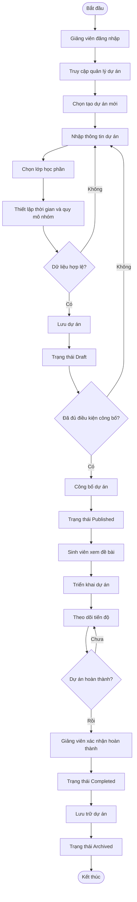

# FE04 – QUẢN LÝ DỰ ÁN (PROJECT MANAGEMENT)

## 1. Giới thiệu chức năng

FE04 – Quản lý dự án là chức năng cho phép giảng viên tạo, quản lý và theo dõi các dự án học tập theo phương pháp Project-Based Learning (PBL).

Mỗi dự án được liên kết với một lớp học phần cụ thể. Giảng viên có thể thiết lập đề bài, mục tiêu, yêu cầu sản phẩm, thời gian thực hiện và quy mô nhóm. Sinh viên có thể xem thông tin dự án đã được công bố và thực hiện các công việc theo yêu cầu.

Chức năng này là cơ sở để kết nối với các chức năng khác trong hệ thống như:

- FE03 – Quản lý lớp học.
- FE05 – Quản lý nhóm và không gian làm việc.
- FE06 – Quản lý milestone và checkpoint.
- FE08 – Quản lý tài nguyên.
- FE10 – Đánh giá và phản hồi.
- FE12 – Quản lý thông báo.

## 2. Đối tượng sử dụng

| Đối tượng | Quyền sử dụng |
|---|---|
| Giảng viên | Tạo, xem, chỉnh sửa, công bố, theo dõi, hoàn thành và lưu trữ dự án thuộc phạm vi quản lý. |
| Sinh viên | Xem danh sách dự án đã công bố thuộc lớp học phần mình tham gia và xem chi tiết đề bài. |
| Quản trị viên | Quản lý dữ liệu và hỗ trợ xử lý các vấn đề liên quan đến dự án theo quyền hệ thống. |

## 3. Chức năng chi tiết

### 3.1. Tạo dự án mới

Giảng viên có thể tạo một dự án mới để giao nhiệm vụ học tập cho sinh viên trong lớp học phần.

**Thông tin cần nhập:**

| Tên trường | Kiểu dữ liệu | Bắt buộc | Mô tả |
|---|---|---|---|
| title | String | Có | Tên dự án. |
| description | Text | Có | Mô tả nội dung và bối cảnh dự án. |
| objectives | Text | Có | Mục tiêu học tập cần đạt được. |
| requirements | Text | Có | Các yêu cầu đối với sản phẩm. |
| acceptance_criteria | Text | Có | Tiêu chí nghiệm thu sản phẩm. |
| class_id | Integer | Có | Mã lớp học phần được giao dự án. |
| start_date | Date | Có | Ngày bắt đầu dự án. |
| due_date | Date | Có | Hạn hoàn thành dự án. |
| min_group_size | Integer | Không | Số thành viên tối thiểu trong nhóm. |
| max_group_size | Integer | Không | Số thành viên tối đa trong nhóm. |
| rubric | JSON/Text | Không | Tiêu chí và thang điểm đánh giá. |

**Quy trình thực hiện:**

1. Giảng viên đăng nhập vào hệ thống.
2. Truy cập chức năng Quản lý dự án.
3. Chọn nút Tạo dự án mới.
4. Hệ thống hiển thị biểu mẫu tạo dự án.
5. Giảng viên nhập các thông tin cần thiết.
6. Giảng viên chọn lớp học phần được giao dự án.
7. Hệ thống kiểm tra dữ liệu đầu vào.
8. Nếu dữ liệu hợp lệ, hệ thống lưu dự án với trạng thái Draft.
9. Nếu dữ liệu không hợp lệ, hệ thống hiển thị thông báo lỗi để giảng viên chỉnh sửa.

### 3.2. Xem danh sách dự án

Hệ thống cho phép giảng viên và sinh viên xem danh sách dự án theo quyền truy cập.

**Đối với giảng viên:**

- Xem các dự án thuộc lớp học phần mình phụ trách.
- Xem tên và mô tả dự án.
- Xem thời gian bắt đầu và hạn hoàn thành.
- Xem trạng thái hiện tại của dự án.
- Truy cập trang chi tiết để quản lý dự án.

**Đối với sinh viên:**

- Xem các dự án đã được công bố.
- Chỉ xem dự án thuộc lớp học phần mình tham gia.
- Xem thời gian thực hiện và yêu cầu của dự án.
- Truy cập thông tin chi tiết để thực hiện nhiệm vụ.

**Thông tin hiển thị:**

| Trường | Mô tả |
|---|---|
| project_id | Mã định danh dự án. |
| title | Tên dự án. |
| class_id | Lớp học phần liên kết. |
| start_date | Ngày bắt đầu. |
| due_date | Hạn hoàn thành. |
| status | Trạng thái dự án. |
| created_at | Thời điểm tạo dự án. |

### 3.3. Xem chi tiết dự án

Khi người dùng chọn một dự án, hệ thống hiển thị thông tin chi tiết theo quyền được cấp.

**Nội dung chi tiết bao gồm:**

- Tên dự án.
- Mô tả dự án.
- Bối cảnh và vấn đề cần giải quyết.
- Mục tiêu học tập.
- Yêu cầu sản phẩm đầu ra.
- Tiêu chí nghiệm thu.
- Lớp học phần được giao.
- Ngày bắt đầu và hạn hoàn thành.
- Quy mô nhóm.
- Rubric đánh giá nếu được phép xem.
- Trạng thái hiện tại.

**Quy trình thực hiện:**

1. Người dùng chọn dự án trong danh sách.
2. Hệ thống tiếp nhận yêu cầu xem chi tiết.
3. Hệ thống kiểm tra quyền truy cập.
4. Hệ thống lấy dữ liệu dự án từ cơ sở dữ liệu.
5. Hệ thống hiển thị thông tin chi tiết.
6. Nếu người dùng không có quyền truy cập, hệ thống trả về thông báo từ chối.

### 3.4. Cập nhật thông tin dự án

Giảng viên có quyền chỉnh sửa thông tin của dự án do mình phụ trách.

**Các thông tin có thể chỉnh sửa:**

- Tên dự án.
- Mô tả dự án.
- Mục tiêu học tập.
- Yêu cầu sản phẩm.
- Tiêu chí nghiệm thu.
- Lớp học phần nếu chưa phát sinh dữ liệu phụ thuộc.
- Ngày bắt đầu.
- Hạn hoàn thành.
- Quy mô nhóm.
- Rubric đánh giá.

**Quy trình thực hiện:**

1. Giảng viên chọn dự án cần chỉnh sửa.
2. Hệ thống kiểm tra quyền cập nhật.
3. Hệ thống hiển thị thông tin hiện tại.
4. Giảng viên thay đổi nội dung cần thiết.
5. Giảng viên xác nhận cập nhật.
6. Hệ thống kiểm tra tính hợp lệ của dữ liệu.
7. Nếu hợp lệ, hệ thống lưu thông tin mới.
8. Nếu không hợp lệ, hệ thống thông báo lỗi.

Sinh viên không được phép chỉnh sửa đề bài chính thức của dự án.

### 3.5. Công bố dự án

Sau khi hoàn thành việc thiết lập đề bài, giảng viên có thể công bố dự án cho sinh viên trong lớp học phần.

**Điều kiện công bố:**

- Dự án có tên hợp lệ.
- Có mô tả dự án.
- Có mục tiêu học tập.
- Có yêu cầu sản phẩm đầu ra.
- Có lớp học phần hợp lệ.
- Có ngày bắt đầu và hạn hoàn thành hợp lệ.
- Giảng viên có quyền quản lý lớp học phần.

**Quy trình thực hiện:**

1. Giảng viên mở dự án đang ở trạng thái Draft.
2. Chọn chức năng Công bố dự án.
3. Hệ thống kiểm tra các thông tin bắt buộc.
4. Hệ thống xác nhận quyền công bố.
5. Nếu hợp lệ, dự án chuyển sang trạng thái Published.
6. Sinh viên thuộc lớp học phần có thể xem đề bài.
7. Hệ thống có thể gửi thông báo đến sinh viên thông qua FE12.

Nếu dữ liệu chưa đầy đủ, hệ thống không cho phép công bố và hiển thị nội dung cần bổ sung.

### 3.6. Theo dõi tiến độ dự án

Giảng viên có thể theo dõi tình hình thực hiện dự án thông qua các thông tin được quản lý trong những chức năng liên quan.

**Thông tin theo dõi bao gồm:**

- Danh sách nhóm tham gia dự án.
- Số lượng thành viên trong từng nhóm.
- Các nhiệm vụ đang thực hiện.
- Các nhiệm vụ đã hoàn thành.
- Tiến độ milestone.
- Tình trạng checkpoint.
- Tình trạng nộp sản phẩm.
- Kết quả đánh giá.

**Quy trình thực hiện:**

1. Giảng viên chọn dự án cần theo dõi.
2. Hệ thống lấy danh sách nhóm liên quan.
3. Hệ thống tổng hợp dữ liệu nhiệm vụ và tiến độ.
4. Hệ thống hiển thị tình trạng thực hiện.
5. Giảng viên xem xét và đưa ra hướng dẫn khi cần thiết.

Lưu ý: Việc tạo nhiệm vụ được xử lý trong chức năng quản lý nhiệm vụ tương ứng; milestone và checkpoint được quản lý tại FE06; đánh giá được quản lý tại FE10.

### 3.7. Hoàn thành dự án

Khi dự án đã kết thúc, giảng viên có thể xác nhận hoàn thành dự án.

**Điều kiện đề xuất:**

- Các sản phẩm bắt buộc đã được nộp.
- Các checkpoint bắt buộc đã được xử lý.
- Các yêu cầu chính của dự án đã được xem xét.
- Giảng viên đã hoàn tất việc đánh giá cần thiết.

**Quy trình thực hiện:**

1. Giảng viên mở dự án cần kết thúc.
2. Kiểm tra tình trạng thực hiện.
3. Xác nhận các yêu cầu hoàn thành.
4. Chọn chức năng Hoàn thành dự án.
5. Hệ thống kiểm tra điều kiện hoàn thành.
6. Nếu đáp ứng điều kiện, trạng thái chuyển sang Completed.
7. Hệ thống lưu thời điểm hoàn thành.

Nếu dự án chưa đáp ứng điều kiện, hệ thống thông báo các nội dung còn thiếu.

### 3.8. Lưu trữ dự án

Giảng viên có thể lưu trữ dự án sau khi kết thúc quá trình quản lý.

**Quy trình thực hiện:**

1. Giảng viên chọn dự án cần lưu trữ.
2. Hệ thống kiểm tra quyền lưu trữ.
3. Hệ thống yêu cầu xác nhận thao tác.
4. Giảng viên xác nhận.
5. Hệ thống chuyển trạng thái dự án sang Archived.
6. Dự án được đưa ra khỏi danh sách đang hoạt động mặc định.
7. Người có quyền vẫn có thể xem lại dữ liệu dự án.

Việc lưu trữ không đồng nghĩa với xóa dữ liệu. Hệ thống phải giữ lại thông tin dự án, nhóm, nhiệm vụ, sản phẩm và kết quả đánh giá liên quan.

## 4. Quy tắc nghiệp vụ

| Mã quy tắc | Nội dung |
|---|---|
| BR04.01 | Mỗi dự án phải được liên kết với một lớp học phần hợp lệ. |
| BR04.02 | Chỉ giảng viên phụ trách hoặc người được cấp quyền mới được tạo dự án. |
| BR04.03 | Chỉ người có quyền mới được cập nhật thông tin dự án. |
| BR04.04 | Ngày kết thúc không được nhỏ hơn ngày bắt đầu. |
| BR04.05 | Tên dự án không được để trống. |
| BR04.06 | Dự án phải có đầy đủ thông tin bắt buộc trước khi công bố. |
| BR04.07 | Sinh viên chỉ được xem dự án đã công bố thuộc lớp học phần mình tham gia. |
| BR04.08 | Sinh viên không được chỉnh sửa đề bài chính thức. |
| BR04.09 | Số lượng thành viên trong nhóm phải tuân theo giới hạn được thiết lập trong dự án. |
| BR04.10 | Dự án ở trạng thái Draft chỉ được truy cập bởi người có quyền quản lý. |
| BR04.11 | Dự án ở trạng thái Completed không tiếp nhận thêm sản phẩm mới, trừ khi được mở lại theo quy định. |
| BR04.12 | Dự án ở trạng thái Archived chỉ được truy cập theo quyền được cấp. |
| BR04.13 | Việc lưu trữ dự án không được làm mất dữ liệu liên quan. |
| BR04.14 | Mọi thao tác cần kiểm tra quyền phải được xác thực tại phía máy chủ. |
| BR04.15 | Việc thay đổi thông tin dự án không được làm sai lệch dữ liệu nhóm, nhiệm vụ và kết quả đã phát sinh. |

## 5. Trạng thái dự án

| Trạng thái | Ý nghĩa |
|---|---|
| Draft | Dự án đang ở dạng bản nháp, giảng viên có thể tiếp tục chỉnh sửa. |
| Published | Dự án đã được công bố cho lớp học phần. |
| InProgress | Dự án đang trong quá trình thực hiện. |
| Completed | Dự án đã hoàn thành. |
| Archived | Dự án đã được lưu trữ. |

**Luồng chuyển trạng thái:**

- Draft → Published: Giảng viên công bố dự án.
- Published → InProgress: Dự án bắt đầu được triển khai.
- InProgress → Completed: Giảng viên xác nhận hoàn thành.
- Completed → Archived: Giảng viên lưu trữ dự án.

Việc mở lại dự án đã hoàn thành hoặc lưu trữ cần được thực hiện bởi người có quyền phù hợp.

## 6. Quy trình nghiệp vụ tổng quát

## 7. Dữ liệu đầu vào và đầu ra

### 7.1. Dữ liệu đầu vào

| Dữ liệu | Mô tả |
|---|---|
| Thông tin dự án | Tên, mô tả, mục tiêu và yêu cầu. |
| Lớp học phần | Lớp được giao thực hiện dự án. |
| Thời gian | Ngày bắt đầu và hạn hoàn thành. |
| Quy mô nhóm | Số lượng thành viên tối thiểu và tối đa. |
| Tiêu chí đánh giá | Rubric và tiêu chí nghiệm thu. |
| Thông tin người dùng | Tài khoản và quyền của giảng viên thực hiện thao tác. |

### 7.2. Dữ liệu đầu ra

| Dữ liệu | Mô tả |
|---|---|
| Thông tin dự án | Dữ liệu dự án sau khi tạo hoặc cập nhật. |
| Trạng thái dự án | Draft, Published, InProgress, Completed hoặc Archived. |
| Danh sách dự án | Danh sách dự án người dùng được phép xem. |
| Chi tiết dự án | Toàn bộ thông tin dự án theo quyền truy cập. |
| Thông báo kết quả | Thông báo thành công hoặc lỗi khi thực hiện thao tác. |
| Dữ liệu tiến độ | Thông tin tổng hợp từ nhóm, nhiệm vụ và checkpoint. |

## 8. Kiểm tra và xử lý lỗi

| Mã lỗi | Trường hợp | Thông báo |
|---|---|---|
| ERR04.01 | Tên dự án bị bỏ trống | Vui lòng nhập tên dự án. |
| ERR04.02 | Thiếu mô tả | Vui lòng nhập mô tả dự án. |
| ERR04.03 | Chưa chọn lớp học phần | Vui lòng chọn lớp học phần. |
| ERR04.04 | Ngày kết thúc trước ngày bắt đầu | Ngày kết thúc phải sau hoặc bằng ngày bắt đầu. |
| ERR04.05 | Quy mô nhóm không hợp lệ | Số lượng thành viên tối đa phải lớn hơn hoặc bằng số lượng tối thiểu. |
| ERR04.06 | Không có quyền thao tác | Bạn không có quyền thực hiện chức năng này. |
| ERR04.07 | Không tìm thấy dự án | Dự án không tồn tại hoặc đã bị xóa. |
| ERR04.08 | Dự án chưa đủ thông tin công bố | Vui lòng hoàn thiện thông tin trước khi công bố. |
| ERR04.09 | Không thể hoàn thành dự án | Dự án vẫn còn nội dung bắt buộc chưa hoàn thành. |
| ERR04.10 | Lỗi hệ thống | Đã xảy ra lỗi, vui lòng thử lại sau. |

## 9. Yêu cầu giao diện

Giao diện quản lý dự án cần có các thành phần sau:

### 9.1. Trang danh sách dự án

- Tiêu đề trang Quản lý dự án.
- Nút Tạo dự án mới.
- Ô tìm kiếm theo tên dự án.
- Bộ lọc theo lớp học phần.
- Bộ lọc theo trạng thái.
- Danh sách dự án.
- Nút xem chi tiết và chỉnh sửa tùy theo quyền.

### 9.2. Trang tạo và chỉnh sửa dự án

- Trường nhập tên dự án.
- Trường nhập mô tả.
- Trường nhập mục tiêu.
- Trường nhập yêu cầu sản phẩm.
- Trường nhập tiêu chí nghiệm thu.
- Danh sách chọn lớp học phần.
- Trường chọn ngày bắt đầu.
- Trường chọn hạn hoàn thành.
- Trường thiết lập quy mô nhóm.
- Khu vực thiết lập rubric.
- Nút Lưu bản nháp.
- Nút Công bố dự án.
- Nút Hủy.

### 9.3. Trang chi tiết dự án

- Thông tin tổng quan dự án.
- Mô tả và mục tiêu.
- Yêu cầu sản phẩm.
- Thời gian thực hiện.
- Trạng thái dự án.
- Danh sách nhóm tham gia.
- Tiến độ thực hiện.
- Các checkpoint liên quan.
- Khu vực thao tác dành cho giảng viên.

## 10. Phân quyền chức năng

| Chức năng | Giảng viên phụ trách | Sinh viên | Quản trị viên |
|---|---|---|---|
| Tạo dự án | Có | Không | Theo quyền |
| Xem danh sách dự án | Có | Có, theo lớp | Có |
| Xem chi tiết dự án | Có | Có, nếu được phép | Có |
| Chỉnh sửa dự án | Có | Không | Theo quyền |
| Công bố dự án | Có | Không | Theo quyền |
| Theo dõi tiến độ | Có | Theo nhóm | Theo quyền |
| Hoàn thành dự án | Có | Không | Theo quyền |
| Lưu trữ dự án | Có | Không | Theo quyền |

## 11. Liên kết với các chức năng khác

| Chức năng | Mối liên hệ với FE04 |
|---|---|
| FE03 – Quản lý lớp học | Cung cấp lớp học phần để giảng viên liên kết dự án. |
| FE05 – Quản lý nhóm và không gian làm việc | Sử dụng dự án đã công bố để tổ chức nhóm và workspace. |
| FE06 – Quản lý milestone và checkpoint | Quản lý các mốc tiến độ và thời hạn trong dự án. |
| FE08 – Quản lý tài nguyên | Lưu trữ tài liệu và tài nguyên phục vụ dự án. |
| FE10 – Đánh giá và phản hồi | Đánh giá sản phẩm và kết quả thực hiện dự án. |
| FE12 – Quản lý thông báo | Gửi thông báo khi dự án được công bố hoặc có thay đổi quan trọng. |

## 12. Tiêu chí nghiệm thu chức năng

Chức năng FE04 được xem là đáp ứng yêu cầu khi:

1. Giảng viên có thể tạo dự án mới.
2. Hệ thống kiểm tra được các trường dữ liệu bắt buộc.
3. Dự án được liên kết với đúng lớp học phần.
4. Giảng viên có thể xem danh sách và chi tiết dự án.
5. Giảng viên có thể cập nhật thông tin dự án theo quyền.
6. Giảng viên có thể công bố dự án khi đủ điều kiện.
7. Sinh viên chỉ xem được dự án thuộc lớp học phần mình tham gia và đã được công bố.
8. Hệ thống quản lý được trạng thái dự án.
9. Giảng viên có thể xác nhận hoàn thành và lưu trữ dự án theo quy định.
10. Hệ thống kiểm tra quyền truy cập ở phía máy chủ.
11. Dữ liệu dự án được lưu trữ và liên kết đúng với các chức năng liên quan.

## 13. Ghi chú triển khai

FE04 là tài liệu mô tả yêu cầu nghiệp vụ và chức năng quản lý dự án của CollabSphere.

Khi triển khai thực tế, nhóm cần bảo đảm sự thống nhất giữa:

- Tài liệu FE04.
- Giao diện quản lý dự án ở Frontend.
- API xử lý dự án ở Backend.
- Cấu trúc bảng dữ liệu dự án trong Database.
- Các chức năng nhóm, nhiệm vụ, checkpoint và đánh giá có liên quan.

Các trạng thái, trường dữ liệu và API trong tài liệu cần được đối chiếu với thiết kế và mã nguồn trước khi xem là đã triển khai hoàn chỉnh.

**Lưu ý về phiên bản mã nguồn hiện tại:** Trong ZIP CNPM-main (17), tài liệu FE04 đã có nhưng Backend hiện chưa thể hiện đầy đủ API CRUD và entity Project tương ứng; Controller đang có phần kiểm tra trạng thái hệ thống. Vì vậy, nội dung FE04 này là đặc tả chức năng hoàn chỉnh để nhóm triển khai, không có nghĩa các chức năng đã chạy được trong ứng dụng.
