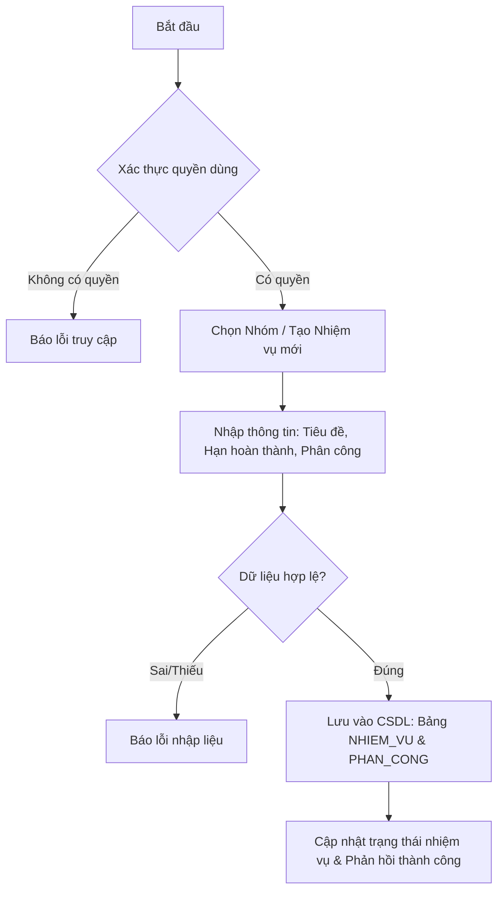

# FE5. Quản lý nhóm và nhiệm vụ

## 1. Mục tiêu
Quản lý nhóm và nhiệm vụ cho phép giảng viên tạo nhóm (`NHOM`), phân công sinh viên vào nhóm (`THANH_VIEN_NHOM`) và theo dõi tiến độ công việc. Đồng thời, cho phép trưởng nhóm tạo các nhiệm vụ (`NHIEM_VU`), thiết lập hạn hoàn thành và phân công nhiệm vụ (`PHAN_CONG`) cho từng sinh viên trong nhóm.

## 2. Vai trò liên quan
GIANG_VIEN, SINH_VIEN (Trưởng nhóm / Thành viên nhóm)

## 3. Luồng nghiệp vụ
1. Người dùng có quyền truy cập danh sách nhóm hoặc danh sách nhiệm vụ.
2. Hệ thống kiểm tra quyền truy cập.
3. Hệ thống trả về thông tin danh sách nhóm (`NHOM`) hoặc chi tiết nhiệm vụ (`NHIEM_VU`).
4. Khi Giảng viên hoặc Trưởng nhóm cập nhật thông tin (tạo nhóm, phân công nhiệm vụ, cập nhật trạng thái), hệ thống cập nhật dữ liệu và ghi nhận kết quả.

## 4. Quy tắc nghiệp vụ
- Chỉ Giảng viên mới có quyền khởi tạo `NHOM`, gán sinh viên vào `THANH_VIEN_NHOM` và theo dõi tổng quan các nhóm thuộc dự án/môn học.
- Trưởng nhóm được quyền tạo `NHIEM_VU` trong phạm vi `NHOM` của mình và thực hiện `PHAN_CONG` cho sinh viên.
- Sinh viên được phân công có trách nhiệm cập nhật trạng thái hoàn thành (`TrangThai`) của nhiệm vụ.
- Không cho phép người dùng ngoài nhóm tự ý chỉnh sửa nhiệm vụ hoặc phân công của nhóm khác.

## 5. API dự kiến
> Đây là hợp đồng API đề xuất để nhóm thống nhất trước khi code, chưa xác nhận là đã được triển khai.

| Phương thức | Endpoint | Mục đích |
| :--- | :--- | :--- |
| GET | `/api/groups` | Xem danh sách nhóm (`NHOM`) |
| GET | `/api/groups/{id}/tasks` | Xem danh sách nhiệm vụ (`NHIEM_VU`) của nhóm |
| POST | `/api/groups` | Giảng viên tạo nhóm mới (`NHOM`) |
| POST | `/api/tasks` | Trưởng nhóm tạo nhiệm vụ (`NHIEM_VU`) |
| POST | `/api/tasks/{id}/assign` | Phân công nhiệm vụ (`PHAN_CONG`) cho sinh viên |
| PATCH | `/api/tasks/{id}` | Cập nhật trạng thái nhiệm vụ (`TrangThai`) |

### Ví dụ dữ liệu JSON
```json
{
  "maNhom": "N01",
  "tieuDe": "Thiết kế sơ đồ ERD",
  "hanHoanThanh": "2026-11-15",
  "trangThai": "DangThucHien",
  "danhSachPhanCong": [
    {
      "maSV": "SV001",
      "ngayPhanCong": "2026-10-27"
    }
  ]
}

```
## 6. Sơ đồ luồng chức năng


## 7. Tiêu chí nghiệm thu
  Người dùng có quyền thực hiện được các thao tác được mô tả trong tài liệu.

  Người dùng không có quyền bị từ chối truy cập hoặc thao tác.

  Dữ liệu không hợp lệ được báo lỗi rõ ràng và không làm sai lệch dữ liệu đã lưu.

  Kết quả thao tác được trả về để giao diện hiển thị cho người dùng.
