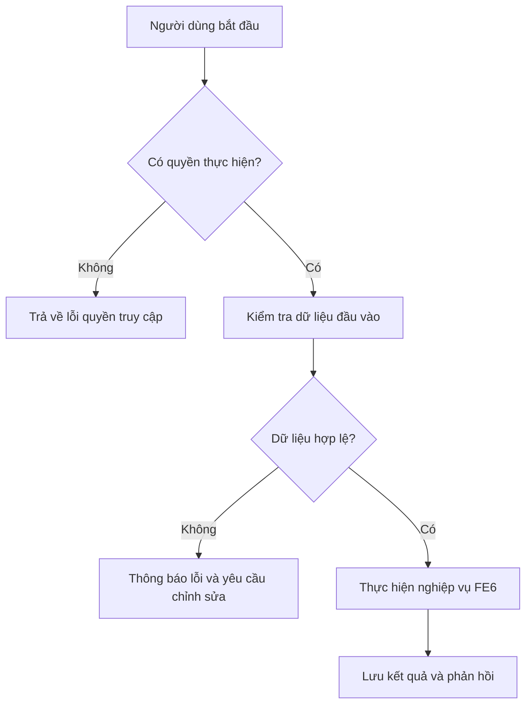

# FE6. Quản lý sản phẩm và nộp bài

## 1. Mục tiêu
Hỗ trợ quản lý mốc nộp bài đồ án (`DU_AN`), cho phép sinh viên tải lên sản phẩm bài nộp (`SAN_PHAM` bao gồm tệp tin và phiên bản), ghi nhận thời gian nộp bài (`NgayNop`). Đồng thời cho phép Giảng viên gửi phản hồi (`PHAN_HOI`) và chấm điểm đánh giá (`DANH_GIA`).

## 2. Vai trò liên quan
GIANG_VIEN, SINH_VIEN

## 3. Luồng nghiệp vụ
1. Người dùng có quyền truy cập thông tin dự án (`DU_AN`) và danh sách bài nộp (`SAN_PHAM`).
2. Hệ thống kiểm tra quyền truy cập.
3. Hệ thống trả về thông tin hạn nộp bài, sản phẩm đã tải lên hoặc kết quả đánh giá (`DANH_GIA`).
4. Khi sinh viên nộp sản phẩm hoặc Giảng viên nhập phản hồi/đánh giá, hệ thống cập nhật trạng thái và ghi nhận kết quả.

## 4. Quy tắc nghiệp vụ
- Sinh viên thuộc nhóm dự án được quyền đính kèm tệp tin (`TepTin`), ghi nhận phiên bản (`PhienBan`) và lưu thông tin sản phẩm bài nộp (`SAN_PHAM`).
- Thời gian nộp bài (`NgayNop`) phải thỏa mãn hạn nộp bài (`HanNop`) quy định trong `DU_AN`.
- Giảng viên có quyền tạo phản hồi (`PHAN_HOI`) đối với sản phẩm và nhập điểm (`Diem`), nhận xét (`NhanXet`) vào bảng `DANH_GIA`.
- Không cho phép người dùng không thuộc dự án tự ý chỉnh sửa tệp tin bài nộp hoặc kết quả đánh giá.

## 5. API dự kiến
> Đây là hợp đồng API đề xuất để nhóm thống nhất trước khi code, chưa xác nhận là đã được triển khai.

| Phương thức | Endpoint | Mục đích |
| :--- | :--- | :--- |
| GET | `/api/projects/{id}/products` | Xem danh sách sản phẩm bài nộp (`SAN_PHAM`) |
| POST | `/api/products` | Sinh viên nộp tệp tin bài nộp mới (`SAN_PHAM`) |
| POST | `/api/products/{id}/feedback` | Giảng viên gửi phản hồi (`PHAN_HOI`) |
| POST | `/api/evaluations` | Giảng viên chấm điểm và nhận xét (`DANH_GIA`) |

### Ví dụ dữ liệu JSON
```json
{
  "maDuAn": "DA01",
  "maSV": "SV001",
  "tepTin": "baocao_v1.pdf",
  "phienBan": "1.0",
  "ngayNop": "2026-11-10T14:30:00"
}
```
## 6. Sơ đồ luồng chức năng


## 7. Tiêu chí nghiệm thu
  Người dùng có quyền thực hiện được các thao tác được mô tả trong tài liệu.

  Người dùng không có quyền bị từ chối truy cập hoặc thao tác.

  Dữ liệu không hợp lệ được báo lỗi rõ ràng và không làm sai lệch dữ liệu đã lưu.

  Kết quả thao tác được trả về để giao diện hiển thị cho người dùng.
