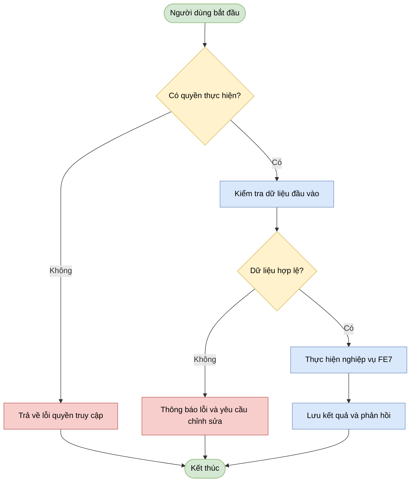
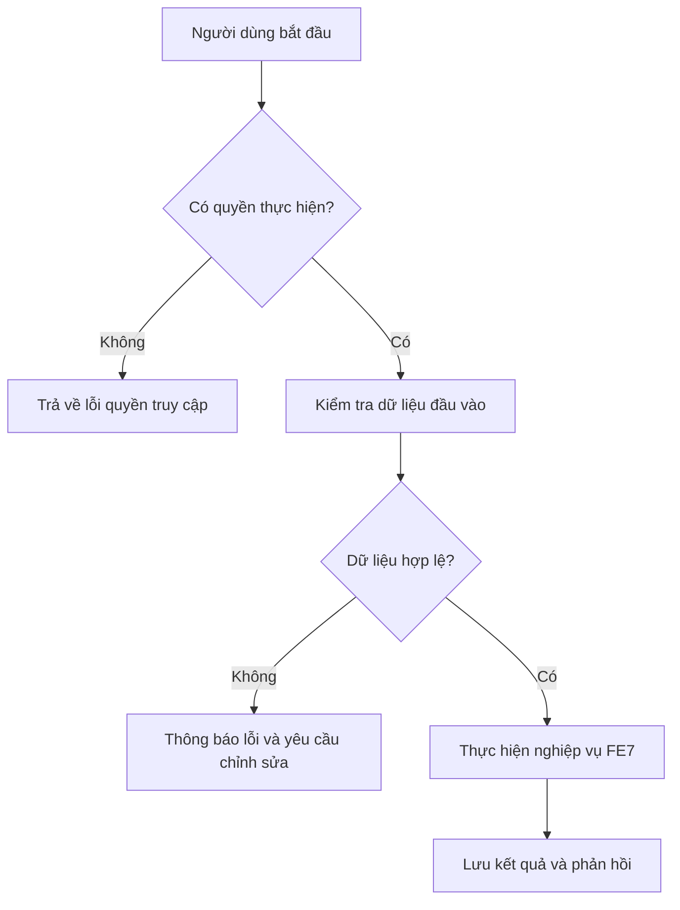

# FE7. Giao tiếp và họp trực tuyến
## 1. Mục tiêu
Cung cấp công cụ giao tiếp thời gian thực bao gồm chat, họp trực tuyến qua video/audio, chia sẻ màn hình và lên lịch cuộc họp; hỗ trợ Giảng viên, Sinh viên và các thành viên trao đổi hiệu quả trong quá trình thực hiện dự án.
## 2. Vai trò liên quan
Admin, Head Department, Staff, Lecturer, Student
## 3. Luồng nghiệp vụ
Người dùng mở giao diện chat hoặc danh sách cuộc họp trong dự án.
Hệ thống kiểm tra quyền truy cập và vai trò đối với dự án/phòng họp.
Hệ thống trả về lịch sử tin nhắn, danh sách cuộc họp hoặc chi tiết phòng họp trực tuyến.
Khi người dùng lên lịch họp, gửi tin nhắn hoặc bắt đầu/kết thúc cuộc họp, hệ thống cập nhật trạng thái và ghi nhận kết quả thời gian thực
## 4. Quy tắc nghiệp vụ
Thành viên thuộc dự án (Lecturer, Student) mới có quyền truy cập vào phòng chat và cuộc họp của dự án đó.
Chỉ Giảng viên (Lecturer) hoặc Trưởng nhóm/Thành viên được cấp quyền mới có thể lên lịch họp hoặc bắt đầu cuộc họp video/audio.
Tính năng chia sẻ màn hình chỉ khả dụng khi người dùng đang tham gia vào cuộc họp video/audio hoạt động.
Người không có quyền hoặc không thuộc dự án sẽ bị từ chối truy cập
## 5. API dự kiến
> Đây là hợp đồng API đề xuất để nhóm thống nhất trước khi code, chưa xác nhận là đã được triển khai.

flowchart TD
    Start([Người dùng / Thành viên dự án]) --> AccessProject[Truy cập giao diện Dự án]
    
   


### Ví dụ dữ liệu JSON
```json
5.1 Tạo cuộc họp mới 
{
  "title": "Họp tiến độ Dự án Tuần 4",
  "startTime": "2026-11-01T09:00:00Z",
  "durationMinutes": 60,
  "isOnline": true
}
5.2 Cập nhật trạng thái cuộc họp 
{
  "status": "ONGOING"
}
```
## 6. Sơ đồ luồng chức năng


## 7. Tiêu chí nghiệm thu
Người dùng có quyền thực hiện được các thao tác được mô tả trong tài liệu (chat, tạo cuộc họp, tham gia họp, chia sẻ màn hình).
Người dùng không thuộc dự án hoặc không có quyền bị từ chối truy cập hoặc thao tác.
Dữ liệu không hợp lệ (ví dụ: thời gian họp ở quá khứ, tiêu đề trống) được báo lỗi rõ ràng và không lưu trữ.
Phản hồi và trạng thái cuộc họp/tin nhắn được cập nhật thời gian thực cho tất cả người dùng liên quan.
