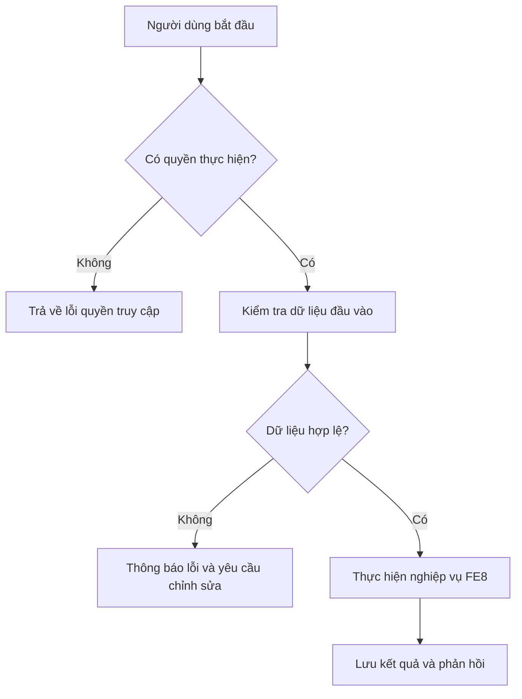

# FE8. Quản lý tài nguyên

## 1. Mục tiêu
Cho phép giảng viên quản lý tài nguyên của lớp và nhóm; sinh viên có thể tải lên, chia sẻ và quản lý tệp tin, tài liệu, slide phục vụ cho quá trình thực hiện dự án.

## 2. Vai trò liên quan
Lecturer, Student, Admin, Staff 

## 3. Luồng nghiệp vụ
Người dùng mở giao diện quản lý tài nguyên của lớp hoặc dự án.
Hệ thống kiểm tra quyền truy cập tệp tin dựa trên vai trò và thành viên trong nhóm/lớp
Hệ thống trả về danh sách tài nguyên, tài liệu hoặc chi tiết tệp tin.
Khi sinh viên/giảng viên tải lên, chia sẻ hoặc xóa tài nguyên, hệ thống cập nhật dữ liệu và ghi nhận kết quả.

## 4. Quy tắc nghiệp vụ
- Thành viên thuộc lớp hoặc dự án mới có quyền xem và tải xuống các tài nguyên liên quan.
- Sinh viên có quyền tải lên, chia sẻ và quản lý tệp tin, tài liệu, slide phục vụ dự án của nhóm mình.
- Giảng viên có quyền quản lý, kiểm duyệt và xóa tài nguyên chung của lớp hoặc các tài nguyên do sinh viên trong lớp tải lên.
- Người không có quyền hoặc không thuộc phạm vi lớp/nhóm sẽ bị từ chối truy cập.

## 5. API dự kiến
> Đây là hợp đồng API đề xuất để nhóm thống nhất trước khi code, chưa xác nhận là đã được triển khai.

| Phương thức | Endpoint | Mục đích |
|---|---|---|
| `GET` | `/api/projects/{projectId}/resources` | Xem danh sách tài nguyên của dự án |
| `POST` | `/api/projects/{projectId}/resources` | Tải lên tệp tin tài nguyên mới (`RESOURCE`) |
| `DELETE` | `/api/resources/{id}` | Xóa tài nguyên tệp tin |
| `GET` | `/api/classes/{classId}/resources` | Giảng viên xem tài nguyên quản lý của lớp |


## Ví dụ dữ liệu JSON
```json
Tải lên tài nguyên mới (POST /api/projects/{projectId}/resources):
{
  "fileName": "Slide_Bao_Cao_Tuan_3.pdf",
  "fileUrl": "https://storage.example.com/files/slide_tuan_3.pdf",
  "fileType": "DOCUMENT",
  "description": "Slide báo cáo tiến độ tuần 3 của nhóm"
}
```

## 6. Sơ đồ luồng chức năng



## 7. Tiêu chí nghiệm thu
- Người dùng có quyền thực hiện thành công các thao tác tải lên, chia sẻ, xem và quản lý tài nguyên.
- Người dùng không có quyền hoặc ngoài phạm vi lớp/dự án bị từ chối truy cập hoặc thao tác.
- Dữ liệu tệp tin không hợp lệ (sai định dạng, vượt quá dung lượng cho phép) được báo lỗi rõ ràng.
- Kết quả thao tác quản lý tài nguyên được phản hồi đầy đủ lên giao diện người dùng.
