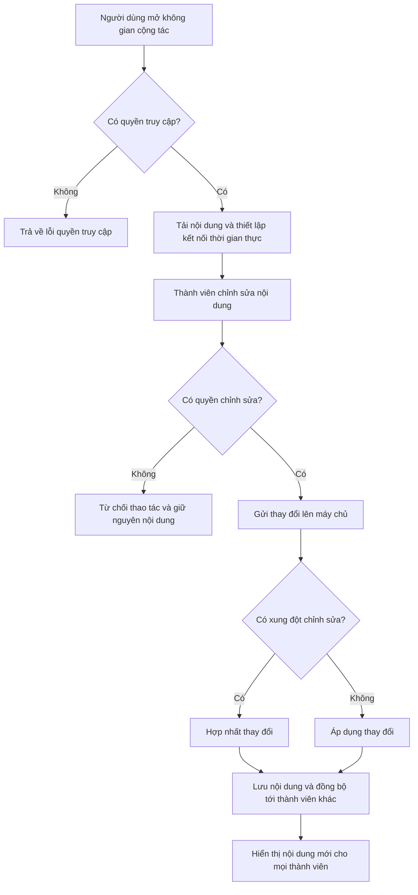

# FE9. Công cụ cộng tác thời gian thực

## 1. Mục tiêu

Cung cấp bảng trắng tương tác, công cụ vẽ sơ đồ và trình soạn thảo văn bản cộng tác; cho phép nhiều thành viên cùng làm việc và đồng bộ nội dung trong thời gian thực.

## 2. Vai trò liên quan

Lecturer, Student

## 3. Luồng nghiệp vụ

1. Người dùng mở không gian cộng tác mà mình là thành viên.
2. Hệ thống kiểm tra quyền truy cập và quyền chỉnh sửa.
3. Hệ thống tải nội dung hiện tại (bảng trắng, sơ đồ, văn bản) và thiết lập kết nối thời gian thực.
4. Khi thành viên chỉnh sửa, hệ thống đồng bộ thay đổi tới các thành viên khác đang trực tuyến.
5. Hệ thống xử lý xung đột chỉnh sửa, lưu nội dung và ghi nhận kết quả.

## 4. Quy tắc nghiệp vụ

- Chỉ thành viên của không gian cộng tác mới được truy cập và chỉnh sửa nội dung.
- Thành viên chỉ có quyền xem thì không được thay đổi nội dung.
- Mọi thay đổi phải được đồng bộ tới tất cả thành viên đang kết nối, không làm mất dữ liệu khi nhiều người cùng chỉnh sửa.
- Nội dung được lưu tự động; khi mất kết nối, hệ thống đồng bộ lại sau khi kết nối trở lại.
- Không cho phép người không có quyền thực hiện thao tác quản trị (xóa không gian, thay đổi quyền thành viên).

## 5. API dự kiến

> Đây là hợp đồng API đề xuất để nhóm thống nhất trước khi code, chưa xác nhận là đã được triển khai.

| Phương thức | Endpoint | Mục đích |
|---|---|---|
| `GET` | `/api/collab/workspaces` | Xem danh sách không gian cộng tác |
| `POST` | `/api/collab/workspaces` | Tạo không gian cộng tác |
| `GET` | `/api/collab/workspaces/{id}` | Xem chi tiết không gian và nội dung hiện tại |
| `PATCH` | `/api/collab/workspaces/{id}/members` | Cập nhật thành viên và quyền truy cập |
| `WS` | `/ws/collab/{id}` | Kết nối đồng bộ thời gian thực |
  editorContainer: { height: '100%', backgroundColor: '#fff', borderRadius: '8px', overflow: 'hidden', boxShadow: '0 1px 3px rgba(0,0,0,0.1)' }
};
## 6. Sơ đồ luồng chức năng

## 7. Tiêu chí nghiệm thu

- Thành viên có quyền chỉnh sửa thao tác được trên bảng trắng, sơ đồ và văn bản cộng tác.
- Thay đổi của một thành viên được hiển thị cho các thành viên khác đang trực tuyến trong thời gian thực.
- Người không có quyền bị từ chối truy cập; người chỉ có quyền xem không chỉnh sửa được nội dung.
- Khi nhiều người cùng chỉnh sửa, nội dung được hợp nhất và không làm mất dữ liệu đã lưu.
- Sau khi mất kết nối và kết nối lại, nội dung được đồng bộ lại chính xác.

export default CollaborationWorkspace;
