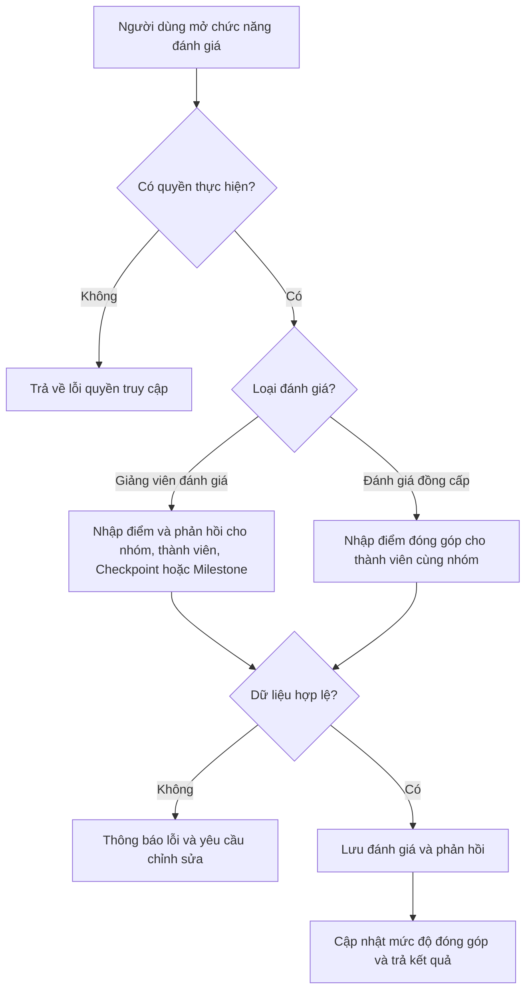

# FE10. Hệ thống đánh giá và phản hồi

## 1. Mục tiêu

Cho phép giảng viên đánh giá nhóm, từng thành viên và bài nộp Checkpoint; hỗ trợ phản hồi câu trả lời Milestone và đánh giá đồng cấp giữa các thành viên nhằm ghi nhận mức độ đóng góp.

## 2. Vai trò liên quan

Lecturer, Student

## 3. Luồng nghiệp vụ

1. Người dùng mở chức năng đánh giá và phản hồi.
2. Hệ thống kiểm tra quyền truy cập.
3. Hệ thống trả về danh sách nhóm, thành viên, bài nộp Checkpoint hoặc câu trả lời Milestone cần đánh giá.
4. Lecturer nhập điểm và phản hồi; Student gửi đánh giá đồng cấp cho các thành viên cùng nhóm.
5. Hệ thống kiểm tra dữ liệu, lưu đánh giá và cập nhật mức độ đóng góp của từng thành viên.

## 4. Quy tắc nghiệp vụ

- Chỉ Lecturer được phân công mới được đánh giá nhóm, thành viên, bài nộp Checkpoint và phản hồi câu trả lời Milestone thuộc phạm vi mình phụ trách.
- Student chỉ được đánh giá đồng cấp các thành viên cùng nhóm của mình.
- Điểm đánh giá phải nằm trong thang điểm quy định.
- Kết quả đánh giá đồng cấp được dùng để ghi nhận mức độ đóng góp của từng thành viên.
- Không cho phép người không có quyền thực hiện thao tác đánh giá.

## 5. API dự kiến

> Đây là hợp đồng API đề xuất để nhóm thống nhất trước khi code, chưa xác nhận là đã được triển khai.

| Phương thức | Endpoint | Mục đích |
|---|---|---|
| `GET` | `/api/evaluations` | Xem danh sách đánh giá và phản hồi |
| `POST` | `/api/groups/{groupId}/evaluations` | Lecturer đánh giá nhóm |
| `POST` | `/api/groups/{groupId}/members/{memberId}/evaluations` | Lecturer đánh giá từng thành viên |
| `POST` | `/api/checkpoints/{checkpointId}/evaluations` | Lecturer đánh giá bài nộp Checkpoint |
| `POST` | `/api/milestones/{milestoneId}/feedback` | Phản hồi câu trả lời Milestone |
| `POST` | `/api/groups/{groupId}/peer-reviews` | Student gửi đánh giá đồng cấp |
| `GET` | `/api/groups/{groupId}/contributions` | Xem mức độ đóng góp của các thành viên |

### Ví dụ dữ liệu JSON

Đánh giá bài nộp Checkpoint:

```json
{
  "score": 8.5,
  "comment": "Nội dung đầy đủ, cần bổ sung phần kiểm thử."
}
```

Đánh giá đồng cấp:

```json
{
  "revieweeId": "u_205",
  "score": 9,
  "comment": "Hoàn thành tốt phần được giao."
}
```

## 6. Sơ đồ luồng chức năng



## 7. Tiêu chí nghiệm thu

- Lecturer đánh giá được nhóm, từng thành viên và bài nộp Checkpoint, đồng thời phản hồi được câu trả lời Milestone.
- Student gửi được đánh giá đồng cấp cho các thành viên cùng nhóm.
- Người dùng không có quyền bị từ chối truy cập hoặc thao tác.
- Điểm hoặc dữ liệu không hợp lệ được báo lỗi rõ ràng và không làm sai lệch dữ liệu đã lưu.
- Mức độ đóng góp của từng thành viên được ghi nhận và hiển thị theo kết quả đánh giá.
