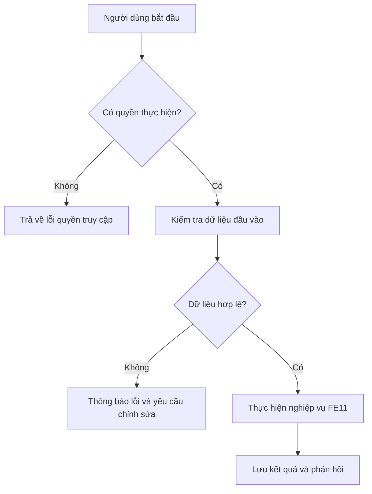

# FE11. Hỗ trợ bằng trí tuệ nhân tạo (AI)

## 1. Mục tiêu

Tích hợp chatbot hỗ trợ brainstorming, hướng dẫn project và đề xuất giải pháp. AI có thể hỗ trợ tạo thông tin project, mục tiêu, timeline, milestone và thông tin liên quan.

## 2. Vai trò liên quan

Lecturer, Student

## 3. Luồng nghiệp vụ

1. Người dùng nhập câu hỏi hoặc yêu cầu tạo nội dung.
2. Hệ thống kiểm tra dữ liệu đầu vào và quyền sử dụng.
3. AI tạo gợi ý/nội dung dựa trên ngữ cảnh được cung cấp.
4. Người dùng xem, chỉnh sửa và quyết định có sử dụng kết quả hay không.

## 4. Quy tắc nghiệp vụ

- Kết quả AI chỉ là nội dung hỗ trợ, cần được người dùng kiểm tra.
- Không gửi bí mật, mật khẩu hoặc dữ liệu nhạy cảm không cần thiết vào prompt.
- Không tự động coi kết quả AI là project đã được phê duyệt.

## 5. API dự kiến

> Đây là hợp đồng API đề xuất để nhóm thống nhất trước khi code, chưa xác nhận là đã được triển khai.

| Phương thức | Endpoint | Mục đích |
|---|---|---|
| `POST` | `/api/ai/chat` | Gửi câu hỏi chatbot |
| `POST` | `/api/ai/generate-project` | Gợi ý thông tin project |
| `POST` | `/api/ai/generate-milestones` | Gợi ý milestone |

### Ví dụ dữ liệu JSON

```json
{
  "syllabusId": 3,
  "projectTopic": "Hệ thống hỗ trợ học tập nhóm",
  "request": "Đề xuất các milestone phù hợp"
}
```

## 6. Sơ đồ luồng chức năng



## 7. Tiêu chí nghiệm thu

- Người dùng có quyền thực hiện được các thao tác được mô tả trong tài liệu.
- Người dùng không có quyền bị từ chối truy cập hoặc thao tác.
- Dữ liệu không hợp lệ được báo lỗi rõ ràng và không làm sai lệch dữ liệu đã lưu.
- Kết quả thao tác được trả về để giao diện hiển thị cho người dùng.
