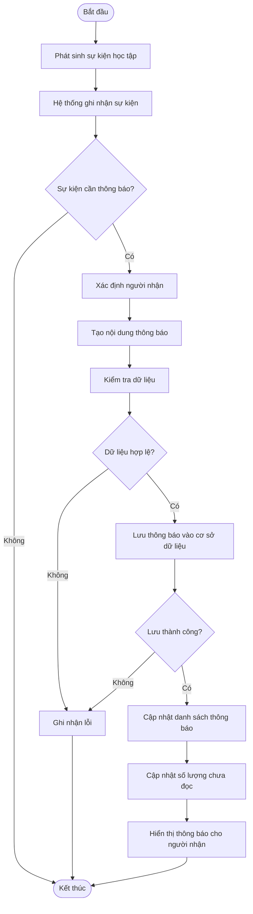
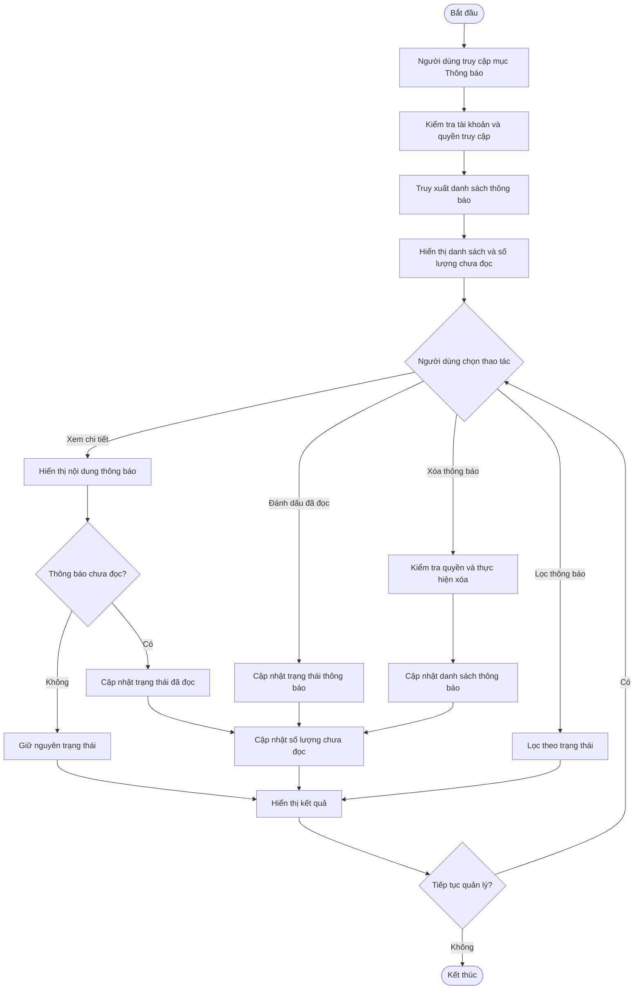

# FE12 – Quản lý thông báo

## 1. Mô tả chức năng

### 1.1. Mục đích

Chức năng Quản lý thông báo cho phép hệ thống tự động tạo, gửi và quản lý các thông báo liên quan đến hoạt động học tập theo phương pháp Project-Based Learning (PBL).

Thông qua chức năng này, giảng viên và sinh viên có thể cập nhật kịp thời các thông tin về lớp học, dự án, nhiệm vụ, hoạt động nhóm, bài nộp và kết quả đánh giá. Hệ thống hỗ trợ người dùng theo dõi các sự kiện quan trọng trong quá trình thực hiện dự án, từ đó chủ động sắp xếp công việc và phối hợp với các thành viên trong nhóm.

Ngoài việc nhận thông báo tự động, người dùng có thể xem danh sách thông báo, xem nội dung chi tiết, lọc theo trạng thái, đánh dấu đã đọc và xóa các thông báo không còn cần thiết.

### 1.2. Đối tượng sử dụng

- **Sinh viên:** Nhận thông báo về dự án được giao, nhóm học tập, nhiệm vụ mới, thời hạn nộp bài, hoạt động của thành viên và kết quả đánh giá.
- **Giảng viên:** Nhận thông báo về hoạt động của sinh viên, bài nộp, tiến độ thực hiện dự án và các vấn đề cần xử lý.
- **Quản trị viên:** Quản lý và gửi các thông báo chung liên quan đến hoạt động của hệ thống.

### 1.3. Phạm vi chức năng

Chức năng Quản lý thông báo bao gồm:

- Tạo và gửi thông báo tự động từ các sự kiện phát sinh trong hệ thống.
- Gửi thông báo đến đúng người dùng hoặc nhóm người dùng có liên quan.
- Hiển thị danh sách thông báo cá nhân.
- Xem nội dung chi tiết của thông báo.
- Lọc thông báo theo trạng thái đã đọc hoặc chưa đọc.
- Đánh dấu một hoặc tất cả thông báo là đã đọc.
- Xóa thông báo khỏi danh sách cá nhân.
- Cập nhật số lượng thông báo chưa đọc.

Phạm vi triển khai cơ bản của chức năng là thông báo trong hệ thống CollabSphere. Các hình thức gửi thông báo qua email hoặc thông báo đẩy trên thiết bị có thể được mở rộng ở các giai đoạn phát triển sau.

### 1.4. Dữ liệu đầu vào

Dữ liệu đầu vào của chức năng bao gồm:

- Thông tin sự kiện phát sinh từ các chức năng khác trong hệ thống.
- Mã người nhận thông báo.
- Tiêu đề và nội dung thông báo.
- Loại thông báo.
- Thời gian tạo thông báo.
- Mã và loại đối tượng nghiệp vụ liên quan.
- Yêu cầu xem, lọc, đánh dấu đã đọc hoặc xóa thông báo của người dùng.

### 1.5. Dữ liệu đầu ra

- Danh sách thông báo thuộc tài khoản người dùng.
- Nội dung chi tiết của thông báo được lựa chọn.
- Số lượng thông báo chưa đọc.
- Danh sách thông báo sau khi lọc.
- Trạng thái thông báo sau khi đánh dấu đã đọc.
- Danh sách thông báo sau khi xóa.
- Kết quả xử lý yêu cầu hoặc thông báo lỗi khi thao tác không thành công.

## 2. Các chức năng chi tiết

### 2.1. Tạo và gửi thông báo tự động

Hệ thống tự động tạo thông báo khi phát sinh các sự kiện liên quan đến hoạt động học tập và quản lý dự án.

Các sự kiện có thể bao gồm:

- Giảng viên tạo dự án mới và giao dự án cho lớp học.
- Sinh viên được thêm vào nhóm hoặc được phân công nhiệm vụ.
- Giảng viên hoặc nhóm cập nhật thông tin quan trọng của dự án.
- Nhiệm vụ mới được giao hoặc sắp đến hạn.
- Thành viên nhóm nộp bài hoặc cập nhật sản phẩm dự án.
- Giảng viên gửi phản hồi hoặc cập nhật kết quả đánh giá.
- Giảng viên hoặc quản trị viên gửi thông báo chung.

Khi phát sinh sự kiện, hệ thống xác định người nhận dựa trên thông tin lớp học, dự án, nhóm và nhiệm vụ có liên quan. Sau đó, hệ thống tạo thông báo với tiêu đề, nội dung, loại thông báo và thời gian tạo tương ứng.

Thông báo được lưu vào cơ sở dữ liệu và hiển thị trong danh sách thông báo của người nhận.

### 2.2. Xem danh sách thông báo

Người dùng có thể truy cập chức năng Quản lý thông báo để xem các thông báo được gửi đến tài khoản của mình.

Danh sách thông báo hiển thị các thông tin:

- Tiêu đề thông báo.
- Nội dung tóm tắt.
- Loại thông báo.
- Thời gian tạo thông báo.
- Trạng thái đã đọc hoặc chưa đọc.

Các thông báo mới được hiển thị ở trạng thái chưa đọc. Hệ thống có thể ưu tiên hiển thị thông báo mới nhất để người dùng dễ dàng cập nhật thông tin.

Người dùng có thể lựa chọn một thông báo để xem nội dung chi tiết và truy cập đối tượng nghiệp vụ liên quan nếu có.

### 2.3. Xem nội dung chi tiết thông báo

Khi người dùng lựa chọn một thông báo, hệ thống hiển thị đầy đủ nội dung và thông tin liên quan.

Nội dung chi tiết có thể bao gồm:

- Tiêu đề và nội dung thông báo.
- Thời gian phát sinh sự kiện.
- Người hoặc chức năng tạo thông báo.
- Đối tượng nghiệp vụ liên quan như dự án, nhiệm vụ hoặc bài nộp.

Đối với các thông báo có liên kết đến đối tượng nghiệp vụ, hệ thống cho phép người dùng truy cập đến trang tương ứng nếu có quyền truy cập.

Khi người dùng mở thông báo chưa đọc, hệ thống cập nhật trạng thái thành đã đọc và tính lại số lượng thông báo chưa đọc.

### 2.4. Lọc thông báo

Hệ thống cho phép người dùng lọc danh sách thông báo theo trạng thái:

- Tất cả thông báo.
- Thông báo chưa đọc.
- Thông báo đã đọc.

Sau khi người dùng lựa chọn trạng thái lọc, hệ thống chỉ hiển thị những thông báo phù hợp với điều kiện được chọn.

Việc lọc thông báo không làm thay đổi dữ liệu hoặc trạng thái đọc của các thông báo.

### 2.5. Đánh dấu thông báo đã đọc

Người dùng có thể đánh dấu một thông báo là đã đọc hoặc đánh dấu tất cả thông báo chưa đọc là đã đọc.

Khi người dùng thực hiện thao tác, hệ thống kiểm tra quyền truy cập, cập nhật trạng thái tương ứng và tính lại số lượng thông báo chưa đọc.

Đối với thông báo đã đọc, hệ thống không thực hiện cập nhật trùng lặp không cần thiết.

### 2.6. Xóa thông báo

Người dùng có thể xóa thông báo không còn cần thiết khỏi danh sách thông báo cá nhân.

Trước khi thực hiện thao tác, hệ thống kiểm tra thông báo có tồn tại và thuộc tài khoản người dùng hay không.

Sau khi xóa thành công, hệ thống cập nhật danh sách thông báo và số lượng thông báo chưa đọc nếu có thay đổi.

Việc xóa thông báo không làm ảnh hưởng đến dữ liệu nghiệp vụ liên quan như dự án, nhiệm vụ, bài nộp hoặc kết quả đánh giá.

## 3. Quy trình nghiệp vụ

### 3.1. Quy trình tạo và gửi thông báo tự động

**Đối tượng thực hiện:** Hệ thống.

**Mục đích:** Tự động tạo và gửi thông báo đến những người dùng có liên quan khi phát sinh sự kiện trong quá trình học tập theo dự án.

**Quy trình thực hiện:**

1. Người dùng thực hiện một hoạt động trên hệ thống, chẳng hạn giảng viên giao dự án, sinh viên nộp bài hoặc giảng viên cập nhật kết quả đánh giá.
2. Hệ thống ghi nhận sự kiện phát sinh từ chức năng tương ứng.
3. Hệ thống xác định loại sự kiện và kiểm tra xem sự kiện có cần tạo thông báo hay không.
4. Nếu sự kiện cần thông báo, hệ thống xác định danh sách người nhận dựa trên thông tin lớp học, dự án, nhóm hoặc nhiệm vụ có liên quan.
5. Hệ thống tạo nội dung thông báo gồm tiêu đề, nội dung, loại thông báo, thời gian tạo và thông tin đối tượng liên quan.
6. Hệ thống kiểm tra tính hợp lệ của dữ liệu thông báo.
7. Hệ thống lưu thông báo vào cơ sở dữ liệu với trạng thái chưa đọc.
8. Hệ thống cập nhật danh sách thông báo và số lượng thông báo chưa đọc của người nhận.
9. Người dùng truy cập chức năng Thông báo để xem thông tin mới.

**Kết quả:** Thông báo được tạo và hiển thị cho đúng người nhận, giúp người dùng cập nhật kịp thời các hoạt động học tập.

### 3.2. Quy trình xem và quản lý thông báo

**Đối tượng thực hiện:** Sinh viên, giảng viên.

**Mục đích:** Cho phép người dùng xem, theo dõi và quản lý các thông báo thuộc tài khoản của mình.

**Quy trình thực hiện:**

1. Người dùng đăng nhập vào hệ thống CollabSphere.
2. Người dùng truy cập chức năng Quản lý thông báo.
3. Hệ thống kiểm tra thông tin tài khoản và quyền truy cập.
4. Hệ thống truy xuất danh sách thông báo thuộc tài khoản người dùng.
5. Hệ thống hiển thị danh sách thông báo cùng số lượng thông báo chưa đọc.
6. Người dùng lựa chọn một thao tác:
   - Xem nội dung chi tiết thông báo.
   - Lọc thông báo theo trạng thái.
   - Đánh dấu một thông báo là đã đọc.
   - Đánh dấu tất cả thông báo là đã đọc.
   - Xóa thông báo không còn cần thiết.
7. Hệ thống kiểm tra tính hợp lệ của yêu cầu và quyền thao tác trên thông báo.
8. Hệ thống thực hiện thao tác tương ứng.
9. Nếu thao tác thành công, hệ thống cập nhật dữ liệu và hiển thị lại danh sách thông báo.
10. Người dùng tiếp tục quản lý thông báo hoặc kết thúc thao tác.

**Kết quả:** Danh sách thông báo được cập nhật theo yêu cầu của người dùng, bảo đảm thông tin hiển thị chính xác và phù hợp với quyền truy cập.

### 3.3. Quy trình xử lý ngoại lệ

Trong quá trình sử dụng, hệ thống cần xử lý các trường hợp sau:

- **Không có thông báo:** Hệ thống hiển thị danh sách trống và thông báo người dùng hiện chưa có thông báo.
- **Thông báo không tồn tại:** Hệ thống thông báo không tìm thấy thông báo và không thực hiện thao tác.
- **Thông báo không thuộc tài khoản:** Hệ thống từ chối truy cập hoặc thao tác trên thông báo.
- **Lỗi khi lưu thông báo:** Hệ thống ghi nhận sự cố và không thông báo rằng thao tác đã thành công khi dữ liệu chưa được lưu.
- **Lỗi khi cập nhật trạng thái:** Hệ thống thông báo lỗi và giữ nguyên trạng thái dữ liệu trước đó.
- **Thông báo đã đọc:** Hệ thống không cập nhật trùng lặp không cần thiết.
- **Thông báo đã bị xóa:** Hệ thống thông báo kết quả phù hợp và cập nhật lại danh sách nếu cần.

## 4. Sơ đồ quy trình nghiệp vụ

### 4.1. Quy trình tạo và gửi thông báo tự động



### 4.2. Quy trình xem và quản lý thông báo



## 5. Thiết kế dữ liệu

### 5.1. Bảng NOTIFICATIONS

Bảng NOTIFICATIONS lưu trữ thông tin các thông báo được tạo và gửi đến người dùng trong hệ thống.

| Tên trường | Kiểu dữ liệu | Mô tả |
|---|---|---|
| id | UUID | Mã thông báo, khóa chính |
| user_id | UUID | Mã người nhận, khóa ngoại đến USERS |
| title | VARCHAR | Tiêu đề thông báo |
| content | TEXT | Nội dung thông báo |
| notification_type | VARCHAR | Loại thông báo |
| related_id | UUID | Mã đối tượng nghiệp vụ liên quan |
| related_type | VARCHAR | Loại đối tượng nghiệp vụ liên quan |
| is_read | BOOLEAN | Trạng thái đã đọc |
| created_at | TIMESTAMP | Thời gian tạo thông báo |

### 5.2. Mối quan hệ dữ liệu

- Một người dùng có thể nhận nhiều thông báo.
- Mỗi thông báo thuộc về một người dùng.
- Một thông báo có thể liên quan đến một dự án, nhiệm vụ, bài nộp hoặc hoạt động khác trong hệ thống.

Quan hệ chính:

```text
USERS (1) ─────── (N) NOTIFICATIONS
```

### 5.3. Quy tắc dữ liệu

- Mỗi thông báo phải có mã định danh duy nhất.
- Mỗi thông báo phải xác định được người nhận.
- Tiêu đề và nội dung thông báo không được để trống.
- Thông báo mới phải có trạng thái chưa đọc.
- Thời gian tạo thông báo phải được ghi nhận chính xác.
- Thông báo phải được liên kết với đúng đối tượng nghiệp vụ nếu có.
- Người dùng chỉ được thao tác trên thông báo thuộc tài khoản của mình.

## 6. Yêu cầu nghiệp vụ

### 6.1. Yêu cầu chức năng

- Hệ thống phải tự động tạo thông báo khi phát sinh các sự kiện đã được quy định.
- Hệ thống phải xác định đúng người nhận thông báo.
- Người dùng phải xem được danh sách và nội dung chi tiết thông báo của mình.
- Người dùng phải lọc được thông báo theo trạng thái đã đọc hoặc chưa đọc.
- Người dùng phải đánh dấu được một hoặc tất cả thông báo là đã đọc.
- Người dùng phải xóa được thông báo không còn cần thiết.
- Hệ thống phải cập nhật chính xác số lượng thông báo chưa đọc.
- Hệ thống phải thông báo kết quả xử lý thao tác cho người dùng.

### 6.2. Yêu cầu bảo mật

- Người dùng phải đăng nhập trước khi sử dụng chức năng.
- Người dùng chỉ được xem và thao tác trên thông báo thuộc tài khoản của mình.
- Hệ thống phải kiểm tra quyền truy cập trước khi thực hiện các thao tác.
- Không được để người dùng truy cập thông báo của tài khoản khác thông qua việc thay đổi mã thông báo.

### 6.3. Yêu cầu dữ liệu

- Thông báo phải phản ánh đúng sự kiện phát sinh.
- Dữ liệu thông báo phải được lưu trữ nhất quán.
- Việc xóa thông báo không được làm mất dữ liệu nghiệp vụ liên quan.
- Trạng thái thông báo phải được cập nhật chính xác sau mỗi thao tác.
- Hệ thống phải xử lý các trường hợp thông báo không tồn tại hoặc đã bị xóa.

## 7. Kết quả đạt được

Chức năng Quản lý thông báo giúp giảng viên và sinh viên cập nhật kịp thời các hoạt động học tập, nâng cao khả năng tương tác và hỗ trợ theo dõi tiến độ thực hiện dự án.

Thông qua việc tự động tạo thông báo từ các sự kiện học tập, hệ thống giúp người dùng chủ động nắm bắt nhiệm vụ, thời hạn, hoạt động nhóm và kết quả đánh giá.

Chức năng góp phần nâng cao hiệu quả quản lý dự án, tăng cường sự phối hợp giữa giảng viên và sinh viên, đồng thời hỗ trợ xây dựng môi trường học tập chủ động, cộng tác và hiệu quả theo phương pháp Project-Based Learning (PBL).
